The [overview chapter](tutorials/application-design-patterns/) maps patterns at three levels. This chapter is the deep reference for the lowest level: the primitives that decide what a single operation can guarantee under concurrency and failure. Everything in [infrastructure building blocks](tutorials/infrastructure-building-blocks/) and [architectural patterns](tutorials/architectural-patterns/) is assembled from these pieces.

Each pattern follows the same shape: **what it is, how it works, the numbers, where it's used, trade-offs, and sources.** You don't need to read it front to back. When a deep dive in an interview turns to "what happens if two requests race" or "how does the leader know it's still the leader", jump to the matching section, learn the mechanism and one or two numbers, and practice saying what it does **not** guarantee.

Complexity ratings (L, M, H, VH) match the overview's scale.

## State and concurrency

### Atomic operations and compare-and-swap

**What it is.** A single operation on one memory word, row or key that either happens completely or not at all, with no other writer able to interleave. Compare-and-swap (CAS) is the general form: "set X to `new` only if it still equals `expected`". Complexity: L–M.

**How it works.** Hardware provides CAS directly (x86 `LOCK CMPXCHG`, or load-linked/store-conditional on ARM). Everything else builds on it: a lock-free counter is a loop that reads, computes, and retries if someone else got there first.

```text
loop:
  old = load(counter)
  new = old + 1
  if CAS(counter, old, new): return new   # succeeded atomically
  # someone else changed it; retry with the fresh value
```

Storage systems expose the same idea at a higher level:

| System | Atomic increment | Conditional write (CAS) |
|---|---|---|
| Redis | `INCR key` | `SET key v NX`, or `WATCH`/`MULTI`, or a Lua script |
| SQL | `UPDATE t SET n = n + 1 WHERE id = ?` | `UPDATE t SET state = 'paid' WHERE id = ? AND state = 'pending'` |
| DynamoDB | `UpdateExpression: ADD n :1` | `ConditionExpression: attribute_not_exists(pk)` or `version = :v` |
| etcd | (none) | `Txn(Compare(ModRevision(k) = r)).Then(Put(...))` |
| Memcached | `incr` | `gets` then `cas` with the returned token |

The SQL conditional `UPDATE` is the workhorse: check the affected row count. `1` means you won the transition; `0` means someone else did, so re-read and decide.

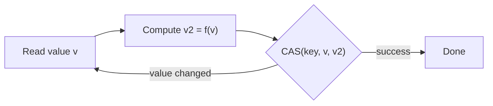

**Numbers.** CAS is cheap uncontended (tens of nanoseconds in memory, one round trip in a database). Under contention, each round only one of `n` contenders wins. If `n` workers all start at once and retry immediately, total attempts are `n + (n−1) + … + 1 = n(n+1)/2`. With 32 workers that is 528 attempts for 32 increments, about 16× wasted work. That is why hot counters move to sharded counters (sum of `k` sub-counters) or batched increments.

**Where it's used.** DynamoDB conditional writes back optimistic locking in its SDK mappers and reject with `ConditionalCheckFailedException`. Kubernetes and etcd implement every update as a compare on revision. Redis `INCR` backs most simple rate limiters and counters. Unique claims ("this username", "this job") are `INSERT` against a unique index or `SET NX`.

**Trade-offs and failure modes.**
- Atomicity covers **one key**. "Debit A and credit B" needs a transaction; two CASes can half-complete.
- The ABA problem: the value goes A → B → A and a CAS on value succeeds wrongly. Compare a version number instead of the value.
- Retry storms on hot keys. Add backoff or restructure the key.
- A CAS that times out has an unknown outcome. Re-read before retrying a non-idempotent transition.

Sources: [Herlihy, Wait-free synchronization](https://cs.brown.edu/~mph/Herlihy91/p124-herlihy.pdf), [DynamoDB condition expressions](https://docs.aws.amazon.com/amazondynamodb/latest/developerguide/Expressions.ConditionExpressions.html), [Redis INCR](https://redis.io/docs/latest/commands/incr/).

### Local transactions and constraints

**What it is.** A database transaction groups several reads and writes so they commit or abort together (atomicity) and survive a crash once committed (durability). Constraints (primary keys, unique, foreign keys, `CHECK`) are invariants the database enforces on every commit. **Isolation** decides what concurrent transactions can see of each other. Complexity: L–M.

**How it works.** Atomicity and durability come from the [write-ahead log](#write-ahead-log). Isolation comes from locks, multi-version concurrency control (MVCC), or both. In MVCC, every write creates a new row version stamped with the writer's transaction ID. A reader takes a snapshot (the set of transactions committed when it started) and sees only versions from that set. Readers never block writers.

The anomalies that weaker isolation allows:

| Anomaly | What happens | Example |
|---|---|---|
| Dirty read | You read another transaction's uncommitted write | A balance that is later rolled back |
| Non-repeatable read | Reading the same row twice gives different values | A report sums a row before and after an update |
| Phantom | Re-running a range query returns new rows | "Count bookings for room 7" changes mid-transaction |
| Lost update | Two read-modify-write cycles overwrite each other | Both read stock 10, both write 9; one sale vanishes |
| Write skew | Two transactions read overlapping data, then write **different** rows, jointly breaking an invariant | Two doctors each see "2 on call" and both go off call |

What each level prevents (PostgreSQL behavior; other databases differ):

| Level | Dirty read | Non-repeatable | Phantom | Lost update | Write skew |
|---|---|---|---|---|---|
| Read Committed (PG default) | prevented | possible | possible | possible | possible |
| Repeatable Read (snapshot isolation in PG) | prevented | prevented | prevented | prevented (one aborts) | **possible** |
| Serializable (SSI in PG) | prevented | prevented | prevented | prevented | prevented |

Snapshot isolation stops lost updates with "first committer wins": if two transactions update the same row, the second fails. It misses write skew because the two transactions write **different** rows. Serializable Snapshot Isolation (SSI) adds tracking of read-write dependencies and aborts a transaction when it finds a "dangerous structure" of two consecutive rw-antidependencies that could form a cycle.

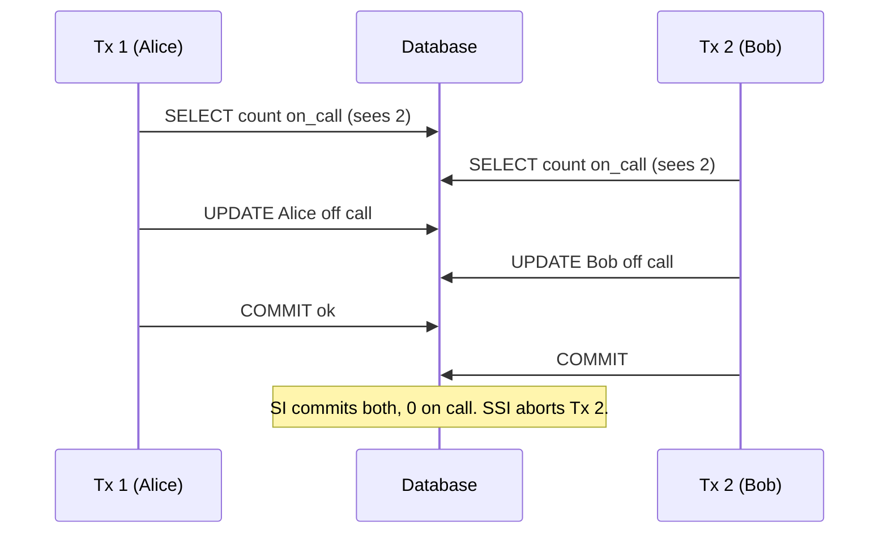

Fixes for write skew without Serializable: lock the rows you read (`SELECT … FOR UPDATE`), materialize the conflict (a row per shift that both must update), or turn the invariant into a constraint (a unique or exclusion constraint).

**Numbers.** A transaction holds its resources (locks, old row versions, a connection) for its whole duration. By Little's Law, `concurrent transactions = TPS × duration`: 2,000 TPS × 50 ms = 100 open transactions, which fits a typical pool. If a remote call inside the transaction pushes duration to 2 s, you need 4,000 connections and the database falls over. Serializable abort rates depend on how much transactions overlap; the SSI paper reports modest overhead versus snapshot isolation on its benchmarks, but aborts rise with contention. Plan for retries either way.

**Where it's used.** PostgreSQL defaults to Read Committed and has offered SSI since 9.1. MySQL InnoDB defaults to Repeatable Read. Oracle's `SERIALIZABLE` is actually snapshot isolation. CockroachDB and Spanner default to serializable (Spanner's is strict serializability).

**Trade-offs and failure modes.**
- Defaults are weak. Read Committed allows lost updates in naive read-modify-write code.
- Serializable transactions fail with serialization errors (`SQLSTATE 40001`); the client must retry the whole transaction.
- Long transactions bloat MVCC (PostgreSQL can't vacuum old versions) and hold locks.
- A transaction does not cover an HTTP call, an email or a message publish. That's what the outbox in chapter 4 is for.

Sources: [PostgreSQL transaction isolation](https://www.postgresql.org/docs/current/transaction-iso.html), [Berenson et al., A Critique of ANSI SQL Isolation Levels](https://www.microsoft.com/en-us/research/publication/a-critique-of-ansi-sql-isolation-levels/), [Ports and Grittner, SSI in PostgreSQL](https://drkp.net/papers/ssi-vldb12.pdf), [Jepsen consistency models](https://jepsen.io/consistency).

### Pessimistic locking

**What it is.** Take a lock before touching data, so conflicting transactions wait instead of failing later. Complexity: M.

**How it works.** Databases keep a lock table keyed by row, page or predicate. Shared (S) locks allow other readers; exclusive (X) locks block everyone else. Two-phase locking (2PL) acquires locks as the transaction runs and releases them only at commit, which gives serializability. In application code you usually request locks explicitly:

```sql
BEGIN;
SELECT qty FROM inventory WHERE sku = 'A1' FOR UPDATE;  -- X lock on the row
UPDATE inventory SET qty = qty - 1 WHERE sku = 'A1';
COMMIT;                                                 -- lock released
```

Useful variants: `FOR UPDATE NOWAIT` (fail immediately), `FOR UPDATE SKIP LOCKED` (skip rows others hold: a job queue in a table), and advisory locks (`pg_advisory_xact_lock(key)`) for application-defined resources.

**Deadlocks.** Tx 1 holds A and wants B; Tx 2 holds B and wants A. Neither can proceed. Databases build a wait-for graph and abort one transaction when they find a cycle.

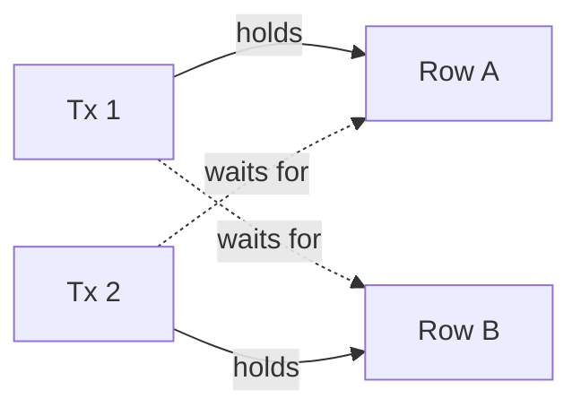

Prevent them by acquiring locks in a consistent order (for example, sort account IDs before locking), keeping transactions short, and setting a lock timeout.

**Numbers.** A hot row's throughput is capped at `1 ÷ lock hold time`. If the lock is held 5 ms (two statements plus an app round trip), one row handles at most 200 updates/s, no matter how many servers you add. Moving the logic into one statement (`UPDATE … SET qty = qty - 1 WHERE qty > 0`) cuts hold time to well under 1 ms. PostgreSQL checks for deadlocks after `deadlock_timeout` (default 1 s) of waiting; InnoDB detects them immediately by default and has `innodb_lock_wait_timeout` of 50 s.

**Where it's used.** Inventory and balance updates in SQL databases, `SKIP LOCKED` job queues (Que, Oban, Solid Queue and others), and Spanner's read-write transactions, which use 2PL with wound-wait to avoid deadlocks.

**Trade-offs and failure modes.**
- Locks held across slow work (a payment API call) serialize everything behind them.
- Deadlocks and lock timeouts become errors your code must retry.
- A database lock dies with the connection, which is good. A distributed lock (Redis, ZooKeeper) can outlive its holder's usefulness; see [leases and fencing tokens](#leases-and-fencing-tokens).
- Prefer the lock in the database that owns the data over a separate lock service.

Sources: [PostgreSQL explicit locking](https://www.postgresql.org/docs/current/explicit-locking.html), [MySQL InnoDB deadlocks](https://dev.mysql.com/doc/refman/8.0/en/innodb-deadlocks.html).

### Optimistic concurrency control

**What it is.** Don't lock. Read the data along with a version, do your work, and at write time check that the version is unchanged. If it changed, abort and retry. Complexity: M.

**How it works.** Kung and Robinson's original scheme has three phases: read (into a private workspace), validate (did anyone commit a conflicting write?), write. In applications it collapses into a version column:

```sql
-- read
SELECT id, body, version FROM doc WHERE id = 42;          -- version = 7
-- write only if nobody else did
UPDATE doc SET body = ?, version = version + 1
 WHERE id = 42 AND version = 7;
-- 0 rows affected → conflict: re-read, re-apply, or report to the user
```

HTTP has the same mechanism built in: the server returns an `ETag`; the client sends `If-Match: "<etag>"`; a stale write gets `412 Precondition Failed`.

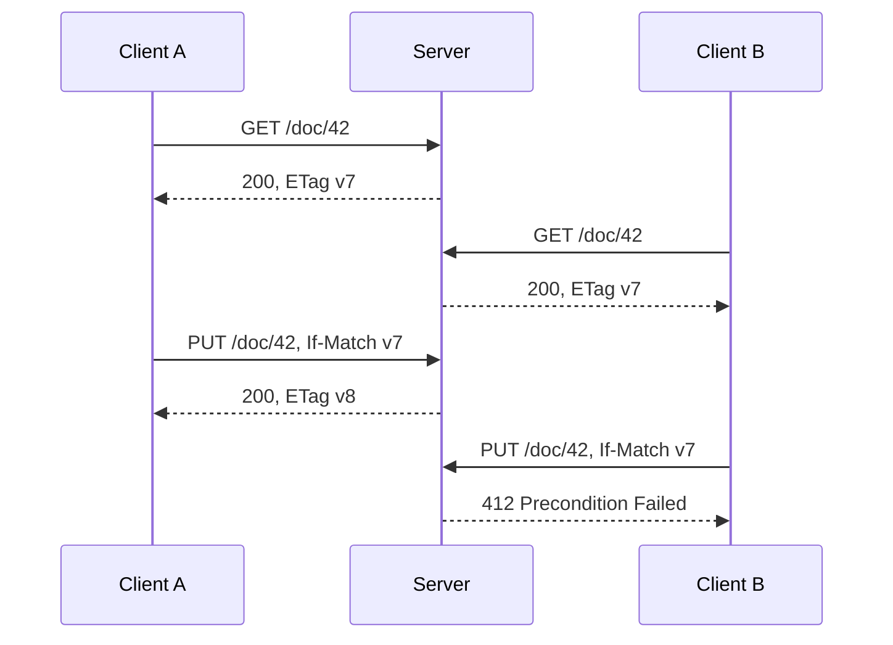

**Numbers.** If other writers update the row at rate `λ` and your read-to-write window is `T`, the chance of a conflict is roughly `p = 1 − e^(−λT)`, and expected attempts are `1 ÷ (1 − p) = e^(λT)`.

| Updates/s on the row (`λ`) | Window `T` | Conflict `p` | Expected attempts |
|---|---|---|---|
| 1 | 50 ms | 5% | 1.05 |
| 10 | 50 ms | 39% | 1.65 |
| 50 | 50 ms | 92% | 12 |

Optimistic wins when `λT` is small; once it approaches 1, switch to a lock or a single atomic statement.

**Where it's used.** Kubernetes `resourceVersion` (stale updates return `409 Conflict`), etcd transactions on `mod_revision`, DynamoDB version attributes, JPA/Hibernate `@Version`, Elasticsearch `if_seq_no`/`if_primary_term`, and wiki or document editors that warn "someone else changed this page".

**Trade-offs and failure modes.**
- Retry storms under contention, as the table shows.
- Checking one row's version does not protect an invariant spanning rows (write skew again).
- Work done before validation is wasted on abort; keep side effects out of the retry loop.
- Great for user-facing edits where waiting on a lock for minutes is impossible.

Sources: [Kung and Robinson, On Optimistic Methods for Concurrency Control](https://www.eecs.harvard.edu/~htk/publication/1981-tods-kung-robinson.pdf), [Kubernetes resource versions](https://kubernetes.io/docs/reference/using-api/api-concepts/#resource-versions), [RFC 9110 conditional requests](https://www.rfc-editor.org/rfc/rfc9110.html#name-conditional-requests).

## Persistence and recovery

### Write-ahead log

**What it is.** Before changing data in place, append a description of the change to a sequential log and flush it to disk. After a crash, replay the log. Complexity: M.

**How it works.** The rule is "log before data": a page may not be written to disk until the log records describing its changes are durable, and a transaction is committed once its commit record is durable. Data pages are flushed lazily later. Each record carries a log sequence number (LSN); each page stores the LSN of its last change, so recovery knows what to redo.

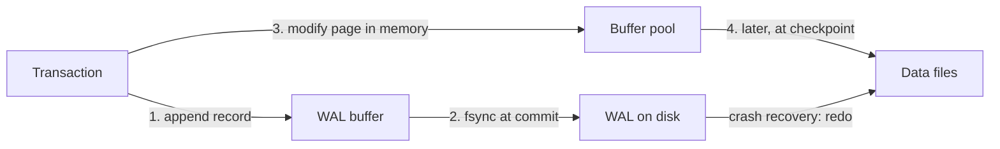

ARIES-style recovery has three passes: analysis (find what was in flight), redo (repeat history from the last checkpoint), undo (roll back losers). The same log doubles as a replication stream: PostgreSQL streaming replication ships WAL to standbys.

**Numbers.** A commit costs one sequential `fsync`. Roughly: enterprise NVMe with power-loss protection, 0.05–0.5 ms; consumer SSDs, often 1–10 ms; a 7,200 rpm disk, about 8 ms per rotation. A single serial writer is capped at `1 ÷ fsync latency` commits/s (2,000/s at 0.5 ms). **Group commit** fixes this: one fsync covers every commit that arrived meanwhile, so 50 commits per flush lifts throughput to 100,000/s at the same latency. The log is sequential I/O, while data pages are random; that asymmetry is the reason WAL exists.

PostgreSQL writes a full page image into the WAL the first time a page changes after a checkpoint, to survive torn 8 KB page writes. That can multiply WAL volume several times right after each checkpoint.

**Where it's used.** PostgreSQL WAL, MySQL InnoDB redo log (plus binlog for replication), SQLite WAL mode, etcd and every Raft implementation, RocksDB's WAL in front of its memtable, and file systems with journaling (ext4, XFS).

**Trade-offs and failure modes.**
- Durability depends on the disk honoring `fsync`. Disabling it (`synchronous_commit = off`, `fsync = off`) trades a window of lost commits for latency.
- The WAL grows until a checkpoint lets it be recycled; a stuck replica or replication slot can fill the disk.
- A storage WAL records physical or row changes, not business intent. It is not a domain event model.

Sources: [PostgreSQL WAL introduction](https://www.postgresql.org/docs/current/wal-intro.html), [Mohan et al., ARIES](https://cs.stanford.edu/people/chrismre/cs345/rl/aries.pdf), [SQLite write-ahead logging](https://www.sqlite.org/wal.html).

### Append-only logs and LSM-trees

**What it is.** A log you only ever append to, read by offset, and never update in place. As a storage engine design, the log-structured merge-tree (LSM) turns all writes into appends, and a B-tree updates pages in place. Complexity: M.

**How it works.** An append-only log is a sequence of immutable records with monotonically increasing offsets. Readers track their own position, so many independent consumers can read the same log and replay from any point still retained. Old data leaves by retention (time or size) or compaction (keep only the latest record per key).

An LSM-tree buffers writes in a sorted in-memory table (memtable, backed by a WAL). When full, it flushes as an immutable sorted file (SSTable). Background compaction merges SSTables into larger levels and drops overwritten or deleted keys. Reads check the memtable, then each level, using per-file Bloom filters to skip files that can't contain the key.

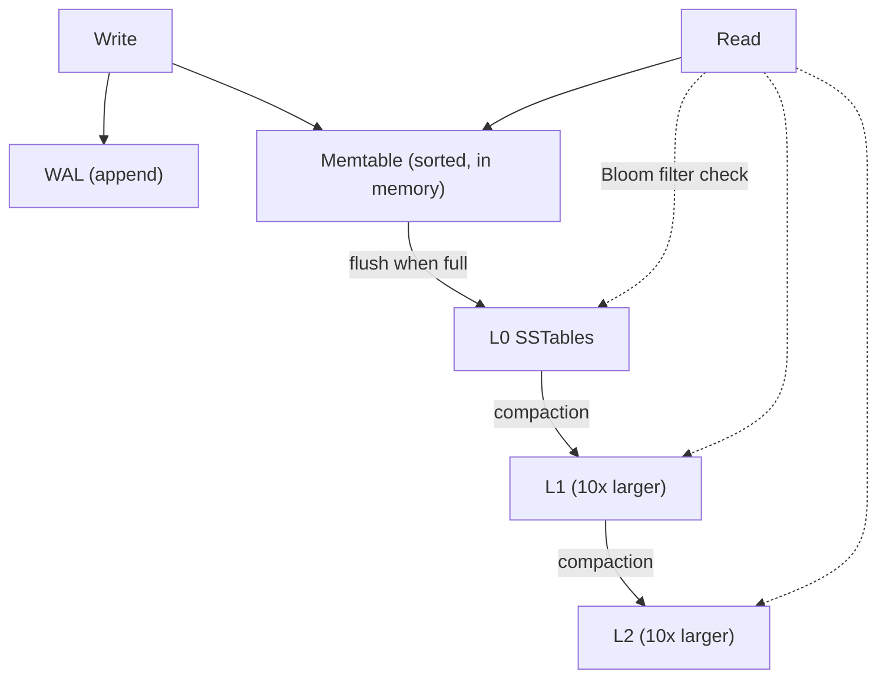

| | B-tree (PostgreSQL, InnoDB) | LSM-tree (RocksDB, Cassandra) |
|---|---|---|
| Write path | Update page in place (+ WAL) | Append to memtable, flush, compact |
| Write amplification | One page per changed row (8–16 KB for a 100-byte row), amortized by checkpoints | Each byte rewritten once per level; roughly 10–30× with leveled compaction |
| Read amplification | One root-to-leaf path, about 3–4 pages, mostly cached | Memtable + several files; Bloom filters cut most misses |
| Space amplification | Page fill factor, fragmentation | Obsolete versions until compaction |
| Good for | Read-heavy, range scans, transactions | Write-heavy, high ingest |

**Numbers.** A Bloom filter at 10 bits per key has a false-positive rate of about 1% (0.8% with the optimal 7 hash functions), so a point read for a missing key touches roughly one file instead of one per level. A B-tree with fanout 500 indexes 125 million keys in 3 levels (`500³`). For logs, Kafka retains data by size or time per partition and gets throughput from sequential I/O and the OS page cache.

**Where it's used.** Kafka and Pulsar topics, Kinesis shards, event stores, Git's object model, RocksDB (inside CockroachDB as Pebble, TiKV, MyRocks), Cassandra, ScyllaDB, HBase, and Bigtable.

**Trade-offs and failure modes.**
- Compaction competes with foreground I/O; if writes outpace it, LSM engines stall writes.
- Deletes become tombstones that live until compaction; tombstone-heavy reads get slow (a known Cassandra pitfall).
- Retention is a contract: a consumer offline longer than retention loses data.
- Ordering is per log or per partition, never global across partitions.

Sources: [Jay Kreps, The Log](https://web.archive.org/web/20240105095933/https://engineering.linkedin.com/distributed-systems/log-what-every-software-engineer-should-know-about-real-time-datas-unifying), [O'Neil et al., The LSM-Tree](https://www.cs.umb.edu/~poneil/lsmtree.pdf), [RocksDB tuning guide](https://github.com/facebook/rocksdb/wiki/RocksDB-Tuning-Guide).

### Snapshots and checkpoints

**What it is.** A saved copy of state at a known log position, so recovery starts from the snapshot and replays only the log after it. Complexity: M.

**How it works.** The invariant: **the snapshot and the log position must be recorded together.** Save state at offset 1,000 but record offset 1,100 and you skip 100 changes; record 900 and you apply 100 twice. Common techniques:

- **Fork and copy-on-write:** Redis `BGSAVE` forks; the child writes the frozen memory image while the parent keeps serving. Pages are copied only when the parent modifies them.
- **Database checkpoints:** PostgreSQL flushes all dirty pages and records a checkpoint location in the WAL; recovery starts there.
- **Raft log compaction:** each server snapshots its state machine with the last included index and term, then discards earlier log entries. A lagging follower receives the snapshot via `InstallSnapshot`.
- **Distributed snapshots:** Chandy–Lamport sends markers along channels so each process records its state and in-flight messages consistently. Flink injects barriers into streams; each operator snapshots when barriers from all inputs arrive, together with the source offsets.

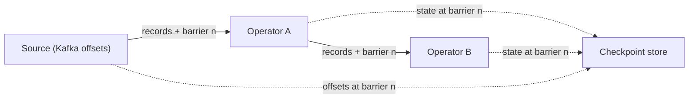

**Numbers.** Recovery time ≈ snapshot load time + `(ops since snapshot) ÷ replay rate`. At 5,000 writes/s with a snapshot every 10 minutes, you replay up to 3 million operations; at 100,000 ops/s that's 30 s. Snapshot more often to cut recovery time, at the cost of more I/O. PostgreSQL defaults to a checkpoint at least every 5 minutes (`checkpoint_timeout`) or when WAL reaches `max_wal_size` (default 1 GB). Fork-based snapshots can, in the worst case, double memory use if every page is written during the snapshot.

**Where it's used.** Redis RDB plus AOF, PostgreSQL checkpoints, etcd and ZooKeeper snapshots, Flink and Kafka Streams state, event-sourced aggregates (snapshot every N events), and VM or EBS volume snapshots.

**Trade-offs and failure modes.**
- Saving state and offset inconsistently loses or repeats work.
- A snapshot on the same disk as the data is not a backup.
- Large snapshots stall the process (fork latency on huge heaps) or saturate the network when sent to a new replica.

Sources: [Chandy and Lamport, Distributed Snapshots](https://lamport.azurewebsites.net/pubs/chandy.pdf), [Flink stateful stream processing](https://nightlies.apache.org/flink/flink-docs-stable/docs/concepts/stateful-stream-processing/), [Redis persistence](https://redis.io/docs/latest/operate/oss_and_stack/management/persistence/), [Raft paper, section 7](https://raft.github.io/raft.pdf).

## Communication and work ownership

### Request/reply

**What it is.** The caller sends a request and waits for a response from a known authority: HTTP, gRPC, a database query. Complexity: L–M.

**How it works.** The request travels over a connection (usually pooled, often multiplexed over HTTP/2), the server processes it, and a response returns with a status. The caller needs a timeout, because the network gives three outcomes, not two:

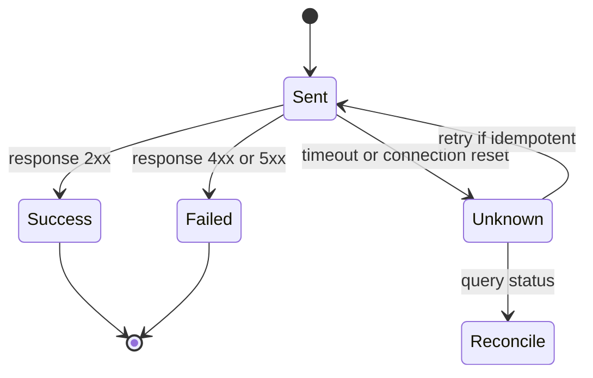

**Unknown** is the dangerous state. The server may have committed and the response was lost. Retry only if the operation is idempotent or carries an [idempotency key](#operation-ids-idempotency-keys-and-deduplication); otherwise, query status. For work that outlasts a request, switch to asynchronous request-reply: `202 Accepted` with a status URL.

**Numbers.** Synchronous chains multiply availability and add latency. Five services in series, each 99.9% available, give `0.999⁵ ≈ 99.5%`, about 3.6 hours of downtime a month instead of 43 minutes. Latency adds: five hops at p50 of 10 ms each is 50 ms at best, and tails compound. With fan-out to `n` backends, the chance that at least one hits its 1% tail is `1 − 0.99ⁿ`: 63% at `n = 100`. Typical round trips: about 0.5 ms within a data center or availability zone, 1–2 ms across zones, 60–80 ms coast to coast in the US.

**Where it's used.** Everywhere: REST and gRPC APIs, database protocols, service mesh traffic. Google's "The Tail at Scale" describes hedged and tied requests to fight fan-out tail latency.

**Trade-offs and failure modes.**
- Temporal coupling: the caller is down when the callee is down.
- Retries after timeouts cause duplicates and load amplification.
- Thread-per-request servers waiting on slow callees exhaust their pools; see [semaphores](#semaphores-and-concurrency-limits).

Sources: [Dean and Barroso, The Tail at Scale](https://research.google/pubs/the-tail-at-scale/), [Azure asynchronous request-reply](https://learn.microsoft.com/en-us/azure/architecture/patterns/asynchronous-request-reply).

### Deadlines and cancellation

**What it is.** A deadline is an absolute time by which the whole request must finish. It propagates with the request so every downstream hop knows how much time is left, and cancellation tells downstream work to stop when the caller gives up. Complexity: M.

**How it works.** The edge sets a deadline (`now + 300 ms`). Each hop computes the remaining budget, subtracts a little for its own work, and passes it on. gRPC sends it as the `grpc-timeout` header and converts it back to a deadline on the server; Go's `context.WithDeadline` carries it through code. When the caller cancels or the deadline passes, the context is cancelled, and well-behaved code checks it before expensive work and aborts queued items that are already late.

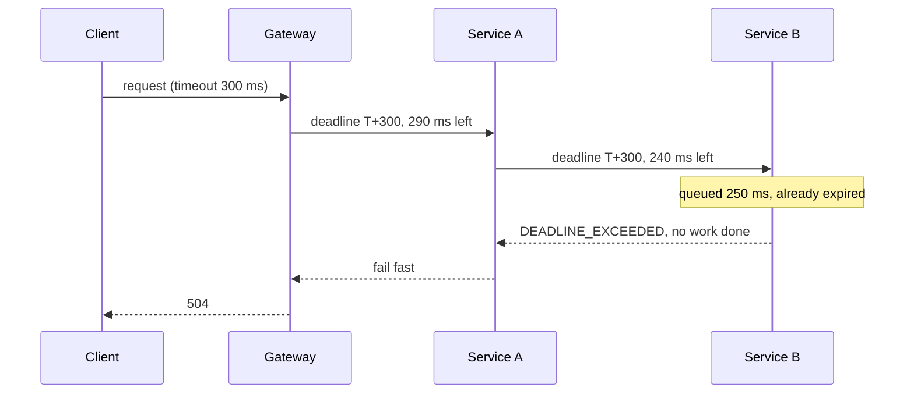

Timeouts per hop that don't share a budget are the anti-pattern: the client gives up at 1 s while the backend keeps working for 30 s on a result nobody will read.

**Numbers.** Set each timeout from the dependency's latency distribution, not a guess: roughly p99.9 of healthy latency plus margin. With a 300 ms budget and a dependency at p50 30 ms / p99 120 ms, one retry fits (120 + 120 is under 300); three do not. Drop work whose deadline has passed: under overload, a server that keeps processing expired requests spends its whole capacity on wasted work, and goodput falls to zero.

**Where it's used.** gRPC deadlines (no default deadline, so set one), Go `context`, .NET `CancellationToken`, Google's internal RPC stack (the SRE book recommends propagating deadlines), and Envoy's per-route timeouts plus `x-envoy-expected-rq-timeout-ms`.

**Trade-offs and failure modes.**
- Cancellation is cooperative. Code that ignores the context keeps running.
- Timing out does not undo a remote commit. The outcome is unknown.
- Budgets that are too tight cause false failures; too loose ones let queues grow.
- Clock skew matters if you pass absolute timestamps between machines; gRPC sends a relative timeout to avoid this.

Sources: [gRPC deadlines](https://grpc.io/docs/guides/deadlines/), [Google SRE, Addressing Cascading Failures](https://sre.google/sre-book/addressing-cascading-failures/), [AWS, Timeouts, retries and backoff with jitter](https://aws.amazon.com/builders-library/timeouts-retries-and-backoff-with-jitter/).

### Acknowledgments and delivery semantics

**What it is.** An acknowledgment (ack) tells the sender that the receiver has taken responsibility for a message. **When** you ack, relative to doing durable work, decides whether a crash loses or duplicates messages. Complexity: M.

**How it works.** Three delivery semantics:

| Semantics | Mechanism | After a crash |
|---|---|---|
| At-most-once | Ack (or commit the offset) **before** processing | Message lost if the crash hits mid-processing |
| At-least-once | Process, then ack | Message redelivered and processed again |
| Effectively-once | At-least-once + idempotent processing, or effect and offset committed in one transaction | Duplicate detected and skipped |

True exactly-once delivery over an unreliable network is impossible; "exactly-once" in products means exactly-once **effect** inside a boundary the product controls.

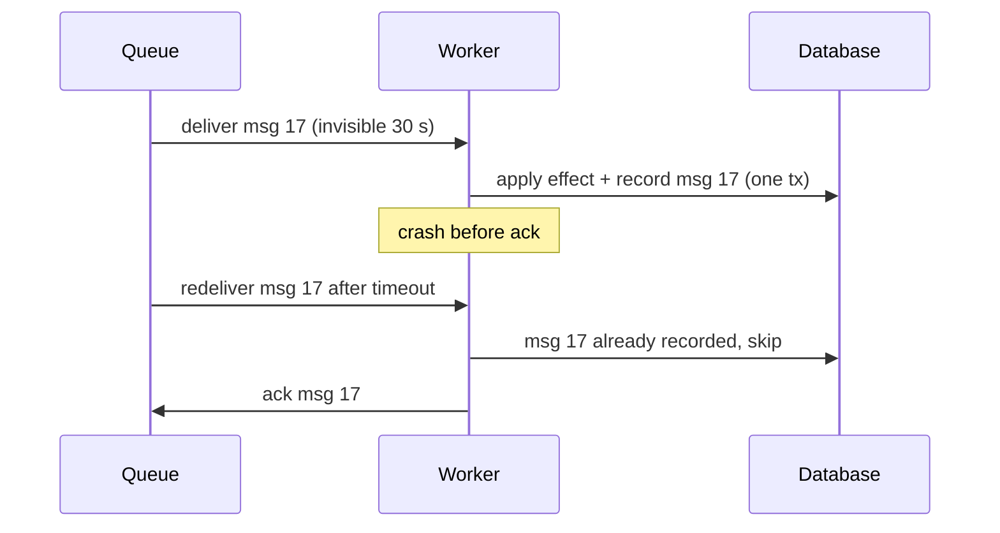

On the producer side, Kafka's `acks` setting decides when the broker acknowledges a write: `acks=0` (don't wait), `acks=1` (leader wrote it), `acks=all` (all in-sync replicas have it). With `acks=all` and `min.insync.replicas=2` on 3 replicas, an acknowledged write survives one broker loss. The idempotent producer attaches a producer ID and per-partition sequence numbers so the broker discards duplicate retries.

**Numbers.** The duplicate window is the time between doing the work and the ack. SQS's default visibility timeout is 30 s: if processing takes longer, the message reappears and a second worker picks it up, so set the timeout above p99.9 processing time or extend it while working. Kafka `acks=all` adds roughly one intra-cluster round trip plus follower fetch delay to produce latency, typically a few milliseconds within a region.

**Where it's used.** Kafka (consumer offset commits, producer acks, transactions with `read_committed` consumers), SQS (visibility timeout, delete as ack), RabbitMQ (manual acks, publisher confirms), and TCP itself (cumulative acks).

**Trade-offs and failure modes.**
- Acking before durable work loses data; acking after it duplicates. Choose at-least-once plus dedup almost always.
- Kafka's transactional exactly-once covers Kafka-to-Kafka; writes to your database or an email API are outside it.
- Redelivery of a "poison" message loops forever without a retry limit and a dead-letter queue.

Sources: [Kafka design: message delivery semantics](https://kafka.apache.org/41/design/design/), [SQS visibility timeout](https://docs.aws.amazon.com/AWSSimpleQueueService/latest/SQSDeveloperGuide/sqs-visibility-timeout.html), [microservices.io idempotent consumer](https://microservices.io/patterns/communication-style/idempotent-consumer.html).

### Operation IDs, idempotency keys and deduplication

**What it is.** The client attaches a unique ID to each logical operation. The server stores the ID with the outcome, so a retry with the same ID returns the stored result instead of repeating the effect. Complexity: M.

**How it works.**

1. The client generates the key **once per intent** (for example a UUIDv4 when the user clicks "Pay") and reuses it on every retry.
2. The server inserts `(key, request_hash, status = in_progress)` with a unique constraint. If the insert conflicts, it reads the existing record: completed returns the saved response; in progress returns `409` or waits; a different request hash is rejected as misuse.
3. The server performs the effect and saves the response **in the same transaction** as the effect where possible.
4. Records expire after a retention window longer than any client's retry horizon.

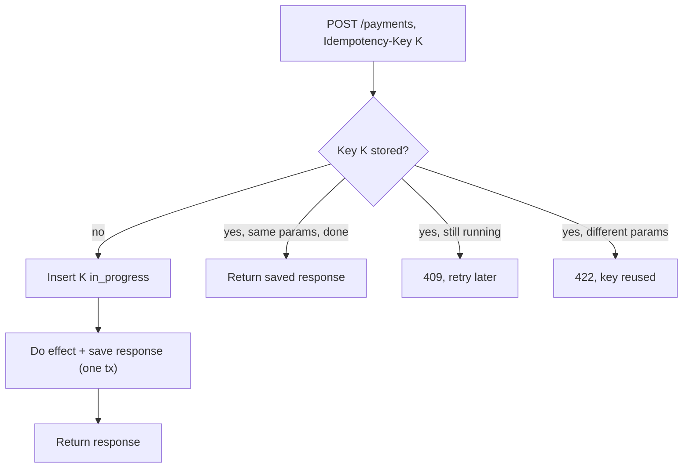

For external effects (a card network, an email provider) that can't join your transaction, record the step as pending, call the provider with **its** idempotency key, and reconcile when the outcome is unknown.

**Numbers.** Collisions are not the risk if you use enough random bits. By the birthday bound, `p ≈ n² ÷ 2^(b+1)` for `n` keys of `b` random bits. UUIDv4 has 122 random bits: after `10¹²` keys, `p ≈ 10²⁴ ÷ 2¹²³ ≈ 10⁻¹³`. A 32-bit random ID reaches 50% collision odds at only about 77,000 keys. Storage: 10 million operations/day × 1 KB record × 1 day retention is about 10 GB, small enough for one table with a TTL index.

**Where it's used.** Stripe accepts an `Idempotency-Key` header on all v1 `POST` requests; it saves the first response (including `500` errors), lets keys be pruned after at least 24 hours, and errors if a retry's parameters differ. SQS FIFO queues deduplicate by `MessageDeduplicationId` within a 5-minute interval. Kafka's idempotent producer dedups by producer ID and sequence number. AWS APIs use client tokens (for example `ClientToken` on EC2 `RunInstances`).

**Trade-offs and failure modes.**
- The dedup record and the effect must commit atomically; otherwise a crash between them repeats or loses the effect.
- Hashing the payload is not an idempotency key: two identical $10 transfers can both be intended.
- A retry after retention expiry is treated as new. Size retention to the longest retry path, including queues and human retries.
- Concurrent duplicates race; the unique constraint, not a prior `SELECT`, must decide the winner.

Sources: [Stripe idempotent requests](https://docs.stripe.com/api/idempotent_requests), [AWS, Making retries safe with idempotent APIs](https://aws.amazon.com/builders-library/making-retries-safe-with-idempotent-APIs/), [Brandur Leach, Implementing Stripe-like idempotency keys in Postgres](https://brandur.org/idempotency-keys).

### Sequence numbers and logical clocks

**What it is.** Counters that order events without trusting wall clocks. Per-entity sequence numbers order one stream; logical clocks order events across machines by causality. Complexity: M.

**How it works.**

- **Sequence numbers:** a single writer stamps each event `1, 2, 3, …` per entity or partition. Receivers apply in order, detect gaps, and drop anything with a number at or below the last applied (stale or duplicate).
- **Lamport clocks:** each process keeps a counter `C`. On a local event or send, `C = C + 1`; on receive of timestamp `t`, `C = max(C, t) + 1`. If event a happened before b, then `C(a) < C(b)`. The converse doesn't hold, so Lamport clocks give a total order (break ties by node ID) but can't detect concurrency.
- **Vector clocks:** each process keeps a vector with one counter per process. Comparing two vectors tells you if one happened before the other or if they are **concurrent**, which is exactly what you need to detect conflicting writes.
- **Hybrid logical clocks (HLC):** a pair `(physical time, logical counter)`. The physical part tracks the max wall time seen; the counter breaks ties. Timestamps stay close to real time, fit in 64 bits, and still respect causality.

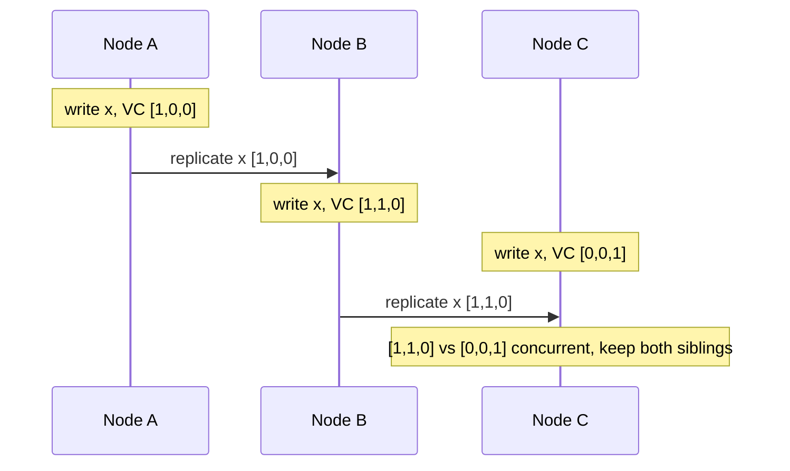

**Numbers.** Vector clocks cost one entry per writer, so they grow with the number of replicas or clients that write; Dynamo truncates them past a threshold (10 entries in the paper), which can lose causality information. Wall clocks under NTP typically drift within milliseconds, but skew of hundreds of milliseconds happens. CockroachDB uses HLC with a default maximum clock offset of 500 ms and treats values within that uncertainty window specially. Spanner's TrueTime returns an interval `[earliest, latest]` with error bound `ε`; the 2012 paper reports `ε` usually between 1 and 7 ms, and commits wait out about `2ε` so timestamps match real-time order.

**Where it's used.** TCP sequence numbers, Kafka offsets and producer sequence numbers, Raft log indexes and terms, ZooKeeper's `zxid` (epoch + counter), Dynamo and Riak vector clocks (Riak later moved to dotted version vectors), CockroachDB and MongoDB cluster time (HLC), Spanner TrueTime.

**Trade-offs and failure modes.**
- Wall-clock "last write wins" silently drops writes when clocks skew.
- Sequence numbers need a single writer per sequence; two writers create duplicates.
- Logical clocks order events but say nothing about real time; "happened before 3 pm" needs physical clocks with bounded error.
- Sortable IDs (Snowflake, ULID) are roughly time-ordered, not a trustworthy global order.

Sources: [Lamport, Time, Clocks, and the Ordering of Events](https://lamport.azurewebsites.net/pubs/time-clocks.pdf), [Kulkarni et al., Hybrid Logical Clocks](https://cse.buffalo.edu/tech-reports/2014-04.pdf), [Spanner paper](https://research.google/pubs/spanner-googles-globally-distributed-database-2/), [Dynamo paper](https://www.allthingsdistributed.com/files/amazon-dynamo-sosp2007.pdf).

### Heartbeats and failure detection

**What it is.** Nodes periodically send "I'm alive" messages; a monitor suspects a node when heartbeats stop arriving within a timeout. Complexity: M.

**How it works.** In an asynchronous network you can't distinguish a dead node from a slow one, so every failure detector trades **detection time** against **false positives**.

- **Fixed timeout:** suspect after `k` missed heartbeats at interval `h`. Detection time is about `k × h`.
- **Phi accrual:** keep a sliding window of inter-arrival times, model their distribution, and output a suspicion level `φ = −log₁₀(P(heartbeat still arrives after time t))`. The application picks a threshold. `φ = 8` means roughly a 10⁻⁸ chance the node is merely late under that model. Detection adapts to the observed network jitter.
- **SWIM:** each round, a node pings one random member; if no reply, it asks `k` other members to ping it indirectly before suspecting. Suspicion and membership changes spread by gossip. Load per node is constant regardless of cluster size.

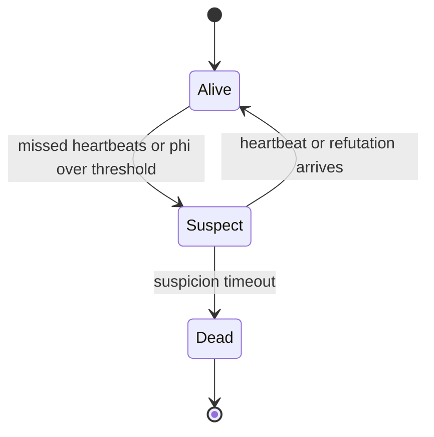

**Numbers.** All-to-all heartbeats cost `N²` messages per interval: 1,000 nodes at 1/s is a million messages per second. SWIM and gossip make it `O(N)` total. Raft's election timeout must exceed heartbeat interval and network jitter; etcd defaults to a 100 ms heartbeat and a 1,000 ms election timeout, and recommends an election timeout of at least 10× the round-trip time. Cassandra's `phi_convict_threshold` defaults to 8. GC pauses of several seconds in JVM services are a classic source of false positives.

**Where it's used.** Raft and ZooKeeper (session timeouts, ephemeral nodes deleted on expiry), Kubernetes node heartbeats via `Lease` objects, Cassandra and Akka (phi accrual), Consul and Serf (SWIM via HashiCorp memberlist), and load balancer health checks.

**Trade-offs and failure modes.**
- A slow or partitioned node looks dead while it keeps running, and may keep writing. Failure detection must be paired with [fencing](#leases-and-fencing-tokens).
- Aggressive timeouts cause flapping and needless failovers, which are themselves outages.
- Health checks that test too much (including shared dependencies) can mark a whole fleet unhealthy at once.

Sources: [Hayashibara et al., The Phi Accrual Failure Detector](https://doi.org/10.1109/RELDIS.2004.1353004), [Das et al., SWIM](https://www.cs.cornell.edu/projects/Quicksilver/public_pdfs/SWIM.pdf), [etcd tuning](https://etcd.io/docs/v3.6/tuning/).

### Leases and fencing tokens

**What it is.** A lease is a lock with an expiry: the holder owns a resource until a deadline and must renew to keep it. A fencing token is a number that increases with every grant, which the protected resource checks so it can reject writes from an old holder. Complexity: H.

**How it works.** A lock service (etcd, ZooKeeper, Chubby, a database row) grants the lease with a TTL and a token (etcd revision, ZooKeeper `zxid` or znode version). The holder renews well before expiry. If it fails to renew, it must stop acting. But a process can be paused (GC, VM migration, page fault storm) and wake up **after** expiry still believing it holds the lease. Only the resource can stop it, by remembering the highest token it has seen.

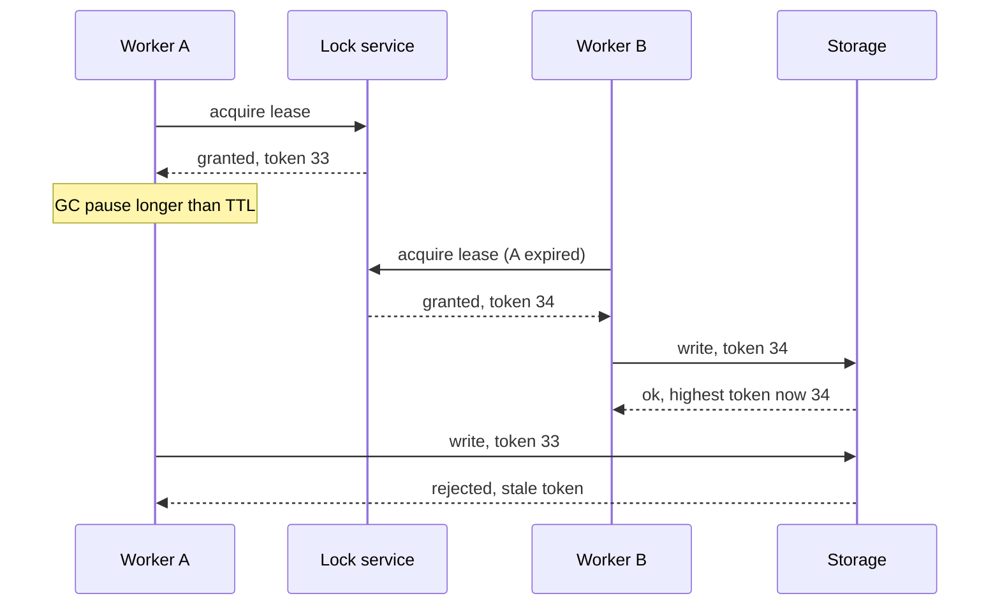

**Numbers.** Leases rely on bounded clock **rate** (drift), not synchronized clocks. With lease length `T` and maximum drift `ρ`, the holder should stop at `T × (1 − ρ) − margin` measured on its own clock, starting from when it **sent** the request. Quartz drift is roughly 10⁻⁵ to 10⁻⁴, so drift is small; the real risk is pauses. A 10 s lease with a renew every 3 s tolerates two lost renewals. Failover takes about one lease duration, so shorter leases mean faster failover and more renewal traffic. Chubby's lock-delay (default one minute) blocks reacquiring a lock after its holder fails, as a fallback for servers that can't check sequencers.

**Where it's used.** Chubby sequencers, ZooKeeper ephemeral nodes and recipes, etcd leases (Kubernetes leader election uses `Lease` objects), HDFS NameNode HA fencing, Kafka controller epochs and leader epochs (brokers reject requests from stale controllers), and Raft terms, which act as fencing tokens for leaders.

**Trade-offs and failure modes.**
- A lease alone is not safe for correctness; without a fencing check at the resource, two holders can write.
- The resource must support a conditional write on the token. Many (an S3 bucket, an email API) do not, so you need idempotency instead.
- Redis-based locks (including Redlock) depend on timing assumptions and give no fencing token; use them for efficiency (avoid duplicate work), not correctness.

Sources: [Kleppmann, How to do distributed locking](https://martin.kleppmann.com/2016/02/08/how-to-do-distributed-locking.html), [Burrows, The Chubby lock service](https://research.google/pubs/the-chubby-lock-service-for-loosely-coupled-distributed-systems/), [Gray and Cheriton, Leases](https://dl.acm.org/doi/10.1145/74851.74870), [etcd API guarantees](https://etcd.io/docs/v3.6/learning/api_guarantees/).

## Agreement and distribution

### Consensus (Raft and Paxos)

**What it is.** A protocol that lets a group of nodes agree on a sequence of values (a replicated log) despite crashes and message loss, as long as a majority is up. Complexity: H.

**How it works (Raft).** Time is divided into **terms**, each with at most one leader.

1. **Leader election:** a follower that hears no heartbeat within a randomized election timeout (150–300 ms in the paper) increments its term, votes for itself, and requests votes. A node grants one vote per term, and only to a candidate whose log is at least as up to date as its own. A majority of votes makes it leader.
2. **Log replication:** clients send commands to the leader. It appends to its log and sends `AppendEntries` with the previous entry's index and term. Followers reject if that previous entry doesn't match (the **log matching** property), and the leader backs up until logs agree.
3. **Commit:** once an entry from the current term is stored on a majority, it is committed; the leader applies it and replies. Followers learn the commit index on the next message.

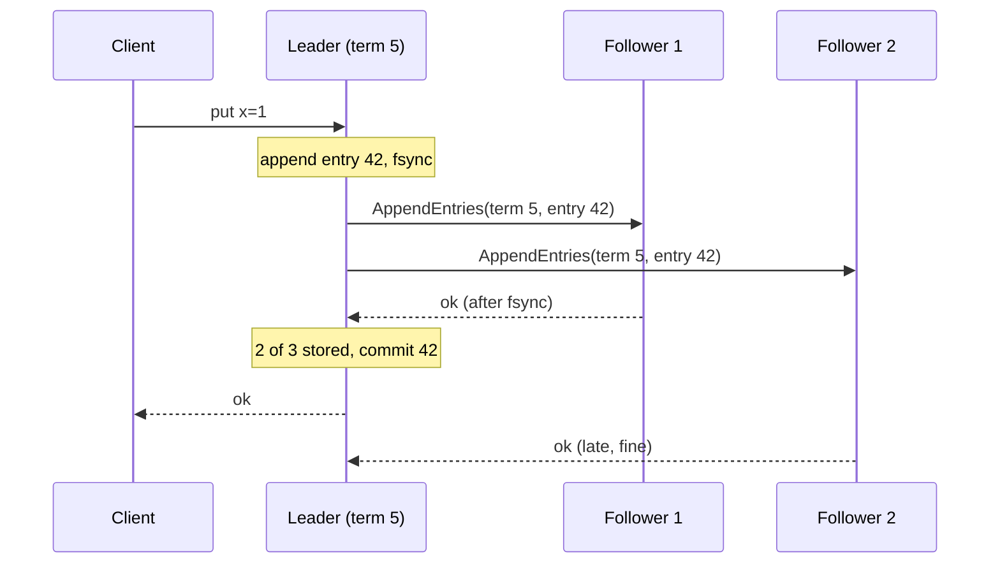

Paxos reaches the same agreement with a prepare/promise and accept/accepted phase per slot; Multi-Paxos keeps a stable leader so steady state costs one round, like Raft. Raft is Multi-Paxos-like, restructured for understandability.

**Numbers.** `2f + 1` nodes tolerate `f` failures: 3 nodes survive 1, 5 survive 2. Even sizes add cost without tolerance (4 nodes still survive only 1). Commit latency ≈ leader fsync + one round trip to the fastest majority + follower fsync, with the fsyncs overlapping the network: roughly 1–3 ms within one region across zones, or about one cross-region RTT (tens of milliseconds) for a multi-region group. Throughput is bounded by the single leader; etcd defaults to a 2 GB storage quota because it's built for metadata, not bulk data. Linearizable reads need the leader to confirm it's still leader (a quorum round, or a read index), or a leader lease that assumes bounded clock drift.

**Where it's used.** etcd (Raft; Kubernetes' source of truth), ZooKeeper (Zab, a Paxos relative), Consul, CockroachDB and TiKV (a Raft group per range), Kafka KRaft metadata quorum, Spanner (Paxos groups per split), Chubby (Paxos).

**Trade-offs and failure modes.**
- No majority, no progress: a 3-node cluster with 2 down is read-only or unavailable.
- Every write pays a quorum round trip; put consensus on metadata and coordination, not every request.
- Consensus orders state changes inside the group. It does not make external side effects transactional.
- Membership changes need joint consensus or single-server changes; doing them by hand risks two majorities.

Sources: [Ongaro and Ousterhout, Raft](https://raft.github.io/raft.pdf), [Lamport, Paxos Made Simple](https://lamport.azurewebsites.net/pubs/paxos-simple.pdf), [The Raft site and visualization](https://raft.github.io/), [etcd tuning](https://etcd.io/docs/v3.6/tuning/).

### Quorum reads and writes

**What it is.** With `N` replicas, a write waits for `W` acknowledgments and a read queries `R` replicas. If `R + W > N`, every read set overlaps every write set, so a read sees at least one replica with the latest acknowledged write. Complexity: H.

**How it works.** The coordinator sends the write to all `N` replicas and returns after `W` acks. A read asks `R` replicas, picks the newest version by timestamp or version vector, and may **read-repair** stale replicas. Replicas that missed writes catch up through hinted handoff (a neighbor stores the write and forwards it later) and anti-entropy repair.

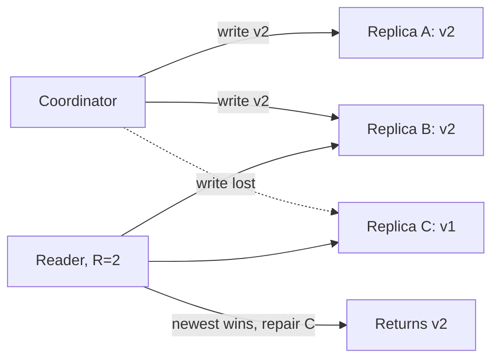

**Numbers.**

| `N` | `W` | `R` | Overlap | Survives for writes | Survives for reads | Typical use |
|---|---|---|---|---|---|---|
| 3 | 2 | 2 | yes | 1 node down | 1 node down | Balanced (Cassandra `QUORUM`) |
| 3 | 3 | 1 | yes | 0 down | 2 down | Read-heavy, fragile writes |
| 3 | 1 | 1 | **no** | 2 down | 2 down | Fast, eventually consistent |
| 6 | 4 | 3 | yes | 2 down | 3 down | Amazon Aurora storage |

Aurora keeps 6 copies across 3 availability zones (2 per zone) with a write quorum of 4 and a read quorum of 3, so it keeps writing after losing a zone and keeps reading after losing a zone plus one more node. Latency of a quorum op is the `W`-th (or `R`-th) fastest replica, which cuts tail latency compared with waiting for all.

**Where it's used.** Dynamo (the paper's common setting is `N=3, R=2, W=2`), Cassandra and ScyllaDB tunable consistency (`ONE`, `QUORUM`, `LOCAL_QUORUM`, `ALL`), Riak, Aurora storage. Cassandra hinted handoff stores hints for a down replica for up to `max_hint_window` (default 3 hours).

**Trade-offs and failure modes.**
- Overlap alone is not linearizability. Concurrent writes, sloppy quorums (writing to substitute nodes during failures), and last-write-wins with skewed clocks all break it.
- A failed write that reached fewer than `W` replicas is not rolled back; later reads may or may not see it.
- `LOCAL_QUORUM` in multi-region setups overlaps only within a region.

Sources: [Dynamo paper](https://www.allthingsdistributed.com/files/amazon-dynamo-sosp2007.pdf), [Verbitski et al., Amazon Aurora](https://www.amazon.science/publications/amazon-aurora-design-considerations-for-high-throughput-cloud-native-relational-databases), [Cassandra consistency](https://cassandra.apache.org/doc/latest/cassandra/architecture/dynamo.html).

### Replication

**What it is.** Keeping copies of the same data on several nodes for availability, durability, read scale and locality. Complexity: M–H.

**How it works.** Three topologies:

| Topology | Who accepts writes | Conflicts | Examples |
|---|---|---|---|
| Leader-follower | One leader per shard | None (single writer) | PostgreSQL, MySQL, MongoDB replica sets, Kafka partitions |
| Multi-leader | A leader per region or device | Yes: resolve by LWW, merge, or CRDT | MySQL group replication multi-primary, CouchDB, offline-first apps |
| Leaderless | Any replica, via quorums | Yes: version vectors, siblings | Dynamo, Cassandra, Riak |

The leader streams a log (WAL, binlog, oplog) to followers, which apply it in order. **Synchronous** replication acks the client only after a follower has the change; **asynchronous** acks immediately.

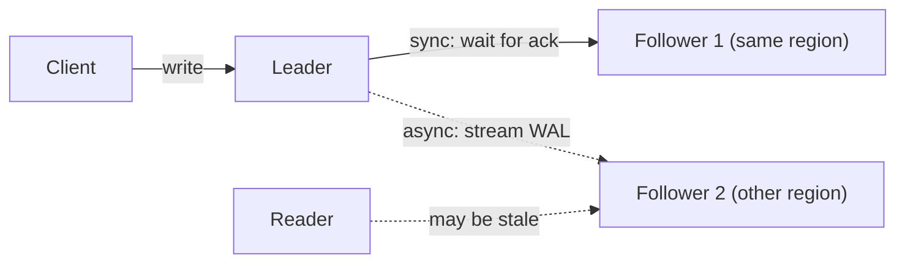

PostgreSQL makes the choice per transaction with `synchronous_commit` (`off`, `local`, `remote_write`, `on`, `remote_apply`). MySQL semi-synchronous replication waits for one replica to receive the event.

**Numbers.** Replication lag = backlog ÷ apply rate. If the leader writes 20 MB/s of WAL and a follower applies 25 MB/s, a 1 GB backlog after a burst takes `1,000 ÷ (25 − 20) = 200 s` to clear. With async replication, **RPO equals the lag at failure**: failing over loses whatever hadn't shipped. Sync replication to a same-region follower adds roughly 1 ms per commit; to another region, 30–100 ms.

**Where it's used.** Every production database. Read replicas for read scale, cross-region replicas for disaster recovery, Aurora and Spanner for quorum-based replication.

**Trade-offs and failure modes.**
- Async replicas break read-your-writes; route a user's reads to the leader for a short window after their write, or wait for an LSN.
- Failover with async replication can lose acknowledged writes, and the old leader must be [fenced](#leases-and-fencing-tokens) to avoid split brain.
- Replication copies corruption and `DELETE`s too; it is not a backup.
- Sync replication to a single follower makes that follower's failure stall writes; use "any 1 of 2" style quorums.

Sources: [PostgreSQL log-shipping standby servers](https://www.postgresql.org/docs/current/warm-standby.html), [PostgreSQL synchronous_commit](https://www.postgresql.org/docs/current/runtime-config-wal.html#GUC-SYNCHRONOUS-COMMIT), [MySQL semisynchronous replication](https://dev.mysql.com/doc/refman/8.0/en/replication-semisync.html).

### Partitioning and consistent hashing

**What it is.** Splitting data across nodes so each holds a subset (a shard or partition). Consistent hashing is a way to assign keys to nodes so that adding or removing a node moves only a small fraction of keys. Complexity: H.

**How it works.**

| Scheme | How a key finds its partition | Good at | Bad at |
|---|---|---|---|
| Hash | `hash(key) mod P`, or a hash ring | Even load | Range scans |
| Range | Sorted key ranges, split when large | Range scans, locality | Hot ranges (time-ordered keys) |
| Directory | Lookup table: key or tenant → shard | Arbitrary placement, moving big tenants | The directory is a dependency to cache and keep available |

Naive `hash(key) mod N` remaps almost everything when `N` changes. **Consistent hashing** places nodes and keys on a ring; a key belongs to the first node clockwise. Adding a node takes keys only from its neighbor. **Virtual nodes** give each physical node many ring positions, which evens out load and spreads a failed node's keys across many survivors. **Rendezvous (highest random weight) hashing** scores every node with `hash(key, node)` and picks the highest; it needs no ring and moves the same minimal fraction. **Jump consistent hash** maps a key to one of `N` numbered buckets in a few lines of code with no memory, but only supports adding or removing the last bucket.

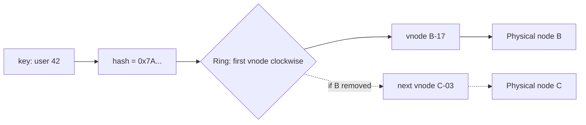

**Numbers.** Going from 10 to 11 nodes with `mod N` moves about `N ÷ (N+1) ≈ 91%` of keys. With consistent hashing it moves about `K ÷ (N+1) ≈ 9%`, the minimum possible. With `v` virtual nodes per server, load imbalance is roughly `1 ÷ √v` standard deviation: 100 vnodes give about 10%. Hot partitions cap throughput: a DynamoDB partition supports up to 3,000 read units and 1,000 write units per second, so a single hot key can throttle regardless of table capacity.

**Where it's used.** Dynamo, Cassandra (`num_tokens` defaults to 16 vnodes per node in recent versions) and Riak use rings. Bigtable, HBase, Spanner and CockroachDB use range partitioning with automatic splits. Kafka partitions by `hash(key) mod partitions`, which is why adding partitions breaks key-to-partition mapping. Vitess supports lookup vindexes (a directory). Memcached clients and Envoy's ring-hash and Maglev load balancers use consistent hashing.

**Trade-offs and failure modes.**
- Consistent hashing reduces remapping, **not** hot keys. A celebrity key still lands on one node; split it (key salting) or cache it.
- Cross-partition queries and transactions get expensive; choose the partition key from your access patterns.
- Rebalancing moves data while serving traffic; throttle it.
- Monotonic keys (timestamps, auto-increment) in range partitioning send all writes to the last range.

Sources: [Karger et al., Consistent Hashing](https://www.cs.princeton.edu/courses/archive/fall09/cos518/papers/chash.pdf), [Lamping and Veach, Jump Consistent Hash](https://arxiv.org/abs/1406.2294), [DynamoDB partition key design](https://docs.aws.amazon.com/amazondynamodb/latest/developerguide/bp-partition-key-design.html), [Azure sharding pattern](https://learn.microsoft.com/en-us/azure/architecture/patterns/sharding).

### Two-phase commit

**What it is.** A protocol that makes a transaction spanning several participants (databases, shards) commit everywhere or nowhere. It provides **atomic commit**, not consensus on a log and not isolation. Complexity: H.

**How it works.**

1. **Prepare:** the coordinator asks every participant to prepare. Each one makes the transaction durable (writes it to its log, keeps its locks) and votes yes, or votes no.
2. **Decide:** if all vote yes, the coordinator durably logs "commit" and tells everyone to commit; any no or timeout means abort.
3. Participants that voted yes **must wait** for the decision. They can't commit or abort on their own, because others may have decided differently.

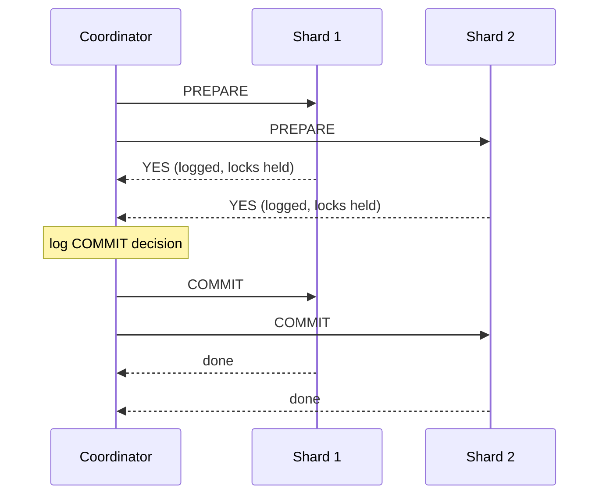

**Why it blocks.** If the coordinator crashes after participants voted yes but before they learn the decision, they sit "in doubt", holding locks, until the coordinator recovers. Three-phase commit adds a pre-commit round to avoid this but assumes bounded network delays, so it's rarely used. **Paxos Commit** (Gray and Lamport) replicates the coordinator's decision with consensus so a coordinator crash doesn't block. Spanner does the practical equivalent: 2PC where each participant and the coordinator is a Paxos group.

**Numbers.** In the failure-free case: 2 round trips plus forced log writes (each participant's prepare, the coordinator's decision), so roughly `2 × RTT + 2 × fsync` before the client hears back, and `4n` messages for `n` participants. Locks are held across both rounds; in one region that's a few milliseconds, across regions 100+ ms, which caps hot-row throughput accordingly. Probability that all `n` participants are up is `aⁿ`: at 99.9% each, 10 participants give 99%.

**Where it's used.** XA transactions, PostgreSQL `PREPARE TRANSACTION`/`COMMIT PREPARED`, Spanner, CockroachDB and YugabyteDB cross-range transactions (with their own optimizations such as parallel commits), and Kafka transactions (a transaction coordinator writes commit markers to each partition).

**Trade-offs and failure modes.**
- Blocking on coordinator failure; in-doubt transactions need monitoring and manual resolution (`pg_prepared_xacts`).
- Every participant must support prepare. HTTP services and SaaS APIs don't, which is why cross-service flows use sagas (chapter 5).
- Atomic commit is not isolation: you still need locks or MVCC on each participant.

Sources: [Gray and Lamport, Consensus on Transaction Commit](https://www.microsoft.com/en-us/research/publication/consensus-on-transaction-commit/), [PostgreSQL PREPARE TRANSACTION](https://www.postgresql.org/docs/current/sql-prepare-transaction.html), [Spanner paper](https://research.google/pubs/spanner-googles-globally-distributed-database-2/).

### Gossip and anti-entropy

**What it is.** Gossip spreads information epidemically: each node periodically exchanges state with a few random peers until everyone knows. Anti-entropy is the background process that compares replicas and repairs differences, often with Merkle trees. Complexity: M–H.

**How it works.** Each round (say every second), a node picks a random peer and they exchange digests (push, pull or push-pull), then send whatever the other is missing. Versions or heartbeat counters decide which value is newer.

For bulk data, comparing every key is too expensive, so replicas build a **Merkle tree**: leaves hash key ranges, parents hash their children. Two replicas compare roots; if equal, they're in sync. Otherwise they descend only into differing subtrees, so the data exchanged is proportional to the differences, not the data size.

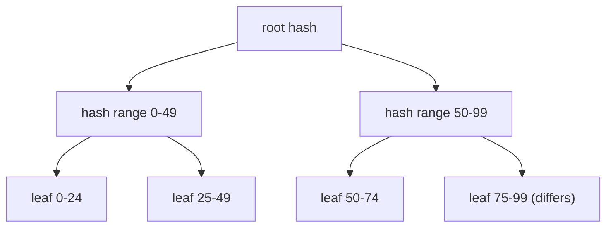

**Numbers.** A rumor reaches all `N` nodes in about `log₂ N + ln N` rounds with push gossip (`O(log N)`). For 1,000 nodes that's about 10 + 7 = 17 rounds; at one round per second, under 20 s. Each node sends a constant number of messages per round, so total load is `O(N)` per round. A Merkle tree over 1 million keys with leaves of about 1,000 keys has 1,000 leaves and depth 10; finding one differing leaf takes about 10 levels of hash comparisons, then streaming only that leaf's 1,000 keys instead of a million.

**Where it's used.** Cassandra gossips cluster membership and state every second and uses Merkle trees in `nodetool repair`. Dynamo and Riak use Merkle-tree anti-entropy. Consul and Serf use SWIM-style gossip. Bitcoin and Ethereum propagate transactions and blocks by gossip. Amazon S3 described using gossip for server state in its 2008 outage post-mortem, where a corrupted message spread through it.

**Trade-offs and failure modes.**
- Eventual only: nodes disagree for seconds. Gossip cannot elect a unique leader or enforce mutual exclusion.
- Bad state spreads as efficiently as good state; validate and checksum messages.
- Merkle trees must be rebuilt or maintained as data changes; repair of large datasets is I/O-heavy and should be scheduled.

Sources: [Demers et al., Epidemic Algorithms for Replicated Database Maintenance](https://dl.acm.org/doi/10.1145/41840.41841), [Dynamo paper](https://www.allthingsdistributed.com/files/amazon-dynamo-sosp2007.pdf), [Das et al., SWIM](https://www.cs.cornell.edu/projects/Quicksilver/public_pdfs/SWIM.pdf).

### CRDTs

**What it is.** Conflict-free replicated data types are data structures that replicas update independently and merge automatically, with a guarantee that all replicas that have seen the same updates reach the same state. Complexity: H.

**How it works.** State-based CRDTs define a merge function that is **commutative, associative and idempotent** (a join on a semilattice), so the order and number of merges doesn't matter. Operation-based CRDTs send commutative operations over reliable causal delivery.

| CRDT | State | Merge | Semantics |
|---|---|---|---|
| G-Counter | One counter per replica | Element-wise max; value = sum | Grow-only count |
| PN-Counter | Two G-Counters (P, N) | Merge each; value = P − N | Increment and decrement |
| LWW-Register | Value + timestamp | Keep highest timestamp | Last writer wins (clock-dependent) |
| OR-Set | Elements tagged with unique IDs + removed tags | Union of both | Add wins over concurrent remove |
| Sequence (RGA, Yjs) | Characters with unique IDs and ordering | Merge by IDs | Collaborative text |

```mermaid
flowchart LR
  A["Replica A: A=3, B=0"] -->|"merge: max per slot"| M["A=3, B=2, value 5"]
  B["Replica B: A=0, B=2"] -->|"merge: max per slot"| M
```

**Numbers.** A G-Counter's state is `O(replicas)`: 5 regions means 5 integers, cheap. An OR-Set keeps a tag per add and tombstones for removes, so metadata can exceed the data; text CRDTs keep IDs per character (modern libraries like Yjs and Automerge compress this heavily, but overhead is still several bytes per character). Convergence time equals propagation time: with cross-region replication, roughly 100 ms to seconds.

**Where it's used.** Riak data types (counters, sets, maps), Redis Enterprise Active-Active databases, and collaborative editors and local-first apps built on Yjs or Automerge.

**Trade-offs and failure modes.**
- Convergence is not correctness. Two regions each selling the last item converge to "sold twice". Invariants like "stock ≥ 0" need coordination (or escrow: pre-split the stock per region).
- Semantics are constrained and sometimes surprising (add-wins vs remove-wins; LWW drops concurrent writes).
- Metadata and tombstone growth need garbage collection, which itself needs some coordination.

Sources: [Shapiro et al., Conflict-free Replicated Data Types](https://inria.hal.science/inria-00609399), [crdt.tech](https://crdt.tech/).

## Resource control

### Bounded buffers and backpressure

**What it is.** Every queue, channel and pool has a maximum size. When it's full, the producer is slowed (backpressure) or new work is rejected, instead of memory growing until the process dies. Complexity: M.

**How it works.** A bounded buffer gives the producer three options when full: **block** (wait), **reject** (fail fast, maybe with `429` or `503`), or **drop** (oldest or newest, for telemetry). Backpressure propagates the signal upstream hop by hop, so the slowest stage sets the pace.

- **TCP flow control:** the receiver advertises a window; the sender can't have more unacknowledged bytes in flight.
- **HTTP/2 and gRPC:** per-stream and per-connection flow-control windows (65,535 bytes initial in the HTTP/2 spec).
- **Reactive Streams:** the subscriber calls `request(n)`; the publisher sends at most `n` items.
- **Go channels, Java `ArrayBlockingQueue`:** a full buffer blocks the sender.

```mermaid
flowchart LR
  P["Producer"] -->|"offer"| Q["Bounded queue (cap 1000)"]
  Q -->|"take"| C["Consumer (slow)"]
  Q -.->|"full: block or 429"| P
  C -.->|"request(n) credits"| Q
```

**Numbers.** By Little's Law, queue length `L = λ × W`. Waiting time in a queue of length `Q` drained at rate `μ` is `Q ÷ μ`: 10,000 items at 1,000/s is a 10 s wait, so any request with a 1 s deadline in that queue is already dead. Size buffers to absorb a **burst**, not sustained overload: to absorb 5 s of arrivals at 1,500/s against service at 1,000/s, you need `(1,500 − 1,000) × 5 = 2,500` slots. If arrivals exceed service on average, no buffer size helps; the backlog grows at `λ − μ` forever.

**Where it's used.** TCP, HTTP/2, gRPC streaming, Reactive Streams (RxJava, Project Reactor, Akka Streams), Kafka consumers (pull-based, so consumers set their own pace), Envoy's `max_pending_requests` circuit breaker, and thread pool executors with bounded queues and a rejection policy.

**Trade-offs and failure modes.**
- Backpressure moves delay upstream; at the edge, something must reject.
- Unbounded queues turn overload into memory exhaustion and stale work. "Queues don't fix overload."
- Large buffers hide problems and inflate latency (bufferbloat). Prefer small buffers plus shedding, and drop work whose deadline passed.
- Blocking producers can deadlock if producers and consumers share a thread pool.

Sources: [Reactive Streams](https://www.reactive-streams.org/), [Fred Hebert, Queues Don't Fix Overload](https://ferd.ca/queues-don-t-fix-overload.html), [Google SRE, Handling Overload](https://sre.google/sre-book/handling-overload/).

### Semaphores and concurrency limits

**What it is.** A semaphore caps how many operations run at once (in-flight requests to a dependency, open connections, parallel jobs). An adaptive limit adjusts that cap from observed latency, like TCP congestion control. Complexity: M.

**How it works.** A counting semaphore with `k` permits: acquire before the call, release in `finally`. If no permit is free, wait briefly or reject. Concurrency limits differ from rate limits: a rate limit caps requests per second; a concurrency limit caps requests **in flight**, which automatically tightens when the dependency slows down.

Static limits are hard to tune, so adaptive algorithms estimate the right limit:

- **AIMD:** add 1 on success, multiply by 0.9 (or halve) on a timeout or rejection. Loss-based, like classic TCP.
- **Vegas-style:** compare current latency to the minimum seen. Estimated queue `= limit × (1 − minRTT ÷ sampleRTT)`. Grow the limit if the queue is small (below about 2–3), shrink if large (above about 4–6).
- **Gradient-style:** compare short-term and long-term latency averages; shrink when the short-term one rises.

```mermaid
flowchart LR
  R["Request"] --> S{"Permit free?"}
  S -->|"yes"| D["Call dependency"]
  S -->|"no"| X["Reject fast (503)"]
  D --> M["Measure latency"]
  M --> A["Adjust limit (AIMD, Vegas, Gradient)"]
  A --> S
```

**Numbers.** The right static limit is Little's Law: `limit = throughput × latency`. A dependency that handles 2,000 requests/s at 50 ms needs about 100 in flight; set the cap at 100–150. If its latency jumps to 500 ms, the same 2,000/s would need 1,000 permits. The cap of 150 instead limits throughput to 300/s and rejects the rest fast, so threads aren't all stuck waiting. Envoy's cluster circuit breakers default to 1,024 for max connections, pending requests and requests, which is often too high for small backends.

**Where it's used.** Netflix's `concurrency-limits` library (Vegas, Gradient2, AIMD), Envoy and Istio circuit breaker thresholds, Hystrix and resilience4j semaphore bulkheads, database connection pools (HikariCP), and Kubernetes API Priority and Fairness (concurrency shares per priority level).

**Trade-offs and failure modes.**
- Too low wastes capacity; too high doesn't protect. Adaptive limits help but can oscillate.
- Per-instance limits don't add up to a global one as you scale out; 50 instances × 100 permits is 5,000 against a database that handles 500.
- Concurrency and rate are different limits; protect a dependency with concurrency, enforce a tenant quota with rate.

Sources: [Netflix concurrency-limits](https://github.com/Netflix/concurrency-limits), [Envoy circuit breaking](https://www.envoyproxy.io/docs/envoy/latest/intro/arch_overview/upstream/circuit_breaking), [Kubernetes API Priority and Fairness](https://kubernetes.io/docs/concepts/cluster-administration/flow-control/).

### Token bucket and leaky bucket

**What it is.** Algorithms that limit request **rate**. A token bucket allows bursts up to a capacity and a steady average rate; a leaky bucket smooths output to a constant rate. Fixed and sliding windows count requests per time window. Complexity: M.

**How it works.**

- **Token bucket:** a bucket holds up to `b` tokens and refills at `r` tokens/s. Each request takes a token; if none remain, reject (or wait). Store only `(tokens, last_refill_time)` and compute refill lazily on each request.
- **Leaky bucket (as a queue):** requests enter a queue of size `b` and leave at a fixed rate `r`. Bursts wait instead of passing through; a full queue rejects.
- **Fixed window:** count requests per key per minute; reset at the boundary.
- **Sliding window (approximate):** weight the previous window by how much of it still overlaps: `estimate = prev × (1 − elapsed ÷ window) + current`.

```text
on request(key):
  tokens, last = load(key)
  tokens = min(b, tokens + (now - last) * r)   # lazy refill
  if tokens >= 1:
    save(key, tokens - 1, now); allow
  else:
    save(key, tokens, now); reject with 429 and Retry-After
```

```mermaid
flowchart LR
  RF["Refill r tokens/s"] --> B["Bucket (capacity b)"]
  REQ["Request"] --> T{"Token available?"}
  B --> T
  T -->|"yes: take 1"| OK["Allow"]
  T -->|"no"| NO["429 Too Many Requests"]
```

**Numbers.** Over any interval `t`, a token bucket admits at most `b + r × t` requests. With `r = 100/s` and `b = 500`, an idle client can burst 500 at once, then sustains 100/s; over 10 s the max is 1,500. A fixed window of 100/minute can admit 200 in two seconds straddling a boundary (100 at 0:59, 100 at 1:00). Cloudflare reported that its sliding-window approximation wrongly allowed or limited only 0.003% of requests across 400 million requests. In a distributed limiter, each check is a Redis round trip (sub-millisecond in-region), or a local bucket with periodic sync that trades exactness for latency.

| Algorithm | Allows bursts | Memory per key | Accuracy |
|---|---|---|---|
| Token bucket | Yes, up to `b` | 2 numbers | Exact |
| Leaky bucket (queue) | No, smooths to `r` | Queue of `b` | Exact, adds delay |
| Fixed window | 2× at boundaries | 1 counter | Coarse |
| Sliding window log | No | One timestamp per request | Exact, expensive |
| Sliding window counter | Slightly | 2 counters | Approximate, very close |

**Where it's used.** AWS API Gateway throttling uses a token bucket (rate plus burst). Stripe described token-bucket request limiters in Redis. Envoy's local rate limit filter is a token bucket; its global rate limiting calls an external service (often backed by Redis). NGINX `limit_req` uses the leaky bucket method, with `burst` and `nodelay` options. Cloudflare uses sliding window counters.

**Trade-offs and failure modes.**
- Rate limits don't bound concurrency: 100/s of 10 s requests is 1,000 in flight.
- Exact global limits need a shared store, which adds latency and a dependency; decide whether to fail open or closed when it's down.
- Clients that retry immediately on `429` waste capacity; return `Retry-After` and expect backoff.
- Per-key state for millions of keys needs TTLs.

Sources: [AWS API Gateway request throttling](https://docs.aws.amazon.com/apigateway/latest/developerguide/api-gateway-request-throttling.html), [Stripe, Scaling your API with rate limiters](https://stripe.com/blog/rate-limiters), [Cloudflare, Counting things](https://blog.cloudflare.com/counting-things-a-lot-of-different-things/), [NGINX limit_req](https://nginx.org/en/docs/http/ngx_http_limit_req_module.html).

## Further reading

- Martin Kleppmann, *Designing Data-Intensive Applications*: chapters on storage engines, replication, partitioning, transactions and consistency cover most of this chapter in more depth.
- [Jepsen analyses](https://jepsen.io/analyses): what real databases actually guarantee under partitions, versus what their docs claim.
- [The Raft paper](https://raft.github.io/raft.pdf) and [Paxos Made Simple](https://lamport.azurewebsites.net/pubs/paxos-simple.pdf).
- [The Dynamo paper](https://www.allthingsdistributed.com/files/amazon-dynamo-sosp2007.pdf): consistent hashing, quorums, vector clocks, hinted handoff and Merkle trees in one system.
- [The AWS Builders' Library](https://aws.amazon.com/builders-library/): timeouts, retries, idempotency, and load shedding from production experience.
- Next: [Infrastructure building blocks](tutorials/infrastructure-building-blocks/) shows how these primitives become queues, caches, gateways and outboxes, and [Architectural patterns](tutorials/architectural-patterns/) shows how they compose into systems.
