The [overview chapter](tutorials/application-design-patterns/) sorts patterns into three levels and rates their cost. This chapter is the deep reference for the middle level: the reusable components you put between your business logic and the low-level primitives. Load balancers, queues, caches, replicas and tracing are what turn "a transaction on one machine" into a service that runs on hundreds of machines.

Each pattern follows the same order, so you can jump straight to the part you need:

1. **What it is:** one or two sentences.
2. **How it works:** the mechanism, with algorithms and configuration knobs.
3. **Diagram:** the request flow, topology or lifecycle.
4. **Numbers:** a formula with a worked example, plus real-world figures.
5. **Where it's used:** real systems that use it.
6. **Trade-offs and failure modes:** what breaks and what the pattern does not promise.
7. **Sources:** the best primary references.

Use it two ways. Before an interview, read a category end to end and practice saying each "Numbers" calculation out loud. During practice, when you name a pattern in a deep dive, check that you can answer the three questions interviewers ask: *how does it work, what does it cost, and what does it not guarantee?*

The primitives these patterns rely on (leases, idempotency keys, consensus, token buckets) are covered in [chapter 3](tutorials/low-level-primitives/). How the patterns combine into whole architectures (CQRS, sagas, cells) is [chapter 5](tutorials/architectural-patterns/).

## Serving and resilience

These patterns decide where a request goes and what happens when the place it goes is slow, broken or full. Most production outages that are not bad deploys are some form of overload, and most of these patterns exist to keep overload from spreading.

### Service discovery and load balancing

**What it is.** Service discovery keeps an up-to-date list of healthy instances for each service. Load balancing picks one instance from that list for each connection or request.

#### How it works

Discovery comes in two shapes. In **server-side discovery**, clients call a stable address (a DNS name or virtual IP) and a load balancer forwards the traffic. In **client-side discovery**, clients read the instance list from a registry (Consul, etcd, Kubernetes Endpoints, Envoy's xDS API) and pick an instance themselves. Instances register on start, deregister on shutdown, and are removed when health checks fail.

The balancer works at one of two layers:

| | L4 (transport) | L7 (application) |
|---|---|---|
| Sees | IP, port, TCP/UDP | HTTP method, path, headers, gRPC method |
| Balances | Connections | Individual requests |
| Can do | Very high throughput, TLS passthrough | Routing, retries, header rewrites, per-request metrics |
| Examples | AWS NLB, Google Maglev, IPVS | Envoy, NGINX, HAProxy, AWS ALB |

An L4 balancer pins a long-lived HTTP/2 or gRPC connection to one backend, so all requests on that connection land on the same instance. That is why gRPC fleets usually need L7 or client-side balancing.

Common algorithms:

- **Round robin:** cycle through instances. Fine when requests cost the same and instances are identical.
- **Least request (least connections):** send to the instance with the fewest in-flight requests. Adapts to slow instances.
- **Power of two choices (P2C):** pick two instances at random, send to the less loaded one. Almost as good as global least-request, without needing a global view.
- **Consistent hash / sticky:** hash a key (user ID, session cookie) to an instance so the same key keeps hitting the same cache-warm instance. Ring hash and Maglev hashing move only about `1/n` of keys when one of `n` instances changes.

**Health checks** are either active (the balancer probes `/healthz` every few seconds) or passive (outlier detection: eject an instance after, say, 5 consecutive 5xx responses). Envoy adds a **panic threshold**: if too few hosts look healthy (50% by default), it balances across all hosts anyway, because a health check that ejects most of the fleet usually reflects a bad check, not a dead fleet.

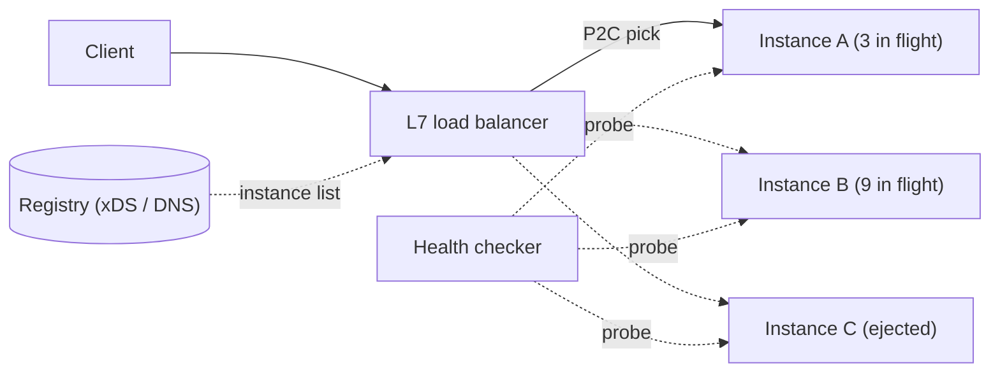

#### Numbers

Throw `n` requests at `n` servers. Random placement gives a most-loaded server roughly `ln n / ln ln n` requests. Picking the better of two random servers drops that to roughly `ln ln n / ln 2`. For `n = 1,000,000`: random gives about `13.8 / 2.6 ≈ 5.3`; two choices gives about `2.6 / 0.69 ≈ 3.8`, and the gap widens under sustained load. Going from two choices to three adds only a constant factor, which is why two is the default.

For consistent hashing with `n = 20` instances, adding a 21st moves roughly `1/21 ≈ 5%` of keys. A naive `hash mod n` moves about 95%.

#### Where it's used

Envoy's `LEAST_REQUEST` policy uses P2C by default (`choice_count: 2`). NGINX offers `random two least_conn`. Google's Maglev is a software L4 balancer that uses its own consistent hashing so connections survive balancer changes. Kubernetes Services do L4 balancing through kube-proxy (iptables or IPVS).

#### Trade-offs and failure modes

- **Stale membership:** DNS TTLs and client caches keep sending traffic to dead instances. Pair discovery with fast passive ejection.
- **Health checks that cascade:** a deep health check that tests the database fails on every instance at once when the database blips, and the balancer drains the whole fleet. Keep liveness shallow.
- **Sticky hot keys:** consistent hashing concentrates a celebrity key on one instance. Use bounded-load consistent hashing or replicate hot keys.
- **New instances:** least-request floods a freshly started, cold instance. Use slow start (Envoy, NGINX `slow_start`).

Sources: [Mitzenmacher, power of two choices](https://www.eecs.harvard.edu/~michaelm/postscripts/mythesis.pdf), [Maglev (NSDI 2016)](https://research.google/pubs/maglev-a-fast-and-reliable-software-network-load-balancer/), [Envoy load balancers](https://www.envoyproxy.io/docs/envoy/latest/intro/arch_overview/upstream/load_balancing/load_balancers).

### Stateless serving and autoscaling

**What it is.** Request handlers keep no client state in local memory or disk between requests, so any instance can serve any request and you can add or remove instances freely. Autoscaling adjusts the instance count to load.

#### How it works

Session data, uploads and caches live in shared stores (Redis, a database, object storage), never on the instance. Then the fleet becomes a pool you size with a control loop.

**Target tracking** is the common policy: pick a metric and a target (CPU at 60%, or 100 in-flight requests per instance) and let the controller hold it. Kubernetes' Horizontal Pod Autoscaler computes:

```
desiredReplicas = ceil(currentReplicas × currentMetric / targetMetric)
```

It ignores changes within a 10% tolerance and, by default, waits for a 5-minute downscale stabilization window so it does not flap. Scaling on a leading indicator (queue depth, in-flight requests) reacts faster than CPU, which lags.

**Cold starts** are the gap between "scale-out decided" and "new instance serving": node provisioning, image pull, runtime start, JIT warm-up, cache fill. Serverless platforms such as AWS Lambda show the same effect per invocation. You mitigate with headroom, pre-warmed (provisioned) capacity, smaller images and readiness probes that gate traffic until warm-up finishes.

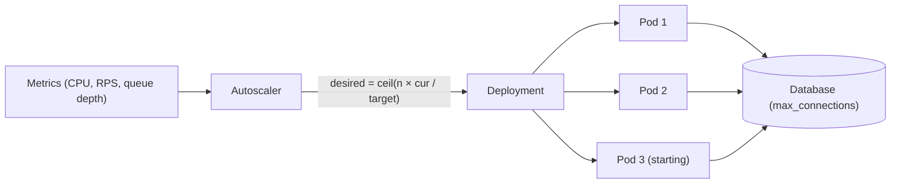

#### Numbers

**Sizing:** at 6,000 requests per second with each instance comfortable at 400 RPS, you need `6,000 / 400 = 15` instances. With a 60% utilization target to absorb spikes and cold-start delay, run `15 / 0.6 = 25`.

**Connection-pool multiplication:** each instance opens its own database pool. 25 instances × 20 connections = 500 connections. Scale out to 100 instances for a spike and you ask for 2,000. PostgreSQL's default `max_connections` is 100, and each backend is a separate process with its own memory. Autoscaling the stateless tier can knock over the stateful tier it depends on. Size pools with Little's Law (see [batching and connection pooling](tutorials/infrastructure-building-blocks/#batching-and-connection-pooling)) and put a pooler such as PgBouncer in front.

**Headroom during cold start:** if traffic grows 10% per minute and a new instance takes 3 minutes to serve, you need at least `1.1³ − 1 ≈ 33%` spare capacity to ride out the gap.

#### Where it's used

Kubernetes HPA, AWS Auto Scaling target tracking, Google Cloud Run and AWS Lambda (concurrency-based). The Twelve-Factor App's "processes are stateless and share-nothing" rule is the usual statement of the stateless part.

#### Trade-offs and failure modes

- Scaling the handler tier does not scale its database, cache or third-party quota. The bottleneck moves downstream.
- Scaling on CPU misses I/O-bound overload; scaling on latency can scale out in response to a slow dependency, which makes things worse.
- Scale-in kills instances mid-request unless you drain connections (`preStop` hook, deregistration delay).
- "Stateless" handlers often hide state: in-memory rate-limit counters, local caches, WebSocket connections.

Sources: [Kubernetes HPA algorithm](https://kubernetes.io/docs/tasks/run-application/horizontal-pod-autoscale/), [AWS target tracking](https://docs.aws.amazon.com/autoscaling/ec2/userguide/as-scaling-target-tracking.html), [The Twelve-Factor App: processes](https://12factor.net/processes).

### API gateway and routing

**What it is.** An API gateway is a reverse proxy at the edge of your system. It gives clients one stable API and routes each request to the right backend, while applying cross-cutting policy: TLS termination, authentication, rate limits, request size limits and logging.

#### How it works

A gateway matches each request against an ordered route table and forwards it to a backend cluster. The three routing styles from the overview:

| Style | Example | Good for | Cost |
|---|---|---|---|
| Hostname | `orders.api.example.com` | Clear ownership, independent certs and DNS | More DNS records, certificates, CORS setup |
| Path | `api.example.com/orders/*` | One origin, simple for clients | Shared route config, larger blast radius |
| Header | `X-Api-Version: 2`, canary cookie | Versions, experiments, canaries without URL changes | Harder to debug; caches must vary on the header |

Typical gateway pipeline: terminate TLS, authenticate (validate a JWT or call an auth service), apply rate limits, match the route, rewrite the path, forward with a timeout, and record metrics. Routing chooses a destination; it never authorizes the caller. Each backend still checks permissions.

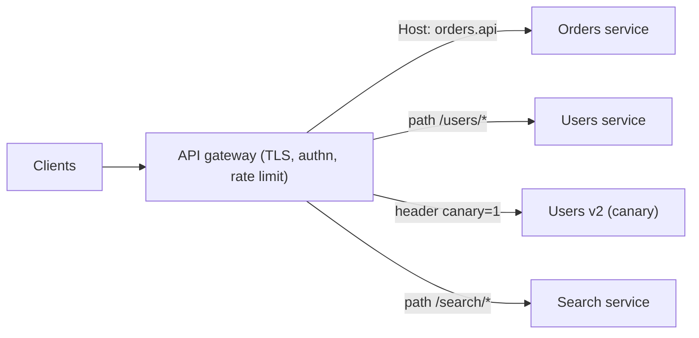

#### Numbers

A gateway adds one network hop and some processing. In-region proxies such as Envoy typically add well under a millisecond to a few milliseconds at the median; JWT signature checks and external auth calls add more. The bigger number is the blast radius: if the gateway fronts 40 services, its availability caps all of them. A 99.95% gateway in series with a 99.9% service gives at best `0.9995 × 0.999 ≈ 99.85%`.

#### Where it's used

Netflix built Zuul as its edge gateway; Zuul 2 moved to asynchronous, non-blocking I/O to handle many connections. Amazon API Gateway, Kong, Envoy Gateway and NGINX are common choices. The Kubernetes Gateway API standardizes `HTTPRoute` matches on hostname, path and headers.

#### Trade-offs and failure modes

- **Shared bottleneck and failure domain:** a bad route config or a gateway overload takes everything down. Roll config out gradually and validate it.
- **Business logic creep:** request aggregation and per-product rules turn the gateway into a monolith nobody owns. Put client-specific composition in a backend for frontend instead (see [chapter 5](tutorials/architectural-patterns/)).
- **Trusting headers:** an `X-User-Id` header the gateway sets must be stripped from incoming client requests, or anyone can forge it.
- **Timeouts:** the gateway timeout must exceed the backend's, or the gateway gives up while the backend is still working.

Sources: [AWS hostname](https://docs.aws.amazon.com/prescriptive-guidance/latest/cloud-design-patterns/api-routing-hostname.html), [path](https://docs.aws.amazon.com/prescriptive-guidance/latest/cloud-design-patterns/api-routing-path.html) and [header](https://docs.aws.amazon.com/prescriptive-guidance/latest/cloud-design-patterns/api-routing-http-header.html) routing, [Netflix Zuul 2](https://netflixtechblog.com/zuul-2-the-netflix-journey-to-asynchronous-non-blocking-systems-45947377fb5c).

### Retry with backoff and jitter

**What it is.** When a call fails with a transient error, you wait and try again. Backoff makes the wait grow after each failure; jitter randomizes it so many clients don't retry in lockstep.

#### How it works

Only retry what is safe and likely to help: timeouts, connection resets, 503, 429. Never retry 400-class validation errors. Only retry mutations that are idempotent or carry an idempotency key.

Exponential backoff: `sleep = min(cap, base × 2^attempt)`. Without jitter, every client that failed at the same moment retries at the same moment, producing synchronized spikes. Marc Brooker's AWS analysis compared three jitter variants:

```python
def full_jitter(attempt):        # spread across the whole window
    return random.uniform(0, min(cap, base * 2 ** attempt))

def equal_jitter(attempt):       # keep half, randomize half
    t = min(cap, base * 2 ** attempt)
    return t / 2 + random.uniform(0, t / 2)

def decorrelated_jitter(prev):   # grow from the previous sleep
    return min(cap, random.uniform(base, prev * 3))
```

Full jitter and decorrelated jitter finished the work with the least total load; equal jitter was slightly worse; no jitter was much worse.

**Retry budgets** cap retries as a fraction of traffic instead of per request. Google's SRE book recommends limiting retries per request (at most 3 attempts) and keeping a per-client retry ratio of 10%, so retries add at most 10% load when the dependency is down. Envoy's retry budget allows active retries up to 20% of active requests by default.

**Deadlines** bound the whole thing: stop retrying when the caller's remaining deadline is too short for another attempt.

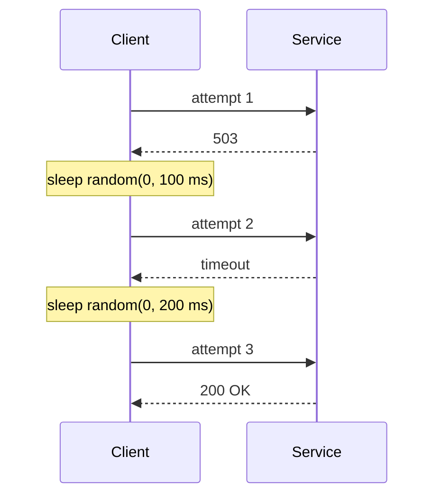

#### Numbers

**Amplification.** If each of `n` layers makes up to `a` attempts, the bottom layer sees up to `aⁿ` calls per user request. With 3 attempts at each of 5 layers: `3⁵ = 243` calls. Retry at one layer (usually the one closest to the caller who knows the deadline) and fail fast below it.

**Budget effect.** With a 10% retry budget and a fully failing dependency, load is `1.1×` normal instead of `3×` with naive 3-attempt retries.

**When retries help.** If failures are independent with probability `p`, success after `k` attempts is `1 − pᵏ`. With `p = 0.01` and 3 attempts, failure drops to `10⁻⁶`. When `p` is high because the dependency is overloaded, failures are correlated and retries only add load.

#### Where it's used

AWS SDKs implement exponential backoff with jitter and a client-side retry quota (token bucket). gRPC has a retry policy with `maxAttempts` and backoff settings plus retry throttling. Envoy, Istio and Linkerd provide proxy-level retries with budgets.

#### Trade-offs and failure modes

- Retries repeat side effects unless the operation is idempotent.
- Retries at every layer multiply load exactly when the system is weakest; this turns a brief overload into a sustained one (a "retry storm").
- Retrying a request whose deadline has passed is pure waste.
- Backoff hides problems: alert on retry rate, not only on final errors.

Sources: [AWS Builders' Library: timeouts, retries and backoff with jitter](https://aws.amazon.com/builders-library/timeouts-retries-and-backoff-with-jitter/), [Exponential backoff and jitter](https://aws.amazon.com/blogs/architecture/exponential-backoff-and-jitter/), [Google SRE: addressing cascading failures](https://sre.google/sre-book/addressing-cascading-failures/).

### Circuit breaker

**What it is.** A circuit breaker wraps calls to a dependency and stops making them for a while once they keep failing. The caller fails fast or uses a fallback instead of tying up threads and adding load to a dependency that is already struggling.

#### How it works

The breaker is a state machine:

- **Closed:** calls pass through. The breaker tracks failures over a rolling window.
- **Open:** once the failure rate passes a threshold (with a minimum request volume), calls fail immediately without touching the dependency.
- **Half-open:** after a sleep window, a few trial calls go through. If they succeed, close; if they fail, open again.

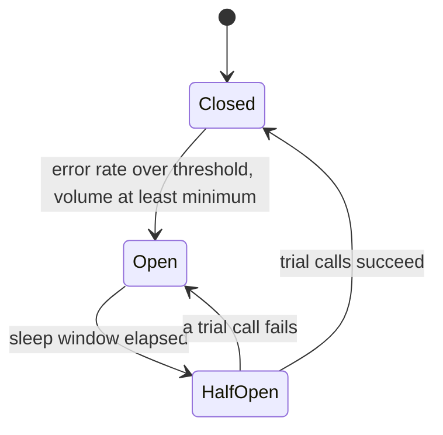

Knobs, using Netflix Hystrix's defaults as a reference:

| Setting | Hystrix default | Meaning |
|---|---|---|
| `requestVolumeThreshold` | 20 | Minimum calls in the window before the breaker can trip |
| `errorThresholdPercentage` | 50 | Failure rate that opens the circuit |
| `sleepWindowInMilliseconds` | 5,000 | Time spent open before a trial |
| `metrics.rollingStats.timeInMilliseconds` | 10,000 | Length of the rolling window |

Count timeouts as failures. A dependency that hangs is worse than one that errors, because it holds your threads.

#### Numbers

Suppose a service handles 500 RPS, calls a dependency with a 2 s timeout, and the dependency starts hanging. Without a breaker, by Little's Law you have `500 × 2 = 1,000` requests stuck waiting. With a 200-thread pool, you are out of threads in under half a second. With a breaker that opens after 20 calls at 50% failure, it trips within the first fraction of a second, and from then on only one trial call every 5 s reaches the dependency.

#### Where it's used

Netflix Hystrix popularized the pattern; it has been in maintenance mode since 2018, and Netflix pointed users to Resilience4j. Envoy implements a different flavor: its "circuit breakers" are concurrency limits (max connections, pending requests, requests, retries), and its outlier detection ejects individual failing hosts. Polly (.NET) and Resilience4j (Java) provide classic three-state breakers.

#### Trade-offs and failure modes

- **False trips:** a few bad calls in a low-volume window can open the circuit. That's why there is a minimum volume.
- **Per-host vs per-service:** one breaker for the whole service opens even if only one replica is bad. Outlier ejection per host is often the better tool.
- **It does not limit concurrency.** While closed, a slow dependency can still exhaust your threads. Pair it with a bulkhead.
- **It does not repair anything.** It only buys the dependency time to recover, and the fallback must be a real product decision.

Sources: [AWS circuit breaker pattern](https://docs.aws.amazon.com/prescriptive-guidance/latest/cloud-design-patterns/circuit-breaker.html), [Fowler: CircuitBreaker](https://martinfowler.com/bliki/CircuitBreaker.html), [Hystrix configuration](https://github.com/Netflix/Hystrix/wiki/Configuration), [Envoy circuit breaking](https://www.envoyproxy.io/docs/envoy/latest/intro/arch_overview/upstream/circuit_breaking).

### Bulkheads

**What it is.** A bulkhead splits capacity into isolated pools so one slow dependency, endpoint or tenant can exhaust only its own pool, not the whole service. The name comes from the watertight compartments in a ship's hull.

#### How it works

The unit of isolation varies:

- **Per dependency:** a separate thread pool or semaphore per downstream call. Hystrix's thread-pool isolation gave each dependency a pool (10 threads by default).
- **Per endpoint or priority:** separate worker pools for critical traffic (checkout) and best-effort traffic (recommendations).
- **Per tenant:** quotas or dedicated capacity so one noisy customer cannot starve others.
- **Per deployment:** separate clusters, cells or shards. **Shuffle sharding** assigns each customer a random small subset of workers, so two customers rarely share all of theirs.

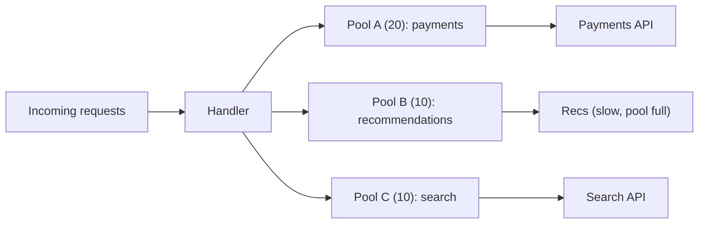

#### Numbers

**Pool sizing** comes from Little's Law: concurrency needed = arrival rate × latency. A dependency called at 200 RPS with a 50 ms p99 needs about `200 × 0.05 = 10` concurrent slots. Give it 15 for headroom. If that dependency slows to 2 s, the pool caps it at 15 in flight, and everything else keeps its capacity.

**Shuffle sharding:** with 8 workers and 2 per customer, there are `C(8,2) = 28` distinct shards. A poison customer that kills its 2 workers fully takes out only customers who share exactly the same pair, roughly `1/28` of them. With 100 workers and 5 per customer there are about 75 million combinations.

#### Where it's used

Hystrix thread pools and semaphores, Resilience4j `Bulkhead`, Envoy per-cluster connection and request limits, and AWS's use of shuffle sharding in Route 53 and other services, described in the Builders' Library.

#### Trade-offs and failure modes

- **Stranded capacity:** a full pool rejects work while other pools sit idle. More pools means more wasted headroom.
- **Quota upkeep:** limits must track real traffic or they become either useless or the cause of outages.
- **Shared layers below:** separate thread pools do not help if every pool shares one database connection pool or one CPU.

Sources: [Azure bulkhead pattern](https://learn.microsoft.com/en-us/azure/architecture/patterns/bulkhead), [AWS Builders' Library: shuffle sharding](https://aws.amazon.com/builders-library/workload-isolation-using-shuffle-sharding/), [Hystrix: how it works](https://github.com/Netflix/Hystrix/wiki/How-it-Works).

### Rate limits and load shedding

**What it is.** A rate limit caps how much traffic a client, tenant or key may send. Load shedding rejects work when the server itself is overloaded, whoever sent it. Both turn overload into fast, explicit rejections instead of slow failures for everyone.

#### How it works

**Rate limiting** usually uses a token bucket (capacity `B`, refill rate `r`): each request takes a token; an empty bucket means reject. Sliding-window counters are the other common choice. Distributed limiters keep counters in Redis or use local limits with periodic sync. The [token bucket primitive](tutorials/low-level-primitives/) is covered in chapter 3.

**Load shedding** reacts to the server's own state: in-flight requests, queue time, CPU. Techniques:

- **Priority shedding:** drop best-effort traffic first, then batch, then interactive, then critical.
- **CoDel-style queue control:** if the queue has not been empty recently, apply a short queue timeout so requests that waited too long are dropped. Facebook reports that M = 5 ms (timeout under standing queue) and N = 100 ms (normal timeout) worked well across many services.
- **Adaptive LIFO:** serve the newest requests first while a backlog exists. The oldest requests are the ones whose clients have likely given up already.
- **Client-side adaptive throttling:** Google's clients track `requests` and `accepts` over two minutes and reject locally with probability `max(0, (requests − K × accepts) / (requests + 1))`, with `K = 2` typical.

Rejected requests get **HTTP 429** (rate limited) or **503** (overloaded), ideally with a **`Retry-After`** header so well-behaved clients back off.

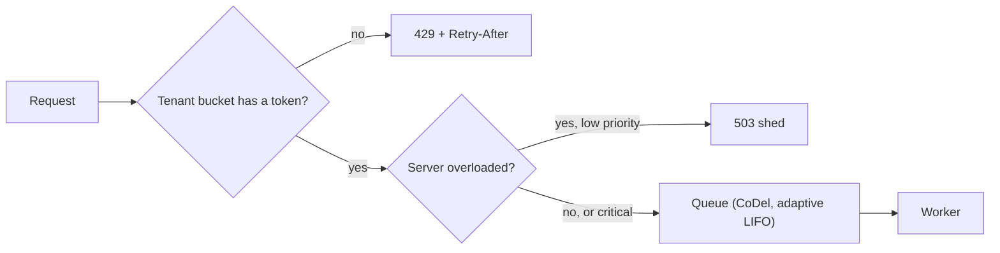

#### Numbers

**Token bucket:** `B = 100`, `r = 10/s` allows a burst of 100, then 10 per second sustained. Over a minute a client gets at most `100 + 600 = 700`.

**Why shedding matters:** a server's goodput collapses past saturation, because it spends work on requests that will time out anyway. If clients time out at 1 s and a server handles 1,000 RPS, any queue longer than about 1,000 requests means everything it serves is already dead. Bounding queue time to 100 ms keeps served requests useful.

**Adaptive throttling example:** if a backend accepts 50 of 200 requests per second, `(200 − 2 × 50) / 201 ≈ 50%` of requests are rejected locally, without crossing the network.

#### Where it's used

Stripe described four limiters in production: a per-user request-rate limiter, a concurrent-request limiter, a fleet-usage load shedder that reserves capacity for critical requests, and a worker-utilization shedder. GitHub's REST API allows 5,000 requests per hour for authenticated users. Facebook's "Fail at Scale" describes CoDel and adaptive LIFO. The Google SRE book describes client-side throttling and criticality levels.

#### Trade-offs and failure modes

- Rejections need product behavior: the client must show something sensible or retry later.
- Queues and retries can bypass limits; a retry storm still counts as load.
- Global limits need coordination; per-node limits drift when the fleet resizes.
- LIFO is unfair to old requests; that's the point, but don't use it where order matters.

Sources: [Google SRE: handling overload](https://sre.google/sre-book/handling-overload/), [Stripe: scaling your API with rate limiters](https://stripe.com/blog/rate-limiters), [Fail at Scale (ACM Queue)](https://queue.acm.org/detail.cfm?id=2839461), [RFC 6585: 429](https://www.rfc-editor.org/rfc/rfc6585).

### Graceful degradation

**What it is.** When a dependency fails or the system is overloaded, you keep the core experience working by turning off, simplifying or serving stale versions of optional features.

#### How it works

First classify every dependency of a request as **required** (checkout needs payment authorization) or **optional** (checkout page shows "you might also like"). For each optional one, define a fallback:

| Fallback | Example |
|---|---|
| Static default | Show top-sellers instead of personalized picks |
| Stale data | Serve the last cached price list with a "may be out of date" note |
| Reduced fidelity | Lower video bitrate, fewer search results, no thumbnails |
| Hide the feature | Omit the reviews widget |
| Defer the work | Accept the order, send the confirmation email later |

Degradation is triggered by a timeout or open circuit on one call, or by a global **brownout switch** (feature flags) that operators or an automatic controller flip under load.

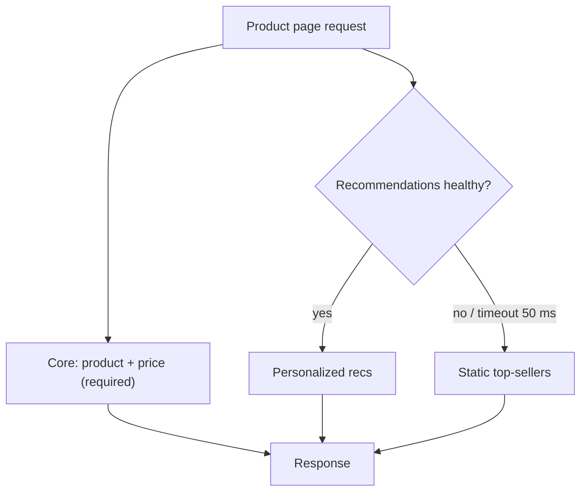

#### Numbers

A page that waits on 10 optional calls, each available 99.9% of the time, would be fully available only `0.999¹⁰ ≈ 99.0%` of the time if each one were required. Making them optional, with a fallback and a tight timeout, puts the page's availability back at that of its required path. Timeouts on optional calls should be short, often a small fraction of the page's latency budget, because waiting for an optional result costs every user.

#### Where it's used

Netflix's API used Hystrix fallbacks such as returning a default, unpersonalized response when a personalization call failed, instead of an error. AWS's Builders' Library article "Avoiding fallback in distributed systems" argues the other side: fallback paths are rarely exercised and can fail or overload in surprising ways, so Amazon often prefers making the primary path more reliable, or pushing data proactively so the "fallback" is the normal path.

#### Trade-offs and failure modes

- **Never fake success for a required operation.** Showing "order placed" when payment authorization failed is a correctness bug.
- Untested fallbacks fail exactly when you need them. Exercise them in game days or with chaos experiments.
- A fallback that calls another service can create a new overload (everyone falls back to the same cache at once).

Sources: [AWS Builders' Library: avoiding fallback](https://aws.amazon.com/builders-library/avoiding-fallback-in-distributed-systems/), [Google SRE: addressing cascading failures](https://sre.google/sre-book/addressing-cascading-failures/), [Netflix: fault tolerance in a high-volume distributed system](https://netflixtechblog.com/fault-tolerance-in-a-high-volume-distributed-system-91ab4faae74a).

### Hedged requests

**What it is.** A hedged request sends a duplicate of a slow request to another replica and uses whichever answer comes first. It trades a little extra load for a large cut in tail latency.

#### How it works

Send the request to one replica. If no reply arrives within a delay, usually the **p95 latency** for that request type, send a second copy to another replica. Take the first response and cancel the other. Because only about 5% of requests are slow enough to be hedged, extra load stays around 5% or less.

**Tied requests** go further: send to two replicas at once, each tagged with the other's identity. When one server starts executing, it tells the other to cancel. This attacks queueing delay with almost no duplicate work, as long as the cancel message arrives before both start. The paper suggests delaying the second send by about twice the average network message delay (1 ms or less inside a data center) to reduce the chance that both start at once.

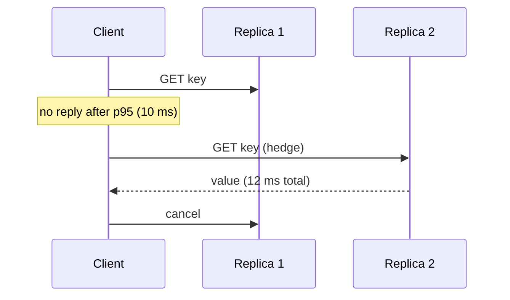

#### Numbers

**Fan-out makes tails common.** If one server is slow 1% of the time and a request fans out to 100 servers, the request is slow with probability `1 − 0.99¹⁰⁰ ≈ 63%`.

**Hedging cuts the tail.** Google's *The Tail at Scale* reports a Bigtable benchmark reading 1,000 keys spread over 100 servers: hedging after 10 ms cut the 99.9th-percentile latency from 1,800 ms to 74 ms while sending only 2% more requests.

**Why it works:** if slowness is independent across replicas with probability `p`, a hedged request is slow only if both copies are slow: about `p²`. With `p = 1%`, that's 0.01%.

#### Where it's used

Google uses hedged and tied requests in Bigtable and other systems described in *The Tail at Scale*. gRPC supports a `hedgingPolicy` with `maxAttempts` and `hedgingDelay`. Envoy can hedge on per-try timeout (`hedge_on_per_try_timeout`). Cassandra's speculative retry (`speculative_retry = 99p`) and DynamoDB client libraries apply the same idea.

#### Trade-offs and failure modes

- **Not for unsafe mutations.** Both copies may execute. Hedge only reads or idempotent writes.
- **Not for an overloaded dependency.** If slowness comes from global overload, hedging adds load where there is none to spare. Cap hedging with a budget.
- **Correlated slowness defeats it.** If all replicas share the slow disk or the same GC trigger, the hedge is slow too.
- Hedging hides the root cause of tail latency; keep measuring un-hedged latency per replica.

Sources: [Dean and Barroso, The Tail at Scale](https://research.google/pubs/the-tail-at-scale/), [gRPC request hedging](https://github.com/grpc/proposal/blob/master/A6-client-retries.md), [Envoy HTTP routing (retries and hedging)](https://www.envoyproxy.io/docs/envoy/latest/intro/arch_overview/http/http_routing).

## Messaging and execution

These patterns move work out of the request path and make it survive crashes. They differ in who receives a message, how long it is kept, and what happens when processing fails. Almost all of them deliver **at least once**, so duplicates are normal, not exceptional.

| Model | Each message goes to | Kept after consumption? | Typical product |
|---|---|---|---|
| Work queue | One worker | No (deleted on ack) | SQS, RabbitMQ queue, Sidekiq |
| Pub/sub | Every subscription | Per subscription, until acked | SNS, Google Pub/Sub |
| Retained log | Every consumer group, each at its own offset | Yes, until retention expires | Kafka, Kinesis, Pulsar |

### Work queue and competing consumers

**What it is.** Producers put jobs on a queue; a pool of workers pulls from it, and each job is processed by one worker. Adding workers adds throughput, and the queue absorbs bursts.

#### How it works

A worker **receives** a message, which makes it invisible to other workers for a **visibility timeout** (a lease). If the worker finishes, it **deletes** (acks) the message. If it crashes or the lease expires, the message becomes visible again and another worker gets it. That is why delivery is at least once and handlers must be idempotent.

Key knobs, using Amazon SQS:

| Knob | SQS value | Purpose |
|---|---|---|
| Visibility timeout | 30 s default, up to 12 h | Lease length; extend it with `ChangeMessageVisibility` for long jobs |
| Long polling | `WaitTimeSeconds` up to 20 s | Fewer empty receives |
| Retention | 4 days default, 1 min to 14 days | How long unconsumed messages live |
| `maxReceiveCount` | You choose | Moves a message to a DLQ after N failed receives |
| FIFO queues | Ordered per message group | Ordering and dedup within a 5-minute window |

You can also build a queue on a database: `SELECT ... FOR UPDATE SKIP LOCKED` in PostgreSQL lets many workers claim different rows without blocking each other.

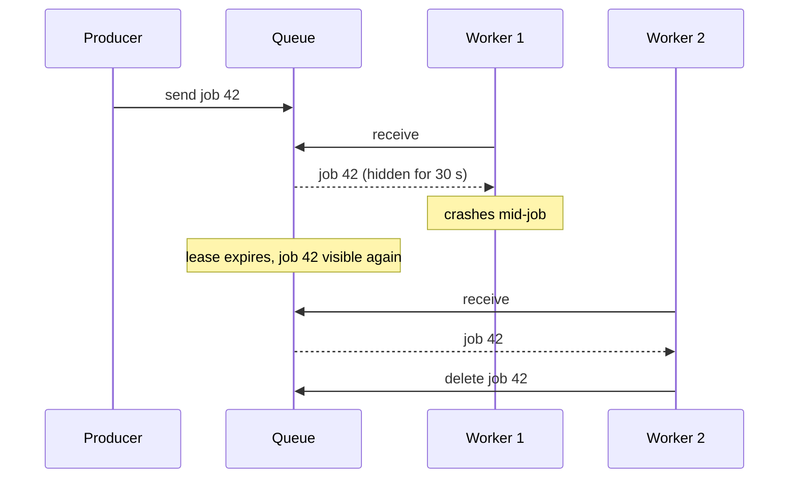

#### Numbers

**Workers needed (Little's Law):** concurrent jobs `L = λ × W`. At 500 jobs/s and 200 ms per job, you need `500 × 0.2 = 100` jobs in flight, for example 25 workers × 4 threads. Plan for 30–50% headroom.

**Backlog drain time:** a backlog `B` drains at `(μ − λ)`, capacity minus arrivals. 1.2 M jobs, 600/s capacity, 500/s arrivals: `1,200,000 / 100 = 12,000 s ≈ 3.3 hours`. Small headroom means slow recovery.

**Visibility timeout** should exceed the p99.9 processing time, or slow jobs run twice; but a long timeout delays retry after a crash.

#### Where it's used

Amazon SQS, RabbitMQ, Google Cloud Tasks, Celery, Sidekiq (Redis), and PostgreSQL-backed queues such as Que and Oban that use `SKIP LOCKED`.

#### Trade-offs and failure modes

- **Redelivery:** crashes and expired leases cause duplicates. Make handlers idempotent (see [inbox](tutorials/infrastructure-building-blocks/#inbox-and-idempotent-consumer)).
- **Poison jobs** fail forever and block capacity until a DLQ catches them.
- **No ordering** across workers in a standard queue.
- **More workers do not help a saturated downstream.** If every job writes to the same database, 10× workers gives 10× database load.

Sources: [SQS visibility timeout](https://docs.aws.amazon.com/AWSSimpleQueueService/latest/SQSDeveloperGuide/sqs-visibility-timeout.html), [Competing consumers pattern](https://learn.microsoft.com/en-us/azure/architecture/patterns/competing-consumers), [PostgreSQL SKIP LOCKED](https://www.postgresql.org/docs/current/sql-select.html#SQL-FOR-UPDATE-SHARE).

### Publish-subscribe

**What it is.** A publisher sends a message to a topic without knowing who listens. Every subscription receives its own copy, so several independent consumers can react to one fact.

#### How it works

The broker keeps a list of subscriptions per topic. When a message arrives, it fans out a copy to each subscription. Each subscription then behaves like its own queue: subscribers ack messages, and unacked messages are redelivered after an ack deadline. Subscriptions can filter by message attributes so a consumer gets only what it needs.

A common AWS shape is **SNS fan-out to SQS**: the topic pushes to one SQS queue per consuming service, and each service runs competing consumers on its own queue. A slow consumer then builds a backlog in its own queue without affecting the others.

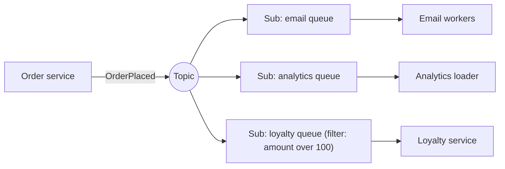

#### Numbers

**Fan-out cost:** `messages delivered = published × subscriptions`. 2,000 events/s to 6 subscriptions is 12,000 deliveries/s; at 2 KB each, about 24 MB/s of egress. Pay attention to per-message pricing.

**Subscriber lag:** a subscriber processing `μ = 800/s` while the topic publishes `λ = 1,000/s` falls behind by 200/s, or 720,000 messages an hour. Retention bounds how long it can fall behind before losing data (Google Pub/Sub keeps unacked messages for 7 days by default).

#### Where it's used

Amazon SNS (often fanning out to SQS), Google Cloud Pub/Sub (ack deadline 10 s by default, extendable to 600 s), Azure Service Bus topics, RabbitMQ fanout and topic exchanges, Redis Pub/Sub (fire-and-forget, no persistence).

#### Trade-offs and failure modes

- **Subscriber lag is invisible to the publisher.** Monitor oldest-unacked age per subscription.
- **Duplicates** and, in most brokers, no ordering guarantee unless you use ordering keys.
- **Schema evolution:** the publisher no longer knows every consumer, so breaking a field breaks someone you didn't know about. Use a schema registry and additive changes.
- **A new subscriber starts from now.** Pub/sub usually cannot replay history to a late joiner; a retained log can.

Sources: [AWS publish-subscribe pattern](https://docs.aws.amazon.com/prescriptive-guidance/latest/cloud-design-patterns/publish-subscribe.html), [Amazon SNS fan-out to SQS](https://docs.aws.amazon.com/sns/latest/dg/sns-sqs-as-subscriber.html), [Google Pub/Sub subscriber overview](https://cloud.google.com/pubsub/docs/subscription-overview).

### Retained partitioned log

**What it is.** A topic is an append-only log split into partitions, kept for a retention period whether or not anyone has read it. Each consumer tracks its own position (offset), so many independent readers can read and re-read the same stream.

#### How it works

- **Partitions:** a topic has `P` partitions. A producer chooses the partition by hashing the message key, so all events for one key land in one partition, in order. Ordering holds only within a partition.
- **Offsets:** each record in a partition has a sequential offset. A consumer commits the offset it has processed (Kafka stores commits in the internal `__consumer_offsets` topic) and resumes from it after a restart.
- **Consumer groups:** within a group, each partition is assigned to exactly one consumer; different groups read independently. A group can have at most `P` active consumers. Adding or removing a consumer triggers a **rebalance**.
- **Replication:** each partition has a leader and followers; with `acks=all` and `min.insync.replicas=2`, a write is acknowledged once the in-sync replicas have it.
- **Retention:** delete segments older than a time or size limit (Kafka's default is 7 days), or use **log compaction**, which keeps at least the latest value per key forever. Compacted topics act as a durable changelog for state.

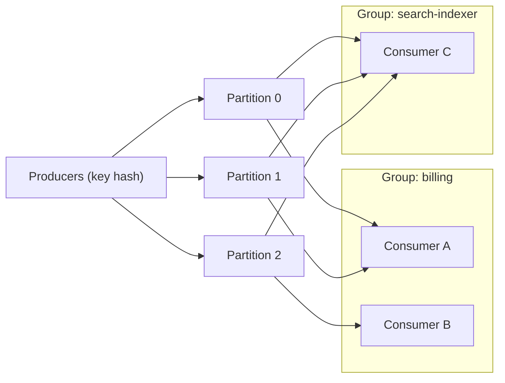

#### Numbers

**Partitions needed:** `P = max(T / p, T / c)`, where `T` is target throughput, `p` is per-partition producer throughput and `c` is per-partition consumer throughput. Target 300 MB/s, producers manage 10 MB/s per partition, consumers 20 MB/s: `max(30, 15) = 30` partitions. Add headroom for growth, since adding partitions later changes key-to-partition mapping and breaks per-key ordering for existing keys.

**Storage:** `ingress × retention × replication factor`. 50 MB/s × 7 days × 3 replicas = `50 × 604,800 × 3 ≈ 90 TB`.

**Consumer lag in time:** lag of 3 M records at 10,000 records/s of spare consumer capacity takes 300 s to clear.

#### Where it's used

Apache Kafka (originally at LinkedIn), Amazon Kinesis Data Streams (1 MB/s or 1,000 records/s write per shard), Apache Pulsar, Redpanda, Azure Event Hubs. Kafka Streams uses compacted changelog topics to back up local state stores.

#### Trade-offs and failure modes

- **Ordering is per partition only**, and a hot key overloads one partition.
- **Rebalances** pause consumption; use cooperative rebalancing and static membership to limit them.
- **Retention is a contract:** a consumer down longer than retention loses data silently.
- **Exactly-once is scoped.** Kafka transactions give exactly-once from Kafka to Kafka; effects in your database or an email API still need idempotency.
- Head-of-line blocking: one slow record stalls its whole partition for that group.

Sources: [Kafka design](https://kafka.apache.org/documentation/#design), [Kafka log compaction](https://kafka.apache.org/documentation/#compaction), [Confluent: how to choose the number of partitions](https://www.confluent.io/blog/how-choose-number-topics-partitions-kafka-cluster/), [Jay Kreps: The Log](https://web.archive.org/web/20240105095933/https://engineering.linkedin.com/distributed-systems/log-what-every-software-engineer-should-know-about-real-time-datas-unifying).

### Change data capture

**What it is.** Change data capture (CDC) turns every committed insert, update and delete in a database into an event stream, so other systems (search, caches, analytics, other services) can follow the data without the application writing twice.

#### How it works

Two approaches:

| | Log-based CDC | Polling (query-based) |
|---|---|---|
| Reads | The database's replication log: PostgreSQL WAL via logical decoding, MySQL binlog, MongoDB oplog | `SELECT ... WHERE updated_at > :last_seen` |
| Captures deletes | Yes | Only with soft deletes |
| Captures every change | Yes, in commit order | No, only the latest state at poll time |
| Load on source | Low | Repeated queries |
| Latency | Sub-second typical | Poll interval |
| Setup | Replication privileges, slots, binlog format | Just SQL |

**Bootstrap:** a new consumer needs the existing data plus all changes. The naive "copy the table, then start streaming" loses changes made during the copy. Correct approaches either record the log position before taking a consistent snapshot and stream from that position, or interleave chunked snapshot reads with the live stream using watermarks (Netflix's DBLog algorithm, which Debezium adopted for incremental snapshots).

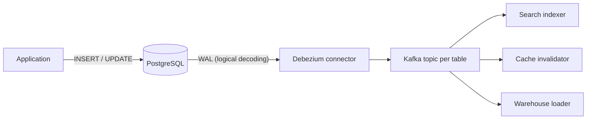

#### Numbers

**WAL retention risk:** a PostgreSQL replication slot keeps WAL until the consumer confirms it. If the connector is down for 6 hours on a database writing 20 MB/s of WAL, the primary retains `20 × 21,600 ≈ 430 GB` of extra WAL. Without a cap (`max_slot_wal_keep_size`), that can fill the disk and stop the primary.

**Event volume:** CDC emits one event per changed row, not per business action. A bulk `UPDATE` touching 5 M rows emits 5 M events.

#### Where it's used

Debezium (PostgreSQL, MySQL, MongoDB, SQL Server and more, on Kafka Connect), AWS DMS, Google Datastream, DynamoDB Streams, MongoDB change streams. LinkedIn's Databus and Netflix's DBLog are well-documented in-house systems.

#### Trade-offs and failure modes

- **Schema coupling:** consumers depend on your table layout. Renaming a column breaks them. Publishing through an outbox decouples the event contract from tables.
- **Row changes do not express intent.** "status changed from 2 to 5" is not "OrderCancelled because of fraud".
- Transactions spanning tables arrive as separate row events; consumers must regroup them if they care.
- Log retention, failover (replication slots historically did not survive PostgreSQL failover without extra tooling) and initial snapshots are operational work.

Sources: [Debezium architecture](https://debezium.io/documentation/reference/stable/architecture.html), [Netflix DBLog](https://netflixtechblog.com/dblog-a-generic-change-data-capture-framework-69351fb9099b), [PostgreSQL logical decoding](https://www.postgresql.org/docs/current/logicaldecoding-explanation.html).

### Transactional outbox

**What it is.** The service writes its business change and an "event to publish" row in the same local database transaction. A separate relay later reads the outbox and publishes to the broker. This closes the dual-write gap where the database commit succeeds but the publish fails (or the reverse).

#### How it works

```sql
BEGIN;
  UPDATE orders SET status = 'PAID' WHERE id = 42;
  INSERT INTO outbox (id, aggregate_id, type, payload, created_at)
  VALUES (gen_random_uuid(), 42, 'OrderPaid', '{...}', now());
COMMIT;
```

Two relay styles:

- **Polling relay:** a loop selects unsent rows in order, publishes them, then marks them sent or deletes them.
- **Log-tailing relay:** CDC (for example Debezium's outbox event router) reads outbox inserts from the WAL or binlog and routes them to topics. Lower latency, no polling load, but more infrastructure.

```python
while True:  # polling relay: one active instance, or one per aggregate_id partition
    rows = db.query("""SELECT * FROM outbox WHERE sent_at IS NULL
                       ORDER BY created_at LIMIT 500 FOR UPDATE SKIP LOCKED""")
    for row in rows:
        broker.publish(topic=row.type, key=row.aggregate_id,
                       value=row.payload, headers={"message_id": row.id})
    db.execute("UPDATE outbox SET sent_at = now() WHERE id = ANY(%s)", ids(rows))
    db.commit()
    if not rows:
        sleep(0.2)
```

If the relay crashes after publishing but before marking rows sent, it publishes them again. The outbox therefore gives **at-least-once** delivery; consumers dedupe on `message_id`.

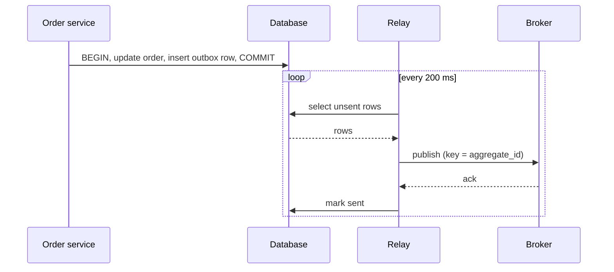

#### Numbers

**Latency:** a polling relay adds on average half the poll interval plus publish time: with 200 ms polls, about 100–150 ms. Log-tailing usually adds tens of milliseconds.

**Polling load:** one indexed query every 200 ms is 5 queries/s per relay, which is negligible. The real cost is table bloat: 2,000 events/s kept for 7 days is about 1.2 billion rows. Delete or partition-drop sent rows quickly.

**Throughput:** a relay that publishes in batches of 500 with a 20 ms broker round trip moves about `500 / 0.02 = 25,000` events/s per relay before database limits.

#### Where it's used

Debezium's outbox event router; Chris Richardson's microservices.io pattern catalog and the Eventuate framework; AWS prescriptive guidance describes it with DynamoDB Streams or relational databases.

#### Trade-offs and failure modes

- **Duplicates:** at least once, always. Consumers need an inbox or idempotent handlers.
- **Ordering:** parallel relays can reorder events. Keep one relay per partition of `aggregate_id`, and publish with the aggregate as the message key.
- **Relay backlog** delays every downstream reaction; alert on the age of the oldest unsent row.
- **Does not commit the consumer's state.** It only guarantees the message eventually leaves, given the relay and broker recover and the row isn't deleted first.

Sources: [microservices.io: transactional outbox](https://microservices.io/patterns/data/transactional-outbox.html), [Debezium outbox event router](https://debezium.io/documentation/reference/stable/transformations/outbox-event-router.html), [AWS transactional outbox](https://docs.aws.amazon.com/prescriptive-guidance/latest/cloud-design-patterns/transactional-outbox.html).

### Inbox and idempotent consumer

**What it is.** An idempotent consumer makes processing the same message twice have the same effect as processing it once. The inbox is the common implementation: record each processed message ID in the same transaction as the state change it caused.

#### How it works

```sql
BEGIN;
  INSERT INTO inbox (consumer, message_id, received_at)
  VALUES ('loyalty', :message_id, now());      -- unique (consumer, message_id)
  -- if this raises a unique violation: ROLLBACK and ack; it's a duplicate
  UPDATE accounts SET points = points + :points WHERE user_id = :user_id;
COMMIT;
-- only now ack the message to the broker
```

Because the dedup record and the effect commit together, a crash anywhere either leaves both or neither. Ack after commit; if the ack is lost, redelivery hits the unique constraint and is skipped.

Alternatives when you can't use a shared transaction:

- **Naturally idempotent writes:** `SET status = 'SHIPPED'` or an upsert keyed by event ID.
- **Version checks:** apply an event only if `event.version > row.version`. This also drops stale out-of-order events.
- **Downstream idempotency keys:** pass the message ID as the `Idempotency-Key` to an external API such as Stripe.

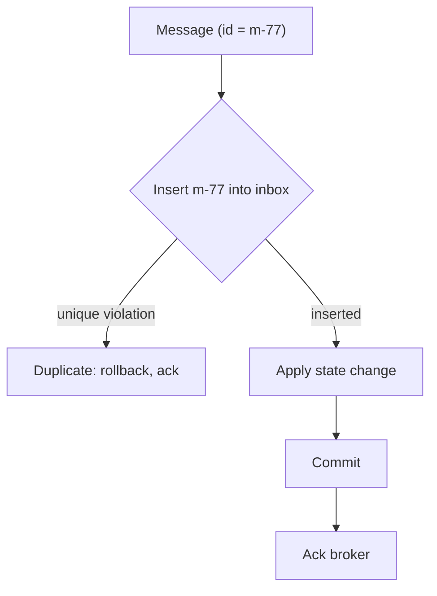

#### Numbers

**Dedup retention:** keep IDs at least as long as the broker can redeliver. With 1,000 messages/s and a 7-day window, the inbox holds about 605 M rows; at roughly 50 bytes per row plus index overhead, that is tens of gigabytes. Partition by day and drop old partitions.

**Cost per message:** one extra indexed insert in a transaction you already run, typically well under a millisecond.

#### Where it's used

The microservices.io idempotent consumer pattern, NServiceBus and MassTransit outbox/inbox features, and Kafka's idempotent producer, which dedupes producer retries inside the broker using producer IDs and sequence numbers. Stripe's API accepts idempotency keys and stores results so retries return the original response.

#### Trade-offs and failure modes

- **The window is finite.** A duplicate that arrives after the ID was purged is processed again.
- **External calls aren't covered.** If the handler sends an email or charges a card, the inbox can't roll that back. Use the external system's idempotency key, or record intent first and send through an outbox.
- **The ID must identify the logical message**, not a delivery attempt. If the publisher generates a new ID on each retry, dedup fails.

Sources: [microservices.io: idempotent consumer](https://microservices.io/patterns/communication-style/idempotent-consumer.html), [AWS Builders' Library: making retries safe with idempotent APIs](https://aws.amazon.com/builders-library/making-retries-safe-with-idempotent-APIs/), [Stripe idempotent requests](https://docs.stripe.com/api/idempotent_requests).

### Dead-letter queue and redrive

**What it is.** A dead-letter queue (DLQ) holds messages that failed processing too many times. It stops one poison message from blocking or wasting a consumer, and keeps it for inspection and replay (redrive) once the bug is fixed.

#### How it works

The broker counts delivery attempts. After `maxReceiveCount` attempts (SQS), `max_delivery_attempts` (Google Pub/Sub dead-letter topics), or when a RabbitMQ message is rejected or expires, the message moves to the DLQ with metadata: original queue, error, attempt count. Kafka has no broker-level DLQ; consumers (or Kafka Connect's `errors.deadletterqueue.topic.name`) publish failed records to a separate topic themselves.

Classify failures before dead-lettering:

| Error | Action |
|---|---|
| Transient (timeout, 503) | Retry with backoff; don't DLQ early |
| Permanent (bad schema, missing entity) | DLQ immediately |
| Bug in consumer | DLQ, fix, redrive |

**Redrive** sends DLQ messages back to the source queue after a fix. SQS supports this natively (`StartMessageMoveTask`) with a rate limit.

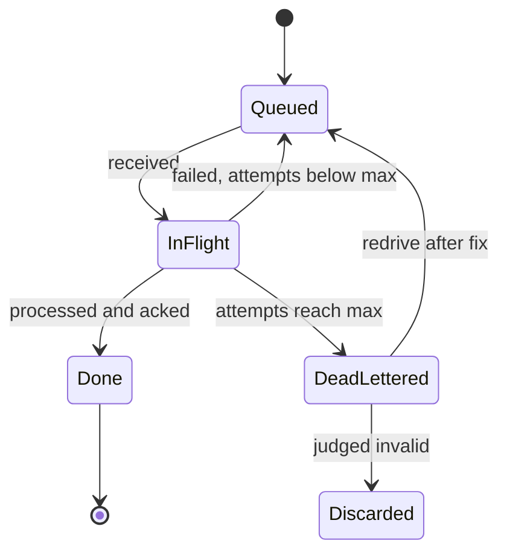

#### Numbers

**Wasted work from a poison message without a DLQ:** a message retried every 30 s forever costs 2,880 attempts a day. 100 such messages in a queue with 10 workers keep a slice of capacity permanently busy, and with FIFO ordering they block everything behind them.

**`maxReceiveCount`:** set it high enough to ride out transient errors with backoff (3–5 attempts across a few minutes is common), but low enough that poison messages leave within minutes.

**Redrive rate:** replaying 1 M dead letters at full speed into a consumer that handles 2,000/s while also serving 1,500/s of live traffic overloads it. Redrive at the spare capacity: 500/s, about 33 minutes.

#### Where it's used

Amazon SQS redrive policy and DLQ redrive, Google Pub/Sub dead-letter topics, Azure Service Bus dead-letter subqueues, RabbitMQ dead-letter exchanges, and Kafka Connect error handling.

#### Trade-offs and failure modes

- **A DLQ is unresolved work, not a solution.** Alert on DLQ depth and age, and assign an owner.
- **Ordering:** skipping a message for one entity while processing its later messages can corrupt state ("updated" applied before "created"). Ordered consumers may need to park the whole key, not just one message.
- **Stalled workflows:** a dead-lettered step leaves a business process half done. Something must time it out or compensate.
- Redriving before the fix just fills the DLQ again.

Sources: [Amazon SQS dead-letter queues](https://docs.aws.amazon.com/AWSSimpleQueueService/latest/SQSDeveloperGuide/sqs-dead-letter-queues.html), [Google Pub/Sub dead-letter topics](https://cloud.google.com/pubsub/docs/handling-failures), [Confluent: Kafka Connect error handling and DLQs](https://www.confluent.io/blog/kafka-connect-deep-dive-error-handling-dead-letter-queues/).

### Job scheduler and worker pool

**What it is.** A scheduler runs work at a future time: once after a delay (send a reminder in 24 hours), on a recurring schedule (cron), or at a deadline (expire an unpaid order). A worker pool executes what comes due.

#### How it works

The common durable design stores jobs in a table indexed by `run_at`:

```sql
SELECT id FROM jobs
WHERE state = 'scheduled' AND run_at <= now()
ORDER BY run_at
LIMIT 100
FOR UPDATE SKIP LOCKED;
-- then set state = 'running', lease_until = now() + interval '5 min'
```

Workers claim due jobs with a lease. A reaper resets jobs whose lease expired. Recurring jobs are expanded into concrete runs, and each run gets a unique key such as `(job_name, scheduled_time)` so two scheduler instances can't create the same run twice.

**In memory,** schedulers use a priority queue (`O(log n)` insert) or a **timing wheel**: an array of buckets where slot `i` holds timers due at tick `i mod size`. Insert and expiry are `O(1)`. Hierarchical wheels (seconds, minutes, hours) cover long delays with few slots. Varghese and Lauck described them in 1987; Kafka uses hierarchical timing wheels for its request purgatory, and Netty has a `HashedWheelTimer`.

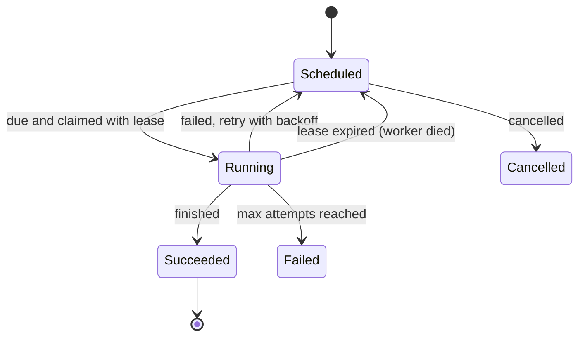

#### Numbers

**Thundering cron:** 2 M users with a "daily at midnight" digest produce 2 M jobs due at the same second. With 200 workers at 50 ms each, the pool drains `200 / 0.05 = 4,000` jobs/s, so the last digest goes out about 500 s late. Spread due times with jitter (`hash(user_id) mod 3600` seconds) to flatten the spike.

**Polling cost vs precision:** polling every 1 s gives up to 1 s scheduling delay. A timing wheel with 1 ms ticks and 512 slots handles millions of timers with constant-time operations.

#### Where it's used

Kubernetes CronJobs, Sidekiq scheduled jobs, Celery beat, Quartz, AWS EventBridge Scheduler, and Google's distributed cron, which the SRE book describes as using Paxos to agree on which replica launches each job so that runs aren't skipped or doubled.

#### Trade-offs and failure modes

- **Duplicate runs:** leases expire while a slow job is still running; use idempotent jobs and fencing tokens.
- **Missed runs:** if the scheduler is down at the scheduled time, decide whether to catch up or skip (Kubernetes' `startingDeadlineSeconds` and `concurrencyPolicy`).
- **Clock skew** across scheduler hosts shifts due times.
- Long-running multi-step jobs outgrow this pattern; use a [durable workflow engine](tutorials/infrastructure-building-blocks/#durable-workflow-engine).

Sources: [Google SRE: distributed periodic scheduling with cron](https://sre.google/sre-book/distributed-periodic-scheduling/), [Varghese and Lauck, hashed and hierarchical timing wheels](https://www.cs.columbia.edu/~nahum/w6998/papers/sosp87-timing-wheels.pdf), [Kafka purgatory and timing wheels](https://www.confluent.io/blog/apache-kafka-purgatory-hierarchical-timing-wheels/), [Kubernetes CronJob](https://kubernetes.io/docs/concepts/workloads/controllers/cron-jobs/).

### Durable workflow engine

**What it is.** A workflow engine runs long-lived business processes as ordinary-looking code (charge card, wait 3 days, ship, send email) and makes that code survive crashes, deploys and multi-day waits. It persists every step so the process resumes exactly where it left off.

#### How it works

In Temporal (and Cadence, its predecessor at Uber), the workflow function runs in a worker, but the server records an **event history**: workflow started, activity scheduled, activity completed with its result, timer started, timer fired, signal received.

- **Activities** are the side-effecting steps (call the payment API). The engine schedules them with timeouts and retry policies. They run **at least once**, so they must be idempotent.
- **Workflow code is replayed** to rebuild state. When a worker picks up a workflow after a crash, it re-runs the function from the start; calls whose results are already in the history return the recorded result instead of executing again.
- **Determinism:** because of replay, workflow code must make the same decisions every time. No direct `random()`, `now()`, network calls or threads; use the SDK's deterministic versions. Changing workflow code that has running instances requires versioning (patching).
- **Timers and signals** are durable: `sleep(30 days)` costs nothing while waiting.

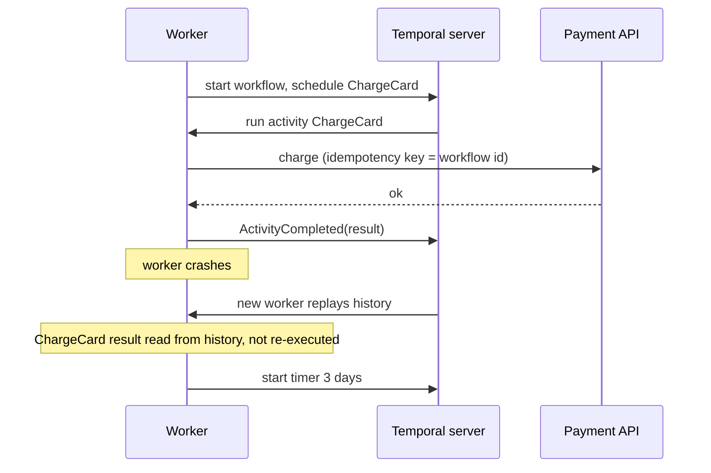

#### Numbers

**History limits:** Temporal warns at 10,240 events or 10 MB and terminates at 51,200 events or 50 MB per workflow execution. A workflow that loops once a minute adds a few events per iteration and hits the warning in days. Use **Continue-As-New** to start a fresh history with carried-over state.

**Replay cost:** replaying a 5,000-event history on cache miss takes measurable CPU; workers keep a sticky cache of recent workflows to avoid it.

**Latency:** each step is a durable write on the server, so a step costs milliseconds to tens of milliseconds. Don't use a workflow engine for a hot, sub-millisecond path.

#### Where it's used

Temporal (from Uber's Cadence lineage; Netflix and Snap have written publicly about using it), AWS Step Functions (a state machine defined in JSON rather than code), Azure Durable Functions (also replay-based), and Restate.

#### Trade-offs and failure modes

- **Versioning is hard.** Changing the order of steps breaks replay for running workflows.
- **Activities can still run twice** (timeout after the side effect, before the completion is recorded).
- **History growth** and payload size limits push large data into object storage.
- It is a stateful platform you must run (or buy), with its own database.

Sources: [Temporal workflow execution](https://docs.temporal.io/workflow-execution), [Temporal workflow limits](https://docs.temporal.io/workflow-execution/limits), [Temporal activity definition](https://docs.temporal.io/activity-definition), [Azure Durable Functions code constraints](https://learn.microsoft.com/en-us/azure/azure-functions/durable/durable-functions-code-constraints).

### Reconciliation controller

**What it is.** A controller continuously compares **desired state** (what the spec says) with **observed state** (what actually exists) and takes actions to close the gap. Instead of executing a sequence of commands once, it loops until reality matches intent.

#### How it works

```python
def reconcile(key):
    desired = spec_store.get(key)          # e.g. Deployment: 5 replicas
    observed = cluster.list_pods(key)      # e.g. 3 running
    if desired is None:
        cleanup(observed); return
    diff = desired.replicas - len(observed)
    if diff > 0:  create_pods(key, diff)    # idempotent: names derived from key
    if diff < 0:  delete_pods(key, -diff)
    status_store.update(key, observed=len(observed))  # optimistic: resourceVersion

for key in work_queue:   # event-driven but level-triggered: informers enqueue keys
    try: reconcile(key)
    except Exception: work_queue.requeue_rate_limited(key)
```

Key properties in Kubernetes:

- **Level-triggered, not edge-triggered:** the controller acts on the current state, not on the event that woke it. Missed or duplicate events don't matter because the next pass sees the truth.
- **Informers and work queues:** a local watch cache reduces API load; keys are deduplicated in the queue, and failures requeue with exponential backoff. A periodic resync re-checks everything.
- **Optimistic concurrency:** updates carry a `resourceVersion`; a conflict means re-read and retry.
- **Leader election** (a lease object) keeps one active instance per controller.

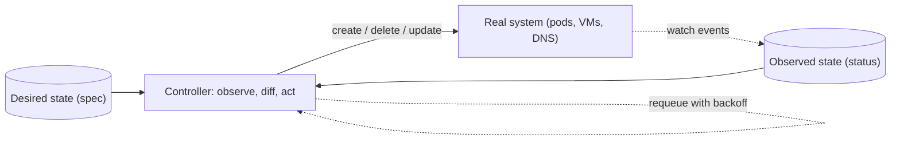

#### Numbers

**Convergence time** ≈ detection delay + action time + retries. If a node dies and the node lifecycle controller waits for the node monitor grace period (roughly 40–50 s by default, depending on version) before marking it unhealthy, pods there won't be replaced for at least that long, plus eviction and scheduling time.

**Backoff:** client-go's default controller rate limiter combines a per-item exponential backoff starting at 5 ms and capped at 1,000 s with an overall token bucket (10 QPS, burst 100), so a broken object doesn't spin the loop.

#### Where it's used

Every built-in Kubernetes controller (Deployment, ReplicaSet, Job, node lifecycle), operators built with controller-runtime, Terraform's plan/apply (a one-shot reconcile), and Argo CD and Flux (GitOps).

#### Trade-offs and failure modes

- **Conflicting controllers** fight over the same field (an HPA and a GitOps tool both setting replicas) and oscillate.
- **Unsafe repeated actions:** reconcile runs many times; every action must be idempotent (create with deterministic names, check before charging).
- **Slow convergence by design:** fine for infrastructure, wrong for a user waiting on a request.
- A buggy desired state is applied faithfully and repeatedly; deleting the spec deletes the resources.

Sources: [Kubernetes controllers](https://kubernetes.io/docs/concepts/architecture/controller/), [Kubernetes API concepts: resourceVersion](https://kubernetes.io/docs/reference/using-api/api-concepts/), [client-go work queue rate limiters](https://github.com/kubernetes/client-go/blob/master/util/workqueue/default_rate_limiters.go).

## Data access and throughput

These patterns make reads and writes faster or cheaper. The first question is always the same: **which copy is authoritative, and how stale may every other copy be?** Indexes and pooling are cheap and should come first; caches, replicas and shards each add a copy or a split you must keep correct.

### Indexes and pagination

**What it is.** An index is a sorted secondary structure that lets the database find rows without scanning the table. Pagination returns a large result in pages; cursor (keyset) pagination uses the index to fetch each page in constant time.

#### How it works

Most relational indexes are **B+ trees**: internal pages hold keys and child pointers, leaves hold keys plus row pointers (or, in InnoDB, the clustered primary key), and leaves are linked for range scans. Lookups and range starts cost `O(log n)` page reads.

- **Composite index** `(tenant_id, created_at)` serves `WHERE tenant_id = ? ORDER BY created_at`. Column order matters: equality columns first, then the range or sort column (the leftmost-prefix rule).
- **Covering index** includes every column the query needs (PostgreSQL `INCLUDE`, or all columns in the key), so the database answers from the index alone (an index-only scan).
- **Every index costs** extra writes, storage and buffer-pool memory.

Pagination styles:

```sql
-- Offset: reads and discards 100,000 rows to return 20
SELECT * FROM posts WHERE tenant_id = 7
ORDER BY created_at DESC, id DESC LIMIT 20 OFFSET 100000;

-- Keyset (cursor): seeks straight to the position
SELECT * FROM posts WHERE tenant_id = 7
  AND (created_at, id) < (:last_created_at, :last_id)
ORDER BY created_at DESC, id DESC LIMIT 20;
```

The cursor is the last row's sort key, usually encoded opaquely for the client. The `id` tiebreaker makes the order stable when timestamps collide.

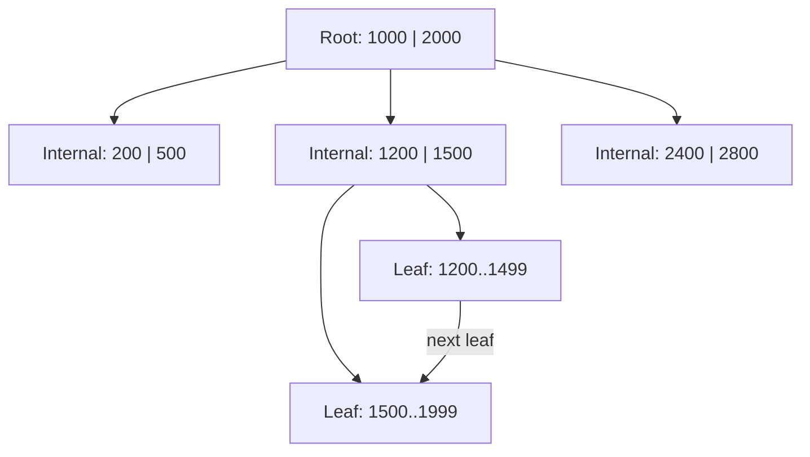

#### Numbers

**Tree depth:** with 8 KB pages and roughly 300–500 keys per internal page, depth is `ceil(log_f(n))`. For 1 billion rows and fanout 400: `log₄₀₀(10⁹) ≈ 3.5`, so about 4 levels. The top levels stay in memory, so a point lookup costs roughly one or two disk reads.

**Offset vs keyset:** page 5,000 at 20 rows per page reads `5,000 × 20 = 100,000` index entries with offset. Keyset reads about 20 regardless of depth. Offset also skips or repeats rows when inserts shift the window.

**Write amplification:** a table with 6 secondary indexes does roughly 7 index or heap writes per insert.

#### Where it's used

PostgreSQL and MySQL InnoDB B+ tree indexes; Slack, Stripe and GitHub APIs return opaque cursors (for example Stripe's `starting_after` and Slack's `next_cursor`). Markus Winand's *Use the Index, Luke* is the standard practical reference.

#### Trade-offs and failure modes

- Cursors need a stable, unique sort order and can't jump to "page 50".
- Indexes on low-selectivity columns (`status` with 3 values) rarely help; the planner may ignore them.
- Adding an index on a large live table needs `CREATE INDEX CONCURRENTLY` or an online schema tool.

Sources: [Use the Index, Luke: anatomy of an index](https://use-the-index-luke.com/sql/anatomy), [Use the Index, Luke: paging through results](https://use-the-index-luke.com/sql/partial-results/fetch-next-page), [PostgreSQL index-only scans](https://www.postgresql.org/docs/current/indexes-index-only-scans.html).

### Cache-aside and read-through

**What it is.** A cache keeps recently read data in fast memory (Redis, Memcached) in front of a slower store. In **cache-aside**, application code checks the cache and fills it on a miss. In **read-through**, the cache library or service loads from the store itself.

#### How it works

```python
def get_user(user_id):
    key = f"user:{user_id}"
    val = cache.get(key)
    if val is not None:
        return val                                   # hit
    val = db.query("SELECT ... WHERE id = %s", user_id)   # miss
    cache.set(key, val, ttl=300 + random.randint(0, 30))  # jittered TTL
    return val

def update_user(user_id, fields):
    db.update(user_id, fields)
    cache.delete(f"user:{user_id}")                  # invalidate, don't set
```

On writes, **delete** the key rather than setting it. Two concurrent writers setting values can leave the older value in the cache; a delete forces the next reader to load fresh data. A **TTL** bounds how long a missed invalidation can live.

**Stampede protection** (many readers miss the same hot key at once and all hit the database):

- **Single-flight / request coalescing:** one loader per key per process; others wait for its result.
- **Leases or locks:** the cache grants one client the right to fill the key; others wait briefly or get the stale value. Facebook's memcache leases do this.
- **Probabilistic early expiration (XFetch):** each reader recomputes early with rising probability as expiry nears: recompute if `now − δ × β × ln(rand()) ≥ expiry`, where `δ` is the recompute time and `β ≈ 1`. One reader usually refreshes before the key expires.
- **Stale-while-revalidate:** serve the expired value while one background refresh runs.

```mermaid
sequenceDiagram
  participant A as App
  participant C as Cache
  participant D as Database
  A->>C: GET user:42
  C-->>A: miss
  A->>D: SELECT user 42
  D-->>A: row
  A->>C: SET user:42 (TTL 300 s)
  Note over A,D: on write: UPDATE database, then DEL user:42
```

#### Numbers

**Effective latency:** `E = h × t_cache + (1 − h) × (t_cache + t_db)`. With `t_cache = 0.5 ms`, `t_db = 10 ms`: at `h = 0.9`, `E = 0.5 + 0.1 × 10 = 1.5 ms`; at `h = 0.99`, `E = 0.6 ms`.

**Database offload:** database load is `(1 − h) × reads`. Going from 90% to 99% cuts database reads by 10×. The inverse is the danger: a cold cache after a restart sends 10× or 100× normal load to the database.

**Stampede scale:** Facebook reported that memcache leases (issued at most once every 10 seconds per key) cut the peak database query rate from 17K/s to 1.3K/s in one workload.

**Memory:** 50 M hot keys × 1 KB ≈ 50 GB, plus per-key overhead (often 50–100 bytes in Redis).

#### Where it's used

Facebook's memcache tier (NSDI 2013 paper: leases, regional pools, invalidations from the MySQL commit log via mcsqueal), Twitter's Twemcache and Pelikan, Redis everywhere, Caffeine and Guava `LoadingCache` (read-through, with built-in single-flight loading).

#### Trade-offs and failure modes

- **Staleness:** a cache is never strongly consistent with the database without extra machinery. State the freshness tolerance.
- **Invalidation races:** a reader loads an old row, a writer updates and deletes the key, then the reader sets the old row. Leases or short TTLs mitigate.
- **Cold start and failover** can overload the database. Warm caches gradually.
- **Hot keys** overload one cache node; replicate them or add a local in-process cache.

Sources: [Scaling Memcache at Facebook (NSDI 2013)](https://www.usenix.org/conference/nsdi13/technical-sessions/presentation/nishtala), [Vattani et al., optimal probabilistic cache stampede prevention](https://cseweb.ucsd.edu/~avattani/papers/cache_stampede.pdf), [Azure cache-aside pattern](https://learn.microsoft.com/en-us/azure/architecture/patterns/cache-aside).

### Write-through and write-behind

**What it is.** Both put the cache in the write path. **Write-through** writes to the cache and the store synchronously before acknowledging. **Write-behind** (write-back) acknowledges after writing to the cache and persists to the store asynchronously, often in batches.

#### How it works

| | Write-through | Write-behind |
|---|---|---|
| Ack after | Cache and store both written | Cache (or a durable buffer) written |
| Write latency | Store latency plus cache | Cache latency |
| Durability | Store's durability | Only as durable as the buffer |
| Read-after-write | Cache is fresh | Cache is fresh; the store lags |
| Store load | One write per write | Coalesced and batched |

Write-through is usually paired with read-through so the cache layer owns all access. The safe form of write-behind uses a **durable buffer**: append the write to a replicated log (Kafka, a WAL), ack, then a flusher applies batches to the store. Coalescing keeps only the last write per key in each batch.

```mermaid
sequenceDiagram
  participant A as App
  participant C as Cache
  participant L as Durable log
  participant D as Database
  A->>C: write counter:9 = 105
  C->>L: append
  L-->>C: replicated
  C-->>A: ack
  Note over L,D: flusher every 1 s
  L->>D: batch upsert (last value per key)
```

#### Numbers

**Coalescing:** a like counter updated 5,000 times a second, flushed once a second, becomes 1 database write per second instead of 5,000.

**Exposure window:** write-behind with an in-memory buffer flushed every `F` seconds at `W` writes/s can lose up to `F × W` acknowledged writes on a crash. `F = 1 s`, `W = 20,000/s` is 20,000 lost writes.

**Write-through latency:** `t_cache + t_db`, for example `0.5 + 5 = 5.5 ms`, compared with 0.5 ms for write-behind.

#### Where it's used

Oracle Coherence, Hazelcast and Apache Ignite implement write-through and write-behind map stores with configurable delays and batch sizes. Operating-system page caches are write-back caches, which is why databases call `fsync`. Counters and view counts often use write-behind with Redis plus periodic flushes.

#### Trade-offs and failure modes

- Write-behind can **lose or reorder acknowledged writes** without a durable, ordered buffer.
- Other writers bypassing the cache see a stale store, and their writes are overwritten by the next flush.
- Write-through caches data that may never be read, wasting memory.
- Constraint failures in the store surface after the client was told "success".

Sources: [Hazelcast: write-through and write-behind](https://docs.hazelcast.com/hazelcast/latest/mapstore/working-with-external-data), [AWS caching strategies (ElastiCache)](https://docs.aws.amazon.com/AmazonElastiCache/latest/dg/Strategies.html).

### Read replicas

**What it is.** Read replicas are copies of a database that apply the primary's change log and serve read-only queries. They scale reads and provide standby copies; they do not scale writes.

#### How it works

The primary streams its log (PostgreSQL WAL, MySQL binlog) to replicas, which replay it. Replication is usually **asynchronous**: the primary commits without waiting, so replicas lag. PostgreSQL's `synchronous_commit` can wait for a standby to flush (`on`) or apply (`remote_apply`) the change, at a latency cost.

Routing: a proxy (ProxySQL, Amazon RDS reader endpoint, Vitess) or the application sends writes to the primary and reads to replicas.

**Read-your-writes** options:

- Read from the primary for a short window after the user writes (sticky session).
- Track the write's log position and read only from a replica that has applied it: `pg_last_wal_replay_lsn()` in PostgreSQL, `WAIT_FOR_EXECUTED_GTID_SET` with GTIDs in MySQL.
- Route reads that must be fresh to the primary; only route tolerant reads to replicas.

```mermaid
flowchart LR
  APP[App] -- writes --> PRI[("Primary")]
  APP -- "reads (lag OK)" --> RT["Read router"]
  PRI -- "WAL stream" --> R1[("Replica 1, lag 40 ms")]
  PRI -- "WAL stream" --> R2[("Replica 2, lag 3 s")]
  RT --> R1
  RT -. "skip: too far behind" .-> R2
  APP -- "read-your-writes" --> PRI
```

#### Numbers

**Capacity:** a primary at 2,000 writes/s and 18,000 reads/s, with each node handling about 10,000 queries/s. Moving 80% of reads to replicas leaves the primary with `2,000 + 3,600 = 5,600`; replicas need `14,400 / 10,000` → 2 replicas, plus one for failure headroom.

**Every replica still applies every write.** Replicas do not reduce write load, and a replica's apply can fall behind if the primary's write throughput exceeds what single-threaded (or limited-parallel) replay can do.

**Stale-read probability:** if lag is typically 50 ms and a user reads their own write 30 ms after posting, most of those reads miss the write. Under load, lag can grow to seconds or minutes.

#### Where it's used

PostgreSQL streaming replication, MySQL replication, Amazon RDS read replicas, and Aurora replicas, which share the primary's storage volume and which AWS says usually lag by less than 100 ms.

#### Trade-offs and failure modes

- **Read-your-writes breaks** unless you design for it.
- **Monotonic reads break** when consecutive reads hit replicas with different lag; pin a session to one replica.
- The primary's write bottleneck stays; sharding is the next step for writes.
- **Long queries on replicas** can conflict with replay (PostgreSQL's `hot_standby_feedback` and `max_standby_streaming_delay` trade bloat for cancelled queries).

Sources: [PostgreSQL warm standby and streaming replication](https://www.postgresql.org/docs/current/warm-standby.html), [PostgreSQL synchronous_commit](https://www.postgresql.org/docs/current/runtime-config-wal.html#GUC-SYNCHRONOUS-COMMIT), [MySQL GTID functions](https://dev.mysql.com/doc/refman/8.0/en/gtid-functions.html).

### Sharded database and shard router

**What it is.** Sharding splits one logical dataset across several independent databases (shards), each owning a subset of keys. A shard router maps every query to the shard that owns its key. It scales writes and storage, which replicas cannot.

#### How it works

1. **Pick a shard key** that appears in almost every query and spreads load: `tenant_id`, `user_id`. Queries without it become scatter-gather across all shards.
2. **Map keys to shards:**
   - **Hash:** `shard = hash(key) mod N` spreads evenly, but resharding moves most keys unless you use consistent hashing or many fixed virtual shards.
   - **Range:** contiguous key ranges per shard; good for range scans, but sequential keys create a hot tail shard.
   - **Directory / lookup table:** an explicit `key → shard` map; flexible (move one big tenant) at the cost of a lookup service.
3. **Route:** in the application library, in a proxy (Vitess VTGate, ProxySQL, Citus coordinator), or in the database itself.
4. **Reshard** by splitting shards online: copy data, stream changes, verify, then cut over writes.

A common trick: create many more **logical shards** than machines (say 4,096), map logical to physical shards, and move whole logical shards as you grow.

```mermaid
flowchart LR
  APP[App] --> RTR["Shard router (VTGate)"]
  MAP[("Shard map: key range to shard")] --> RTR
  RTR -- "user 17 → keyspace id 0x2a..." --> S1[("Shard -40")]
  RTR --> S2[("Shard 40-80")]
  RTR --> S3[("Shard 80-c0")]
  RTR --> S4[("Shard c0-")]
```

#### Numbers

**Shard count:** `N = max(peak writes / writes per shard, data size / size per shard)`, with headroom. 60,000 writes/s at 5,000 per shard needs 12; 40 TB at 2 TB per shard needs 20. Take 20, then provision about 30 to grow into.

**Scatter-gather cost:** a query without the shard key hits all `N` shards; its latency is the max of `N` latencies (see [hedged requests](tutorials/infrastructure-building-blocks/#hedged-requests)), and its load is `N×`.

**Hot shard:** if one tenant has 15% of traffic in a 20-shard system, its shard runs at 3× the average load. Isolate big tenants on dedicated shards.

#### Where it's used

Vitess (built at YouTube; Slack is a well-documented user) with keyspace IDs, vindexes and online resharding via VReplication. Citus for PostgreSQL. Instagram mapped thousands of logical shards onto fewer PostgreSQL servers and encoded the shard ID inside its 64-bit IDs. DynamoDB, Cassandra and MongoDB shard automatically by partition key.

#### Trade-offs and failure modes

- **Cross-shard transactions and joins** become distributed problems (two-phase commit, sagas, or denormalization).
- **Hot tenants and keys** defeat even distribution.
- **Resharding** is a long, risky migration; plan logical shards up front.
- **Global uniqueness and secondary indexes** need extra machinery (global ID generators, lookup vindexes).

Sources: [Vitess sharding concepts](https://vitess.io/docs/reference/features/sharding/), [Azure sharding pattern](https://learn.microsoft.com/en-us/azure/architecture/patterns/sharding), [Instagram: sharding and IDs](https://instagram-engineering.com/sharding-ids-at-instagram-1cf5a71e5a5c).

### Materialized views and search indexes

**What it is.** A materialized view stores the precomputed result of a query (an aggregate, a join, a denormalized document) so reads don't recompute it. A search index is a specialized derived view: an inverted index for full-text search, or a vector index for similarity search.

#### How it works

**Materialized views** are refreshed in one of three ways: full recompute on a schedule (`REFRESH MATERIALIZED VIEW CONCURRENTLY` in PostgreSQL), incremental maintenance inside the database (Oracle fast refresh, Materialize, ClickHouse materialized views on insert), or an external projector that consumes CDC or domain events and updates a read-optimized store.

**Inverted index:** for each term, a sorted **postings list** of document IDs (plus positions and frequencies). A query intersects or unions postings lists and ranks results with a relevance score; Elasticsearch and Lucene default to BM25. Lucene writes immutable segments and merges them in the background; new documents become searchable after a **refresh** (Elasticsearch: every 1 s by default for indexes that receive searches), which is why it's called near real-time.

**Vector (ANN) index:** embeddings are indexed by approximate nearest neighbor structures such as **HNSW** (a layered proximity graph) or IVF (cluster then search nearest clusters). They trade a little recall for orders-of-magnitude faster queries than brute force.

```mermaid
flowchart LR
  DB[("Orders DB (source of truth)")] -- CDC --> K[Change stream]
  K --> PROJ["Projector"]
  PROJ --> ES[("Search index: inverted postings")]
  PROJ --> MV[("Dashboard view: daily totals")]
  U[User search] --> ES
  D[Dashboard] --> MV
```

#### Numbers

**Update amplification:** one product price change that appears in 5 views and 1 search document costs 6 derived writes. A projector at 2,000 changes/s with 6× amplification does 12,000 writes/s.

**Lag budget:** end-to-end freshness ≈ CDC lag + queue lag + projector time + index refresh. Typically `0.2 + 0.3 + 0.05 + 1 ≈ 1.5 s` for Elasticsearch.

**Rebuild time:** reindexing 500 M documents at 20,000 docs/s takes about 7 hours. Plan backfills with aliases so you can build a new index and switch atomically.

**Shard sizing:** Elastic's guidance is to keep shards roughly between 10 and 50 GB.

#### Where it's used

Elasticsearch and OpenSearch (Lucene), Apache Solr, PostgreSQL materialized views and `tsvector` full-text search, pgvector (HNSW and IVFFlat), and vector search in Elasticsearch, OpenSearch and dedicated engines.

#### Trade-offs and failure modes

- **Not authoritative.** Never decide a payment from the search index; re-check the source.
- **Lag:** users who just saved a document may not find it; read from the source for their own recent writes.
- **Backfills and rebuilds** compete with live traffic; schema changes often require a full reindex.
- **Out-of-order updates** overwrite newer data with older; use external versioning (Elasticsearch `version_type=external`).

Sources: [Elasticsearch near real-time search](https://www.elastic.co/guide/en/elasticsearch/reference/current/near-real-time.html), [Elastic: size your shards](https://www.elastic.co/guide/en/elasticsearch/reference/current/size-your-shards.html), [PostgreSQL materialized views](https://www.postgresql.org/docs/current/rules-materializedviews.html), [Malkov and Yashunin, HNSW](https://arxiv.org/abs/1603.09320).

### Object storage and claim check

**What it is.** Object storage (S3, GCS, Azure Blob) stores large, immutable blobs by key with very high durability and cheap capacity. The **claim check** pattern stores a large payload there and passes only a reference (the "claim check") through queues, databases and APIs.

#### How it works

**Presigned URLs** let clients upload or download directly to the bucket, bypassing your servers. Your API checks permission, then signs a URL for one key, one method, and a short expiry (SigV4 presigned URLs can last up to 7 days, but minutes is typical).

**Multipart upload** splits a large file into parts uploaded in parallel and retried individually, then a `CompleteMultipartUpload` call assembles them. S3 limits: parts of 5 MiB to 5 GiB (the last part can be smaller), up to 10,000 parts, objects up to 48.8 TiB. Abandoned uploads keep billing until a lifecycle rule aborts them.

**Claim check flow:** the producer uploads the blob, then sends a small message `{"bucket": ..., "key": ..., "sha256": ...}`. The consumer fetches the blob by key.

```mermaid
sequenceDiagram
  participant C as Client
  participant API as Upload API
  participant S3 as Object store
  participant Q as Queue
  participant W as Transcoder
  C->>API: request upload (video.mp4, 2 GB)
  API-->>C: presigned PUT URLs for parts
  C->>S3: upload parts in parallel
  C->>API: complete upload
  API->>Q: message with bucket and key only
  Q->>W: claim check
  W->>S3: GET object
```

#### Numbers

**Request rates:** S3 supports at least 3,500 PUT/COPY/POST/DELETE and 5,500 GET/HEAD requests per second per partitioned prefix, and scales by spreading keys across more prefixes.

**Part sizing:** a 200 GB file needs parts of at least `200 GB / 10,000 = 20 MB`. With 64 MB parts it's 3,200 parts; 16 parallel streams at 50 MB/s each upload in about `200,000 / 800 = 250 s`.

**Why claim check:** SQS messages max out at 256 KB and Kafka's default max message size is about 1 MB. A 50 MB image can't go through either, and even 500 KB messages waste broker memory and replication bandwidth.

**Durability:** S3 is designed for 99.999999999% (11 nines) object durability and has offered strong read-after-write consistency since December 2020.

#### Where it's used

Amazon S3, Google Cloud Storage, Azure Blob Storage, Cloudflare R2, MinIO; the SQS Extended Client Library implements claim check for large SQS messages automatically.

#### Trade-offs and failure modes

- **Access control:** a leaked presigned URL works for anyone until it expires. Keep expiries short and scope them to one key.
- **Lifetime mismatch:** a message pointing to a deleted object, or orphaned objects whose messages were never sent. Use lifecycle rules and write the object before the message.
- **No partial updates or atomic multi-object writes;** "rename" is copy plus delete.
- **Latency** is tens of milliseconds per request, so object stores are bad for many tiny reads.

Sources: [S3 multipart upload limits](https://docs.aws.amazon.com/AmazonS3/latest/userguide/qfacts.html), [S3 performance guidelines](https://docs.aws.amazon.com/AmazonS3/latest/userguide/optimizing-performance.html), [S3 presigned URLs](https://docs.aws.amazon.com/AmazonS3/latest/userguide/using-presigned-url.html), [Claim check pattern](https://learn.microsoft.com/en-us/azure/architecture/patterns/claim-check).

### CDN and edge caching

**What it is.** A content delivery network caches responses at points of presence (PoPs) close to users, so most requests never reach your origin. It cuts latency, origin load and bandwidth cost, and absorbs traffic spikes and some attacks.

#### How it works

- **Cache key:** by default scheme, host, path and query string. Anything else that changes the response (a header, a cookie) must be in the key, via `Vary` or CDN config, or users get each other's content.
- **Freshness:** `Cache-Control: public, max-age=60, s-maxage=600` lets browsers keep it 60 s and shared caches 600 s. `stale-while-revalidate=30` and `stale-if-error=86400` (RFC 5861) let the edge serve stale content while refreshing or while the origin is down.
- **Tiering:** an edge miss goes to a regional or **origin shield** tier before the origin, so a global miss costs the origin one request instead of one per PoP.
- **Invalidation:** purge by URL, by prefix, or by tag (surrogate keys), or avoid purges with **versioned URLs** (`app.3f9c1.js`) and long TTLs.
- **Request collapsing:** concurrent misses for the same object at one PoP send one origin fetch.

```mermaid
flowchart LR
  U1[Users EU] --> E1["Edge PoP Frankfurt"]
  U2[Users US] --> E2["Edge PoP Virginia"]
  U3[Users APAC] --> E3["Edge PoP Tokyo"]
  E1 -- miss --> SH["Origin shield (tier 2)"]
  E2 -- miss --> SH
  E3 -- miss --> SH
  SH -- miss --> O[("Origin")]
```

#### Numbers

**Offload:** origin requests = `total × (1 − h)`. At 200,000 requests/s and a 95% hit ratio, the origin sees 10,000/s; at 99%, 2,000/s.

**Tiering effect:** 300 PoPs each missing an object once per TTL send 300 origin requests per TTL. With a shield, it's about 1 per TTL.

**Latency:** a user 100 ms RTT from the origin, fetching over a new TLS connection, pays several round trips (TCP plus TLS 1.3 handshake plus request) ≈ 300 ms. From an edge 10 ms away, ≈ 30 ms.

**Bandwidth cost:** 2 PB/month egress at a 95% hit ratio sends only 100 TB from your origin.

#### Where it's used

Akamai, Cloudflare (tiered cache, cache reserve), Fastly (surrogate-key purging, VCL), Amazon CloudFront (Origin Shield). Netflix's Open Connect appliances sit inside ISP networks and serve its video from there instead of from a central origin.

#### Trade-offs and failure modes

- **Private data leaks:** caching a personalized page under a shared key shows one user's data to others. Mark private responses `Cache-Control: private` or `no-store`.
- **Cache-key mistakes:** too broad leaks or mixes variants; too narrow (every query param) kills the hit ratio.
- **Invalidation delay:** purges take time to propagate; versioned assets avoid the problem.
- **Origin cold storms:** a global purge or a new release can send a wall of misses to the origin.

Sources: [RFC 9111: HTTP caching](https://www.rfc-editor.org/rfc/rfc9111), [RFC 5861: stale-while-revalidate](https://www.rfc-editor.org/rfc/rfc5861), [Cloudflare tiered cache](https://developers.cloudflare.com/cache/how-to/tiered-cache/), [Amazon CloudFront Origin Shield](https://docs.aws.amazon.com/AmazonCloudFront/latest/DeveloperGuide/origin-shield.html).

### Batching and connection pooling

**What it is.** Batching groups many small operations into one request so fixed overhead (round trips, syscalls, fsyncs, headers) is paid once. Connection pooling reuses a bounded set of open connections instead of opening one per request.

#### How it works

**Batching** flushes when a batch reaches a size limit or a time limit, whichever comes first. Kafka's producer uses `batch.size` (16 KB default) and `linger.ms` (how long to wait for more records; the default became 5 ms in Kafka 4.0, previously 0). Databases batch through multi-row `INSERT`, `COPY`, and group commit, which flushes many transactions in one fsync. The DataLoader pattern batches GraphQL lookups made in the same tick into one `WHERE id IN (...)` query.

**Connection pooling:** opening a PostgreSQL connection costs a TCP and TLS handshake, authentication and a new backend process. An application-side pool (HikariCP, SQLAlchemy) keeps connections open; a proxy pool (PgBouncer, RDS Proxy) sits between many application instances and the database and multiplexes many client connections onto few server connections.

PgBouncer pooling modes:

| Mode | Server connection held for | Breaks |
|---|---|---|
| Session | The client session | Nothing, but little multiplexing |
| Transaction | One transaction | Session state: `SET`, advisory locks, some prepared statements |
| Statement | One statement | Multi-statement transactions |

```mermaid
flowchart LR
  A1["App pod x50 (pool 20 each)"] --> PGB["PgBouncer (transaction mode)"]
  A2[Workers x20] --> PGB
  PGB -- "~40 server connections" --> PG[("PostgreSQL")]
```

#### Numbers

**Little's Law for pools:** connections needed `L = λ × W`. At 4,000 queries/s with 5 ms average query time (including network), you need `4,000 × 0.005 = 20` busy connections on average. A pool of about 30 handles bursts. Above that, extra connections only add contention.

**Database-side sizing:** HikariCP's guidance starts from `connections = (core_count × 2) + effective_spindle_count`. A 16-core server is happy with roughly 30–40 active connections, not 2,000.

**Batching gain:** with a 1 ms round trip and 0.02 ms per row, inserting 10,000 rows one at a time takes about `10,000 × 1.02 ms ≈ 10 s`; in batches of 500 it takes `20 × (1 + 10) ms = 220 ms`.

**Batching cost:** a time-based flush adds up to `linger` latency, half that on average.

#### Where it's used

PgBouncer, Amazon RDS Proxy, ProxySQL, HikariCP, Kafka producer batching, gRPC and HTTP/2 connection reuse, Facebook's DataLoader (open-sourced for GraphQL), and PostgreSQL group commit (`commit_delay`).

#### Trade-offs and failure modes

- **Batching adds waiting** and makes one bad item fail a whole batch unless you handle partial failure.
- **Pools hide queues:** when the pool is exhausted, requests wait for a connection; set an acquire timeout and monitor wait time.
- **Pool multiplication:** pool size × instance count can exceed `max_connections` as services scale out.
- **Transaction pooling** breaks session-level features that some ORMs rely on.

Sources: [HikariCP: about pool sizing](https://github.com/brettwooldridge/HikariCP/wiki/About-Pool-Sizing), [PgBouncer features and pooling modes](https://www.pgbouncer.org/features.html), [Kafka producer configs](https://kafka.apache.org/documentation/#producerconfigs).

## Shared operational capabilities

These capabilities cut across every service. You rarely draw them in the first diagram, but interviewers expect you to know where identity is checked, how you would find a slow request, and what happens when a region or a database is lost.

### Sidecar, ambassador and service mesh

**What it is.** A **sidecar** is a helper process deployed next to each service instance (same pod or host) that handles a cross-cutting concern. An **ambassador** is a sidecar that proxies the service's outbound calls. A **service mesh** is a fleet of such proxies plus a control plane that configures them all, giving every service the same transport, security and telemetry without code changes.

#### How it works

- **Data plane:** each pod's traffic is redirected (via iptables or eBPF) through a local proxy: Envoy in Istio, the Rust `linkerd2-proxy` in Linkerd. The proxy does mTLS, retries, timeouts, load balancing, circuit breaking and metrics.
- **Control plane:** istiod or the Linkerd control plane watches Kubernetes, issues workload certificates and pushes routing and policy config to proxies (for Envoy, via the xDS APIs).
- **Sidecarless variants:** Istio's ambient mode runs a per-node L4 proxy (ztunnel) for mTLS and an optional per-namespace L7 waypoint proxy, cutting per-pod overhead.

```mermaid
flowchart LR
  CP["Control plane (config, certs)"] -. xDS .-> PA
  CP -. xDS .-> PB
  subgraph PodA["Pod A"]
    A[Service A] --> PA["Sidecar proxy"]
  end
  subgraph PodB["Pod B"]
    PB["Sidecar proxy"] --> B[Service B]
  end
  PA -- "mTLS, retries, metrics" --> PB
```

#### Numbers

**Latency:** each call passes through two proxies (client-side and server-side). Published benchmarks from the mesh projects typically show added p50 latency on the order of a millisecond or less per hop for Linkerd and a few milliseconds at higher percentiles for sidecar Istio; measure your own workload. A request crossing 6 services traverses 12 proxies.

**Resources:** a sidecar per pod multiplies memory and CPU. 2,000 pods × 50 MB per proxy = 100 GB of RAM just for proxies; this is the main argument for ambient or per-node designs.

#### Where it's used

Istio (Envoy, now with ambient mode), Linkerd, Consul service mesh, AWS App Mesh (discontinued by AWS in favor of Amazon ECS Service Connect and VPC Lattice). Envoy as a sidecar was popularized by Lyft, where it was created.

#### Trade-offs and failure modes

- **A mesh cannot infer business idempotency.** Mesh-level retries of a non-idempotent POST cause duplicate effects. Configure retries per route.
- **Harder diagnosis:** failures can come from the app, either proxy, or config pushed by the control plane.
- **Control plane outage:** proxies keep their last config, but new pods and cert rotation stall.
- **Double policy:** retries and timeouts in both the app library and the mesh multiply.

Sources: [Istio architecture](https://istio.io/latest/docs/ops/deployment/architecture/), [Istio ambient mode overview](https://istio.io/latest/docs/ambient/overview/), [Linkerd architecture](https://linkerd.io/2/reference/architecture/), [Azure ambassador pattern](https://learn.microsoft.com/en-us/azure/architecture/patterns/ambassador).

### Identity and authorization

**What it is.** **Authentication** establishes who is calling (a user, or a workload). **Authorization** decides whether that caller may perform this action on this resource. Both must happen at every trust boundary, not only at the edge.

#### How it works

**User identity:** OAuth 2.0 issues **access tokens** that a client presents to APIs; **OpenID Connect** adds an **ID token** (a signed JWT) that tells the client who logged in. APIs validate JWT access tokens locally by checking the signature against the issuer's published keys (JWKS), plus `iss`, `aud`, `exp`. Short-lived access tokens (minutes) plus refresh tokens limit the damage of a leak; opaque tokens need an introspection call but can be revoked instantly.

**Workload identity:** services authenticate each other with **mTLS**: each workload has a short-lived X.509 certificate, often carrying a SPIFFE ID such as `spiffe://prod/ns/payments/sa/api`. Meshes issue and rotate these automatically.

**Authorization models:**

| Model | Decision based on | Example |
|---|---|---|
| RBAC | Caller's roles | `admin` may delete projects |
| ABAC | Attributes of caller, resource, context | Same department and business hours |
| ReBAC | Relationships in a graph | Viewer of a folder can view its documents (Google Zanzibar) |

Policy can live in code, in a policy engine (OPA, Cedar), or in a relationship service (Zanzibar, SpiceDB, OpenFGA).

**Confused deputy:** a privileged service performs an action on behalf of a caller using its *own* authority, so a caller tricks it into accessing what the caller couldn't. Fix it by propagating the end user's identity (token exchange, RFC 8693) and checking the user's permission, not just the service's.

```mermaid
sequenceDiagram
  participant U as User
  participant IdP as Identity provider
  participant GW as Gateway
  participant S as Orders service
  participant AZ as Authz check
  U->>IdP: log in (OIDC)
  IdP-->>U: ID token and access token (JWT, 10 min)
  U->>GW: GET /orders/9 with bearer token
  GW->>GW: verify signature, exp, aud
  GW->>S: forward over mTLS with user claims
  S->>AZ: may user read order 9?
  AZ-->>S: allow
```

#### Numbers

**Local verification vs introspection:** verifying a JWT signature is a CPU operation measured in microseconds; an introspection call is a network round trip (around a millisecond in-region). At 50,000 requests/s, introspection means 50,000 extra calls per second unless cached.

**Revocation window:** with 10-minute access tokens and no revocation list, a stolen token works for up to 10 minutes. With 24-hour tokens, a day.

**Zanzibar scale:** Google's Zanzibar paper reports trillions of access control lists, millions of authorization checks per second, and p95 latency under 10 ms.

#### Where it's used

Okta, Auth0, Keycloak, Google Identity, AWS IAM and Cognito; SPIFFE/SPIRE and Istio for workload identity; Google Zanzibar and open-source descendants (SpiceDB, OpenFGA); AWS Cedar and Open Policy Agent for policy evaluation.

#### Trade-offs and failure modes

- **Gateway-only checks** miss internal paths: batch jobs, queues, admin tools, service-to-service calls.
- **JWT revocation** is hard; long-lived tokens plus no denylist means compromised tokens stay valid.
- **Trusting forwarded headers** from untrusted sources lets callers impersonate users.
- **Authorization caches** go stale; Zanzibar's "zookies" exist to avoid the new-enemy problem when ACLs change.

Sources: [RFC 6749: OAuth 2.0](https://www.rfc-editor.org/rfc/rfc6749), [OpenID Connect Core](https://openid.net/specs/openid-connect-core-1_0.html), [Zanzibar (USENIX ATC 2019)](https://research.google/pubs/zanzibar-googles-consistent-global-authorization-system/), [SPIFFE concepts](https://spiffe.io/docs/latest/spiffe-about/spiffe-concepts/).

### Metrics, logs and distributed tracing

**What it is.** The three main telemetry signals. **Metrics** are cheap numeric time series for alerting and dashboards. **Logs** are discrete event records for detail. **Traces** follow one request across services as a tree of timed spans, showing where time went.

#### How it works

**What to measure:**

- **RED** (for request-driven services): Rate, Errors, Duration.
- **USE** (for resources: CPU, disks, pools, queues): Utilization, Saturation, Errors.
- **Google's four golden signals:** latency, traffic, errors, saturation.

Record latency as histograms, not averages, so you can compute p99 across instances.

**Trace context propagation:** each request carries a trace ID and parent span ID. The W3C `traceparent` header looks like `00-4bf92f3577b34da6a3ce929d0e0e4736-00f067aa0ba902b7-01`: version, 16-byte trace ID, 8-byte parent span ID, flags (sampled). Every service creates a child span and forwards the header. Across queues, put the context in **message headers**, or the trace breaks at the first asynchronous hop.

**Sampling:**

- **Head-based:** decide at the root (for example keep 1%) and propagate the decision. Cheap, but it drops most rare errors.
- **Tail-based:** buffer all spans of a trace in a collector and decide after it finishes (keep all errors and slow traces, 1% of the rest). Better signal, more infrastructure.

```mermaid
flowchart LR
  A["API (root span)"] -- traceparent --> B["Orders (child span)"]
  B -- traceparent --> C["Payments (child span)"]
  B -- "message header" --> Q[Queue]
  Q --> D["Email worker (linked span)"]
  A -. spans .-> COL["OTel Collector (tail sampling)"]
  B -. spans .-> COL
  C -. spans .-> COL
  D -. spans .-> COL
  COL --> BE[("Trace backend")]
```

#### Numbers

**Trace volume:** 20,000 requests/s × 15 spans × 500 bytes ≈ 150 MB/s, or about 13 TB/day unsampled. At 1% head sampling, 130 GB/day.

**Metric cardinality:** series count = product of label values. A histogram with 12 buckets × 50 endpoints × 5 status codes × 200 pods = 600,000 series. Adding a `user_id` label multiplies it by the user count, which is how metric systems fall over.

**Error budget:** an availability target of 99.9% means about 43 minutes of failure per 30 days (`0.001 × 43,200 min`).

#### Where it's used

Google's Dapper paper introduced large-scale tracing with low sampling rates; Zipkin and Jaeger followed. OpenTelemetry is now the standard for APIs, SDKs and the Collector (with a tail-sampling processor). Prometheus for metrics; Loki, Elasticsearch or cloud services for logs.

#### Trade-offs and failure modes

- **Context lost across queues, thread pools and batch jobs** breaks traces exactly at the hard parts.
- **Sampling hides rare failures** unless you use tail sampling or always keep errors.
- **A trace is not a durable audit record;** traces are sampled and expire. Use an audit log for compliance.
- **Logging PII and secrets** turns your log store into a data breach.

Sources: [OpenTelemetry context propagation](https://opentelemetry.io/docs/concepts/context-propagation/), [W3C Trace Context](https://www.w3.org/TR/trace-context/), [Dapper (Google, 2010)](https://research.google/pubs/dapper-a-large-scale-distributed-systems-tracing-infrastructure/), [Brendan Gregg: the USE method](https://www.brendangregg.com/usemethod.html).

### Backup, restore, failover and repair

**What it is.** **Backups** are independent copies you can restore after data loss or corruption. **Failover** moves service to a standby when the primary fails. **Repair** detects and fixes divergence between replicas. Together they decide how much data you can lose and how long you are down.

#### How it works

Two targets drive the design:

- **RPO (recovery point objective):** how much recent data you may lose, measured in time.
- **RTO (recovery time objective):** how long until service is back.

**Point-in-time recovery (PITR):** take periodic base backups and continuously archive the write-ahead log. To restore, load the base backup and replay WAL up to a target time, such as one second before an accidental `DROP TABLE`. PostgreSQL uses `pg_basebackup` plus WAL archiving (tools: pgBackRest, WAL-G); MySQL uses snapshots plus binlogs.

**Failover:** detect primary failure (missed heartbeats), promote the most up-to-date replica, **fence** the old primary so it cannot accept writes, and repoint clients (DNS, proxy, or virtual IP). Patroni (with etcd), Orchestrator for MySQL and managed services like RDS Multi-AZ automate this.

**Repair:** replicas drift through bugs and missed writes. Cassandra runs anti-entropy repair with Merkle trees; read repair fixes divergent values when reads detect them.

| Strategy | Typical RPO | Typical RTO | Cost |
|---|---|---|---|
| Nightly backup only | Up to 24 h | Hours | Low |
| Backup + continuous WAL archive (PITR) | Seconds to minutes | Tens of minutes to hours | Low to medium |
| Async replica, automatic failover | Seconds (replica lag) | Tens of seconds to minutes | Medium |
| Sync replica, automatic failover | Zero for committed data | Tens of seconds | Higher write latency |

```mermaid
stateDiagram-v2
  [*] --> Healthy
  Healthy --> Suspected : heartbeats missed
  Suspected --> Healthy : heartbeat resumes
  Suspected --> Fencing : timeout confirmed
  Fencing --> Promoting : old primary fenced
  Promoting --> Repointing : replica promoted
  Repointing --> Degraded : clients moved, no standby yet
  Degraded --> Healthy : new replica rebuilt
```

#### Numbers

**Restore time:** restoring 4 TB at 400 MB/s takes `4,000,000 / 400 = 10,000 s ≈ 2.8 h`, before WAL replay. Replaying 6 hours of WAL generated at 20 MB/s (432 GB) at 100 MB/s adds about 72 minutes. If your RTO is 1 hour, a full restore alone can't meet it; you need a standby.

**RPO with async replication:** data lost on failover ≈ replica lag × write rate. 2 s of lag at 3,000 writes/s loses about 6,000 acknowledged writes.

**Failure detection vs false failover:** a 10 s heartbeat timeout adds up to 10 s to RTO; a 1 s timeout risks failing over during a GC pause or network blip.

#### Where it's used

PostgreSQL PITR with pgBackRest or WAL-G, Patroni for automated failover, Amazon RDS automated backups (PITR within a retention window) and Multi-AZ, Cassandra anti-entropy repair. GitLab's 2017 database incident is the classic public post-mortem: an accidental deletion, then the discovery that several backup methods had not been working.

#### Trade-offs and failure modes

- **Replication copies corruption and deletions too.** Replicas are not backups.
- **A backup is not proven until you restore it.** Schedule automated restore tests and measure the real RTO.
- **Split brain:** failover without fencing lets two primaries accept writes. Use fencing tokens, STONITH, or a consensus-based leader lease.
- **Backups share a blast radius** if they live in the same account or region; keep copies isolated and immutable.

Sources: [PostgreSQL continuous archiving and PITR](https://www.postgresql.org/docs/current/continuous-archiving.html), [GitLab database incident post-mortem](https://about.gitlab.com/blog/postmortem-of-database-outage-of-january-31/), [AWS disaster recovery options](https://docs.aws.amazon.com/whitepapers/latest/disaster-recovery-workloads-on-aws/disaster-recovery-options-in-the-cloud.html), [Patroni documentation](https://patroni.readthedocs.io/en/latest/).

## Further reading

- [AWS Builders' Library](https://aws.amazon.com/builders-library/): retries, timeouts, load shedding, shuffle sharding, fallback and caching, written by the engineers who run them.
- [Google SRE book](https://sre.google/sre-book/table-of-contents/): especially "Handling overload", "Addressing cascading failures" and "Monitoring distributed systems".
- [Dean and Barroso, The Tail at Scale](https://research.google/pubs/the-tail-at-scale/): hedged and tied requests, and why fan-out makes tails dominate.
- [Scaling Memcache at Facebook](https://www.usenix.org/conference/nsdi13/technical-sessions/presentation/nishtala): leases, stampedes and invalidation at scale.
- [Martin Kleppmann, *Designing Data-Intensive Applications*](https://dataintensive.net/): replication, partitioning, logs and derived data in one coherent story.
- [Azure Architecture Center: cloud design patterns](https://learn.microsoft.com/en-us/azure/architecture/patterns/) and [AWS cloud design patterns](https://docs.aws.amazon.com/prescriptive-guidance/latest/cloud-design-patterns/introduction.html): short, vendor-flavored pattern write-ups.
- Next: [chapter 5, architectural patterns](tutorials/architectural-patterns/), shows how these building blocks combine into CQRS, sagas, cells and multi-region designs. For the primitives underneath, see [chapter 3](tutorials/low-level-primitives/).
