The [overview chapter](tutorials/application-design-patterns/) maps the patterns and helps you choose between them. This chapter is the reference for its **high-level architecture** level. For each pattern you get:

- **What it is** in one or two sentences.
- **How it works**: the components, the data flow and a diagram.
- **Numbers**: a formula with a worked example, plus real-world figures where a source supports them.
- **Where it's used**: real systems, with sources.
- **Trade-offs and failure modes**: what breaks, and what the pattern does not guarantee.

Don't read it front to back. Jump to the pattern that comes up in your practice question, and use the numbers to back a trade-off out loud. The lower levels have their own chapters: [low-level primitives](tutorials/low-level-primitives/) (transactions, logs, consensus) and [infrastructure building blocks](tutorials/infrastructure-building-blocks/) (queues, outbox, caches, gateways).

Keep the overview's rule in mind throughout: **decide who owns the authoritative state and which guarantee you need, then pick the smallest pattern that keeps that guarantee under the failures you must tolerate.** CRUD, CQRS, event sourcing and the outbox are [separate decisions](tutorials/application-design-patterns/#crud-cqrs-event-sourcing-and-outbox-are-separate-decisions); the sections below keep them separate.

## Application structure

These patterns decide how code and data are organized, inside one process or across services.

### CRUD and transactional application

**What it is.** An application that stores current state as rows and changes it with create, read, update and delete operations inside local database transactions. It is the right default for most systems.

**How it works.** A stateless handler validates a request, opens a transaction, reads and writes rows, and commits. The database enforces invariants with constraints (unique keys, foreign keys, `CHECK`), and concurrency control protects read-modify-write sequences. Two safe ways to update a balance:

```sql
-- Conditional update: the database checks the invariant atomically
UPDATE accounts SET balance = balance - 30
WHERE id = 42 AND balance >= 30;          -- 0 rows updated = insufficient funds

-- Optimistic concurrency: detect a concurrent writer with a version column
UPDATE orders SET status = 'CANCELLED', version = version + 1
WHERE id = 7 AND version = 12;            -- 0 rows updated = retry or reject
```

CRUD describes the storage model, not the API. A domain command such as `CancelOrder` is still CRUD underneath.

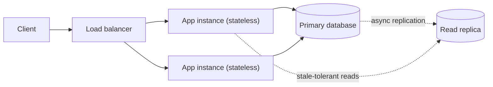

**Numbers.** Optimistic concurrency fails when another write lands inside your read-to-write window. If a row receives `λ` updates per second and each transaction holds the version for `T` seconds, the chance of a conflict is roughly `1 − e^(−λT)`. At `λ = 5/s` and `T = 50 ms`, `λT = 0.25`, so about 22% of attempts retry. At 0.1 updates/s the rate falls to 0.5%. That is why optimistic locking suits rarely contended rows, and why a hot row (a global counter, a popular item's stock) needs a conditional update, a lock or sharding of the counter.

A single well-tuned relational primary handles roughly thousands to tens of thousands of simple write transactions per second, depending on hardware, row size and durability settings. Stack Overflow served one of the busiest sites on the web from a handful of SQL Server machines for years.

**Where it's used.** Most SaaS products, admin tools, catalogs, CRMs and back offices. Stack Overflow's [2016 architecture](https://nickcraver.com/blog/2016/02/17/stack-overflow-the-architecture-2016-edition/) is a well-known example of a large CRUD system on a few databases.

**Trade-offs and failure modes.**

- History disappears on update unless you add an audit table, temporal tables or an outbox.
- Read-modify-write in application code without a version check silently loses updates.
- The default isolation level (Read Committed in PostgreSQL) does not prevent every anomaly. Write skew needs `SERIALIZABLE` or an explicit lock.
- Remote calls inside a transaction hold locks for the duration of the call; keep them outside.

Sources: [PostgreSQL transaction isolation](https://www.postgresql.org/docs/current/transaction-iso.html), [Fowler, Optimistic Offline Lock](https://martinfowler.com/eaaCatalog/optimisticOfflineLock.html).

### Transaction script, layered design and domain model

**What it is.** Three ways to organize business logic. A **transaction script** is one procedure per use case. A **layered design** separates presentation, application, domain and data access. A **domain model** puts rules on objects that guard their own invariants, grouped into **aggregates** (Domain-Driven Design).

**How it works.** A transaction script reads rows, applies rules inline and writes rows. It is simple and fast until rules interact. A domain model loads an aggregate, calls a method that checks invariants, and saves the aggregate in one transaction. An aggregate is the **consistency boundary**: everything inside it is consistent at commit; anything outside is updated by reference or eventually.

```text
class Order (aggregate root)
  lines: List<OrderLine>
  status: Draft | Placed | Cancelled
  version: int

  addLine(sku, qty, price):
    require status == Draft
    require lines.count < 100            -- invariant lives here
    lines.add(OrderLine(sku, qty, price))

  place():
    require lines not empty
    status = Placed
    record OrderPlaced(id, total())      -- optional domain event
```

Vaughn Vernon's rules for aggregates: protect true invariants inside one boundary, keep aggregates small, reference other aggregates by ID, and update other aggregates eventually.

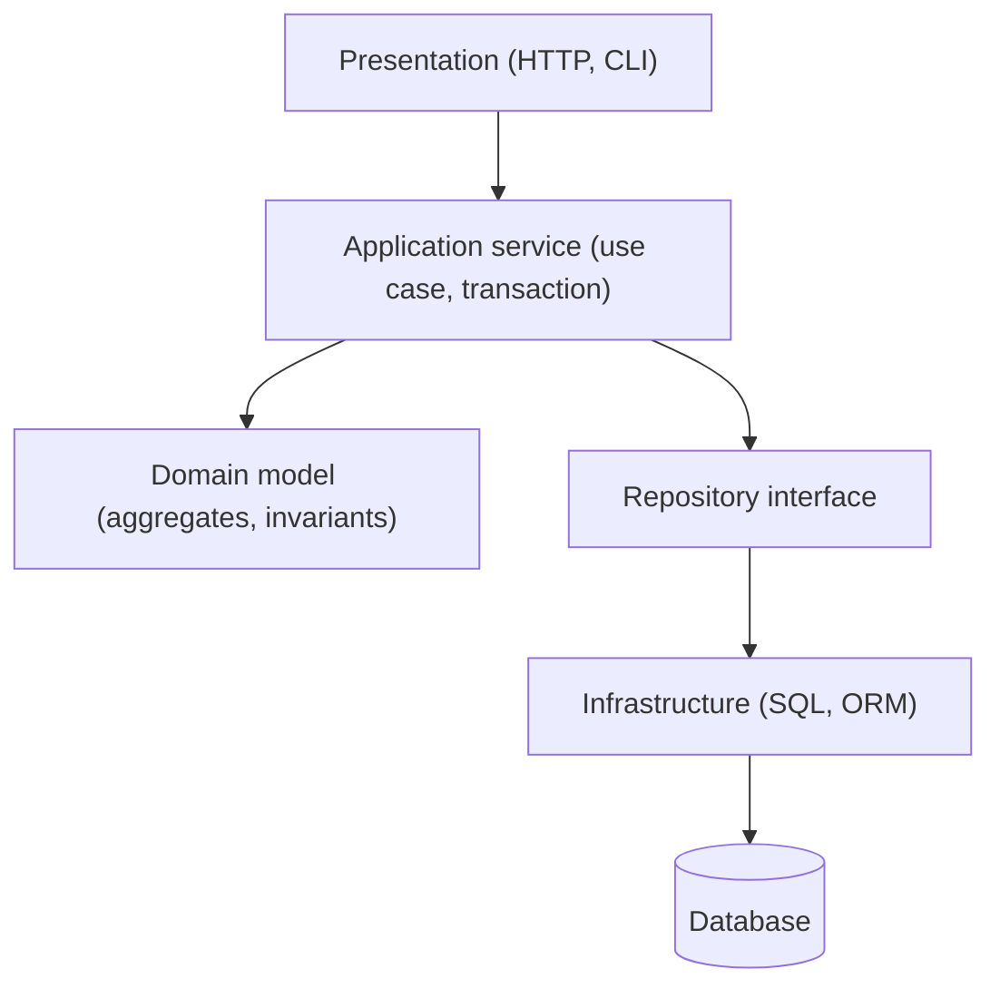

**Numbers.** Aggregate size drives contention. Using the conflict formula from the CRUD section, an aggregate edited by `u` users each writing at rate `r` has `λ = u × r`. A "Project" aggregate holding all tasks, with 20 users each saving every 30 s, has `λ ≈ 0.67/s`; with `T = 100 ms` about 6% of saves conflict. Split tasks into their own aggregates and each sees far less. Hidden lazy loading costs too: listing 100 orders that each lazily load lines issues `1 + 100` queries; at 0.5 ms per round trip that is about 50 ms against roughly 1 ms for one join.

| Approach | Use when | Breaks down when |
|---|---|---|
| Transaction script | Few, independent rules; CRUD screens | Rules duplicate across scripts |
| Layered design | Most applications; clear separation of concerns | Layers only pass data through |
| Domain model | Interacting invariants, rich lifecycle | Simple data entry; heavy reporting queries |

**Where it's used.** Fowler's *Patterns of Enterprise Application Architecture* named transaction script and domain model. DDD aggregates are standard in enterprise Java and .NET codebases, and they map directly to the event-sourced aggregates and actors later in this chapter.

**Trade-offs and failure modes.** Too many layers obscure simple work. Large aggregates cause lock contention and slow loads. An invariant that spans aggregates cannot be enforced in one transaction; either redraw the boundary or accept eventual correction with a process manager.

Sources: [Fowler, Domain Model](https://martinfowler.com/eaaCatalog/domainModel.html), [Fowler, Transaction Script](https://martinfowler.com/eaaCatalog/transactionScript.html), [Vernon, Effective Aggregate Design](https://www.dddcommunity.org/library/vernon_2011/).

### Modular monolith

**What it is.** One deployable application split into modules along business boundaries, where each module exposes a public interface, owns its data and may depend only on declared modules.

**How it works.** Code moves from technical folders (`models/`, `controllers/`) into domain folders (`orders/`, `billing/`, `inventory/`). Each module has:

- A **public API**: the only classes other modules may call.
- **Private tables** (or a private schema) that other modules never query directly.
- A **declared dependency list**, checked by a tool in CI so violations fail the build.

Modules still call each other in process and can share one database transaction when they must. That keeps strict invariants cheap while the boundaries settle.

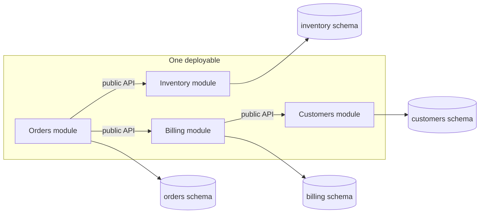

**Numbers.** An in-process call costs nanoseconds to microseconds; a call across a network in one data center costs roughly 0.5–1 ms plus serialization, and adds a failure mode. A request that crosses 6 module boundaries pays nothing extra in a monolith and 3–6 ms plus 6 failure points as microservices. Shopify reported that its core monolith had about 6,000 Ruby classes, manually assigned to components, worked on by more than a thousand developers over a decade. Its Packwerk tool later enforced 48 packages in the core monolith.

**Where it's used.** Shopify's core Rails application is the best-documented example. Shopify built Wedge to score each component's isolation from call graphs collected in CI, and then Packwerk, which statically checks `package.yml` dependency and privacy rules. Fowler's "Monolith First" argues that most successful microservice systems started this way.

**Trade-offs and failure modes.**

- One release train: a bad change in one module rolls back everyone.
- One process: a memory leak or CPU-heavy module affects the rest.
- Boundaries erode without tooling. Shared tables are the most common leak and the hardest to undo.
- Scaling is all or nothing, though a well-cut module is cheap to extract later.

Sources: [Shopify, Deconstructing the Monolith](https://shopify.engineering/deconstructing-monolith-designing-software-maximizes-developer-productivity), [Shopify, Packwerk](https://shopify.engineering/enforcing-modularity-rails-apps-packwerk), [Fowler, Monolith First](https://martinfowler.com/bliki/MonolithFirst.html).

### Bounded-context services and private data ownership

**What it is.** Independently deployable services, each aligned to a bounded context (a part of the domain with its own consistent language and model) and each the only owner of its data: **database per service**.

**How it works.** A service owns its tables; no other service reads or writes them. Others get data through the owner's API or through events it publishes. "Database per service" can mean a private schema, a private database on a shared server, or a separate server; the rule is about access, not hardware.

Conway's law shapes the boundaries: "organizations which design systems are constrained to produce designs which are copies of the communication structures of these organizations." Teams that own one context end to end can release without coordination. Cutting services that cross team lines produces chatty interfaces and coordinated deploys.

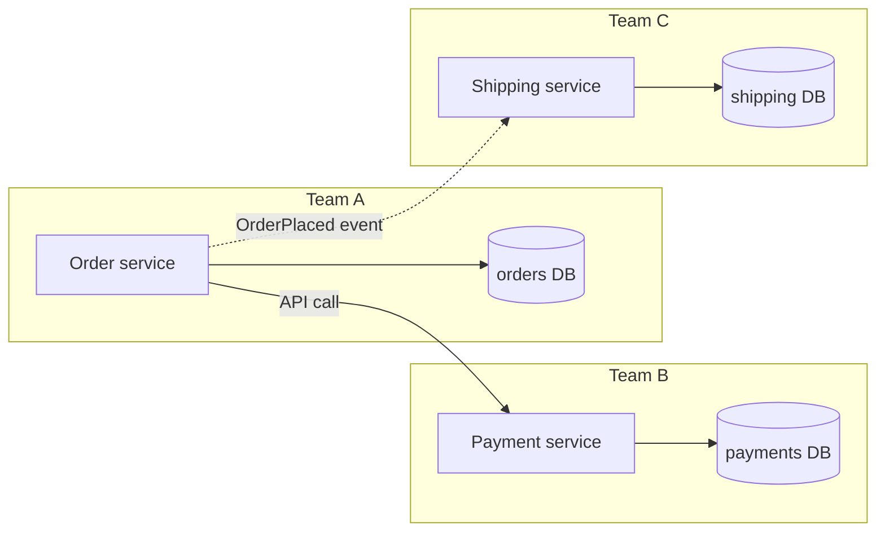

**Numbers.** Communication paths in a team grow as `n(n − 1)/2`: 8 people have 28 paths, 20 people have 190. Small teams that own one service each keep that number low; that is the reasoning behind Amazon's two-pizza teams. The cost appears in availability and latency. A request that synchronously needs `k` services, each 99.9% available, is at most `0.999^k` available: 99.5% for `k = 5`, 99.0% for `k = 10`. Cross-service queries become network joins: fetching 50 orders and then each customer one by one is 51 round trips; batch the lookup.

**Where it's used.** Amazon moved from a two-tier monolith to services that own their data; Werner Vogels described it in a 2006 ACM Queue interview, including the rule that service data is accessible only through the service's interface ("you build it, you run it" comes from the same interview). The [microservices.io database-per-service pattern](https://microservices.io/patterns/data/database-per-service.html) describes the data rule.

**Trade-offs and failure modes.**

- An invariant that spans two services can no longer be one transaction. Use a saga, a reservation, or redraw the boundary.
- One service per table is the classic mistake: maximum coupling, minimum autonomy.
- Contract changes need versioning and consumer-driven tests.
- Distributed debugging needs tracing and correlation IDs from day one.

Sources: [Conway, How Do Committees Invent? (1968)](https://www.melconway.com/Home/Committees_Paper.html), [Vogels interview, ACM Queue 2006](https://queue.acm.org/detail.cfm?id=1142065), [Fowler, Bounded Context](https://martinfowler.com/bliki/BoundedContext.html).

### Shared database across services

**What it is.** Several services read and write the same database tables. It is fine as a deliberate transition step and harmful as a permanent design.

**How it works.** Each service connects to one schema and runs its own queries. Cross-service invariants can use ordinary transactions and joins, which is why it is tempting. The coupling is invisible: a column rename or a long-running query in one service breaks or slows another.

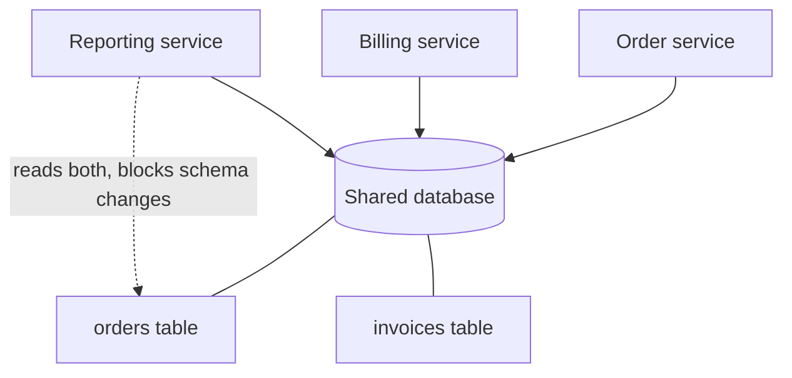

**Numbers.** Two costs grow with the number of services `S`:

- **Connections:** `S × instances × pool size`. Ten services with 20 instances and a pool of 10 open 2,000 connections. PostgreSQL's default `max_connections` is 100, and each connection is a backend process, so you need a pooler such as PgBouncer.
- **Schema change coordination:** a change to a table read by `k` services needs `k` teams to deploy compatible code first. With expand-and-contract, each change takes at least two releases per affected service.

**Where it's used.** Most monolith-to-services migrations pass through this stage. Chris Richardson documents it as the "shared database" pattern, with its drawbacks next to database per service.

**Trade-offs and failure modes.**

- Release independence is lost: the schema is a shared, unversioned API.
- Runtime coupling: one service's slow query or lock storm affects all.
- Ownership blurs; nobody can safely refactor a table. Plan the exit: assign each table one owning service, put views or APIs in front of it for the others, then move it.

Sources: [microservices.io, Shared database](https://microservices.io/patterns/data/shared-database.html), [PostgreSQL connection settings](https://www.postgresql.org/docs/current/runtime-config-connection.html).

### Synchronous API composition and backends for frontends

**What it is.** **API composition** answers a query by calling several services and merging their responses. A **backend for frontend (BFF)** is a composition layer built for one client type (iOS, web, TV) and usually owned by that client's team.

**How it works.** The composer receives a client request, fans out calls (in parallel when they don't depend on each other), applies per-call deadlines, merges, and trims the payload for the client. A BFF adds client-specific shaping: fewer fields for a TV, a different page structure for mobile. Gateways handle cross-cutting concerns (auth, rate limits, routing); BFFs handle client-specific composition; business rules stay in the services.

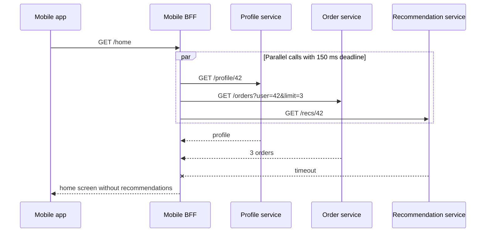

**Numbers.**

- **Latency:** sequential calls cost `Σ tᵢ`; parallel calls cost `max(tᵢ)`. Five calls of 40 ms each take 200 ms sequentially and about 40 ms in parallel, plus the slowest one's variance.
- **Tail:** if each call exceeds its p99 with probability 1%, a request with 5 parallel calls hits at least one slow call with probability `1 − 0.99^5 ≈ 4.9%`. Your p99 becomes roughly each dependency's p95.
- **Availability:** required calls multiply: `0.999^5 ≈ 99.5%`. Making recommendations optional (degrade instead of fail) removes it from the product, so four required calls give 99.6%.

**Where it's used.** Netflix redesigned its API around device-specific endpoints: client teams wrote Groovy adapter scripts on the server that fanned out to Java service APIs, to reduce chattiness and payload size. Sam Newman named the BFF pattern from work at SoundCloud. The API gateway itself is covered in the [infrastructure chapter](tutorials/infrastructure-building-blocks/).

**Trade-offs and failure modes.**

- Each BFF duplicates some orchestration; shared logic drifts.
- The composer is a new failure domain with fan-out load: one client request becomes `n` backend requests.
- No transactional consistency across the merged data. Two services can disagree within one response.
- Retries at the BFF and in each service multiply. Retry at one layer.

Sources: [Newman, Backends For Frontends](https://samnewman.io/patterns/architectural/bff/), [microservices.io, API composition](https://microservices.io/patterns/data/api-composition.html), [InfoQ, Netflix API optimization](https://www.infoq.com/news/2013/02/netflix-api-optimization/).

### Hexagonal architecture (ports and adapters)

**What it is.** A way to structure one application so the domain core depends only on interfaces it defines (**ports**), and every technology (HTTP, database, message broker, payment provider) plugs in through **adapters**. Alistair Cockburn named it in 2005.

**How it works.** Dependencies point inward. **Driving** (primary) adapters call the application: an HTTP controller, a queue consumer, a test. **Driven** (secondary) adapters implement ports the core needs: a repository, a payment gateway, a clock.

```text
// Driven port, defined by the core in the core's language
interface PaymentGateway {
  authorize(orderId: OrderId, amount: Money, idempotencyKey: string): AuthResult
}

// Driving port: the use case the core offers
interface PlaceOrder {
  execute(cmd: PlaceOrderCommand): OrderId
}

// Adapters live outside the core
class StripePaymentGateway implements PaymentGateway { ... }   // production
class FakePaymentGateway  implements PaymentGateway { ... }    // tests
```

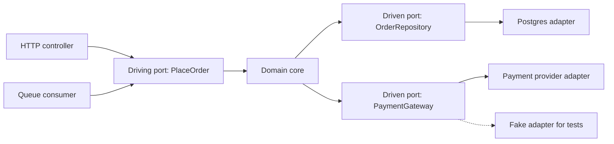

**Numbers.** The main payoff is test speed and isolation. A domain test against in-memory adapters runs in roughly a millisecond; one that starts a database and calls a sandbox API takes roughly 100–500 ms. A suite of 2,000 domain tests runs in about 2 s instead of 3–15 minutes, which changes how often engineers run it.

**Where it's used.** Netflix described moving a studio application to hexagonal architecture so it could swap data sources (from a monolith's API to new services) without touching business logic. The pattern is close to Clean Architecture and Onion Architecture; all three keep the domain free of framework imports.

**Trade-offs and failure modes.**

- More interfaces and mapping code. For a CRUD screen, it is ceremony.
- A port hides the network but not its behavior: latency, partial failure, transaction boundaries and schema constraints still leak through. A repository port that pretends a remote call is local invites N+1 calls.
- It governs code dependencies inside one service. It says nothing about how services are distributed.

Sources: [Cockburn, Hexagonal Architecture](https://alistair.cockburn.us/hexagonal-architecture/), [Netflix, Ready for changes with Hexagonal Architecture](https://netflixtechblog.com/ready-for-changes-with-hexagonal-architecture-b315ec967749).

## Data and interactions

These patterns decide how state changes travel between owners and how reads are served.

### Event-driven integration

**What it is.** Services communicate by publishing facts about what happened ("OrderPlaced") to a broker, and other services react on their own schedule. The publisher doesn't know or wait for its consumers.

**How it works.** The producer commits a state change and, through a [transactional outbox](tutorials/application-design-patterns/#outbox-and-inbox-step-by-step) or a durable event store, publishes an event to a topic. Each consumer group reads at its own pace, dedupes by event ID, and updates its own data. Events come in two shapes:

| Shape | Payload | Consumer does | Trade-off |
|---|---|---|---|
| Event notification | `{"type":"OrderChanged","orderId":42}` | Calls back to the producer for details | Small, stable schema; callback load and coupling at read time |
| Event-carried state transfer | Full order snapshot or the changed fields | Acts alone, keeps a local copy | Larger payloads, stronger schema contract, consumers hold stale copies |

**Schema evolution.** Treat events as a public API. Use a schema registry (Avro, Protobuf or JSON Schema) with a compatibility rule. Backward compatibility (new consumers can read old events) allows adding optional fields and removing fields; full compatibility also lets old consumers read new events. Never reuse a field's name with a new meaning; publish a new event type or version instead. Include `eventId`, `eventType`, `version`, `occurredAt` and the entity key in every envelope.

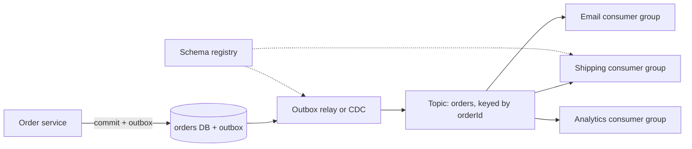

**Numbers.**

- **Availability:** with a synchronous call chain, the order flow needs `A_order × A_shipping × A_email`. With events, placing an order needs only `A_order × A_broker`; downstream outages turn into lag, not errors.
- **Lag:** `lag ≈ backlog ÷ (consumer throughput − arrival rate)` while draining. A 2 hour shipping outage at 500 events/s leaves 3.6 M events; a consumer that processes 2,000/s drains it in `3.6M ÷ 1,500 = 2,400 s`, about 40 minutes.
- **Storage:** event-carried state at 2 KB × 1,000 events/s is 2 MB/s, about 173 GB/day before replication; at replication factor 3 that is about 520 GB/day. Kafka's default maximum message size is about 1 MB, so large payloads go to object storage with a reference (claim check).

**Where it's used.** Kafka was built at LinkedIn to move activity and change events between systems; it is now the default backbone for event-driven integration. Confluent Schema Registry defaults to backward compatibility.

**Trade-offs and failure modes.**

- No end-to-end transaction: consumers see the fact later and may fail independently.
- Ordering holds only per partition key; events for different keys interleave.
- Delivery is at least once; consumers must be idempotent.
- The business process becomes implicit across subscribers (see choreography below). Tracing must propagate across the broker.

Sources: [Fowler, What do you mean by "Event-Driven"?](https://martinfowler.com/articles/201701-event-driven.html), [Confluent, Schema evolution and compatibility](https://docs.confluent.io/platform/current/schema-registry/fundamentals/schema-evolution.html), [Kafka design](https://kafka.apache.org/documentation/#design).

### CQRS

**What it is.** Command Query Responsibility Segregation: one model handles writes (commands that enforce rules), a different model handles reads (queries shaped for screens). It does not require separate databases, events or event sourcing.

**How it works.** Two levels:

| Level | Write side | Read side | Freshness |
|---|---|---|---|
| Same database | Normalized tables, domain model | SQL views, materialized views or separate read tables updated in the same transaction | Immediate (or at refresh for materialized views) |
| Separate read store | Normalized tables or event store | Elasticsearch, Redis, a denormalized table, a column store, fed by events or CDC | Eventually consistent: projection lag |

A **projector** consumes changes in order per entity, updates the read model idempotently, and stores its checkpoint (log offset or last event version) in the same transaction as the read-model update. Rebuilding means resetting the checkpoint and replaying.

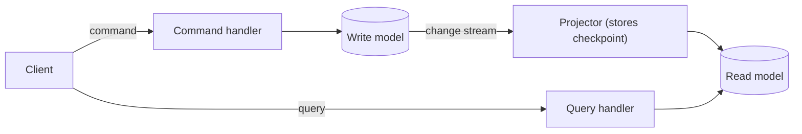

**Numbers.**

- **Projection lag** = backlog ÷ net drain rate. Steady state with spare capacity is usually tens to hundreds of milliseconds; it grows without bound once arrivals exceed projector throughput.
- **Rebuild time** = events ÷ replay throughput. Replaying 500 M events at 20,000/s takes 25,000 s, about 7 hours. Plan rebuilds as blue-green: build the new projection beside the old, then switch.
- **Read-your-writes:** a user who submits a form and immediately reloads expects to see it. Return the new version from the command, and have the query wait until the projection's checkpoint reaches that version (with a short timeout) or read that one entity from the write model.

**Where it's used.** Greg Young popularized the term; Microsoft's Azure Architecture Center and Fowler both describe it and warn it adds risk to most systems. A common real form: an order database for writes plus a search index or denormalized "order history" table for the customer's list page.

**Trade-offs and failure modes.**

- Two models to maintain; a separate store adds propagation, backfills and freshness rules.
- Stale reads confuse users unless you design read-your-writes.
- A projector bug corrupts the read model silently; you need a rebuild path and reconciliation checks.
- Fowler's warning stands: use it on specific bounded contexts, not on the whole system.

Sources: [Fowler, CQRS](https://martinfowler.com/bliki/CQRS.html), [Azure, CQRS pattern](https://learn.microsoft.com/en-us/azure/architecture/patterns/cqrs).

### Event sourcing

**What it is.** The authoritative record of an entity is its ordered list of domain events; current state is derived by folding over them. A service is event-sourced only when that history governs its state changes, not when it merely publishes or archives events.

**How it works.** Each aggregate has a stream (`order-42`). To handle a command: load the latest snapshot if any, replay later events to rebuild state, decide, and append new events **with the expected version**. The store rejects the append if another writer got there first; that is optimistic concurrency on the stream.

```text
handle(cmd: CancelOrder):
  (state, version) = load("order-" + cmd.orderId)   -- snapshot + later events
  if state.status == Shipped: reject("already shipped")
  events = [OrderCancelled(cmd.orderId, cmd.reason, now())]
  store.append("order-" + cmd.orderId, events, expectedVersion = version)
  -- WrongExpectedVersion: reload and retry, or reject

-- Minimal relational event store
CREATE TABLE events (
  stream_id   text,
  version     bigint,
  global_pos  bigserial,
  type        text,
  schema_ver  int,
  payload     jsonb,
  metadata    jsonb,
  PRIMARY KEY (stream_id, version)   -- the unique key enforces the expected-version check
);
```

**Projections** subscribe to the global order (`global_pos`) to build read models, as in CQRS. **Snapshots** store folded state every `k` events to bound load time. **Versioning:** old events are immutable, so an **upcaster** converts `OrderPlaced v1` into `v2` at read time (for example, adding a default currency). For corrections, append a compensating event; don't edit history.

**Sensitive data and GDPR.** Immutable history conflicts with the right to erasure. Options: keep personal data out of events and reference it by ID; or **crypto-shredding**: encrypt each person's fields with a per-person key held in a separate key store, and delete the key to make those fields unreadable everywhere, including backups.

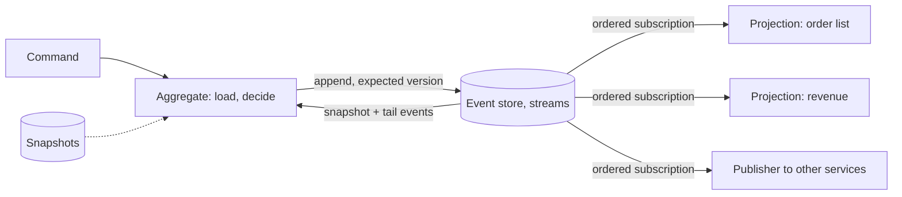

**Numbers.**

- **Growth:** 10 M orders × 30 events × 500 bytes = 150 GB per year of orders, before indexes and replicas. Event stores grow forever unless you archive closed streams.
- **Load time:** with replay at roughly 10–50 µs per event in memory plus read I/O, a 5,000-event stream costs 50–250 ms to rebuild. With a snapshot every `k = 100` events you replay at most 99 and on average about 50: a few milliseconds. The snapshot adds `1/k` extra writes per event.
- **Concurrency:** the expected-version check behaves like the optimistic formula in the CRUD section: `1 − e^(−λT)` per stream. Keep streams small and hot streams rare.

**Where it's used.** Accounting ledgers are the oldest form: entries are never erased, only reversed. LMAX's exchange runs its business logic in memory with event sourcing, snapshots nightly, and restarts by replaying a day's journal in under a minute. EventStoreDB (now KurrentDB) and Marten (on PostgreSQL) are purpose-built stores; both expose expected-version appends.

**Trade-offs and failure modes.**

- Event schema evolution is permanent work; every past version must stay readable.
- Rebuilds, reprocessing and projection bugs are operational burdens.
- Querying across aggregates needs projections; there is no `SELECT ... WHERE` on current state without one.
- It does not give exactly-once side effects. A projector or publisher still needs checkpoints and idempotency.
- It is a poor fit for CRUD domains where nobody needs the history.

Sources: [Fowler, Event Sourcing](https://martinfowler.com/eaaDev/EventSourcing.html), [Azure, Event Sourcing pattern](https://learn.microsoft.com/en-us/azure/architecture/patterns/event-sourcing), [Fowler, The LMAX Architecture](https://martinfowler.com/articles/lmax.html).

## Business coordination

These patterns coordinate work that spans owners, services or time.

### Saga orchestration

**What it is.** A long-running business transaction split into local transactions, driven by a central orchestrator that tells each participant what to do and runs compensating actions when a step fails. Garcia-Molina and Salem introduced sagas in 1987.

**How it works.** The orchestrator persists the saga's state before and after each step, so a crash resumes from the last recorded step. Each step is a command with an idempotency key (saga ID plus step name); each compensation is a business action (refund, release), not a rollback. Steps after a **pivot** (the point of no return, such as shipping) are retried until they succeed instead of compensated.

```text
saga_instance
  saga_id        uuid PK
  type           'PlaceOrder'
  state          'PAYMENT_PENDING'
  data           jsonb      -- orderId, amount, reservationId ...
  version        int        -- optimistic lock on the instance
  deadline_at    timestamp  -- timer for the current step
  updated_at     timestamp
```

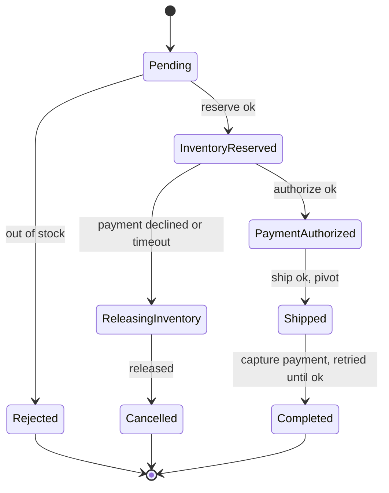

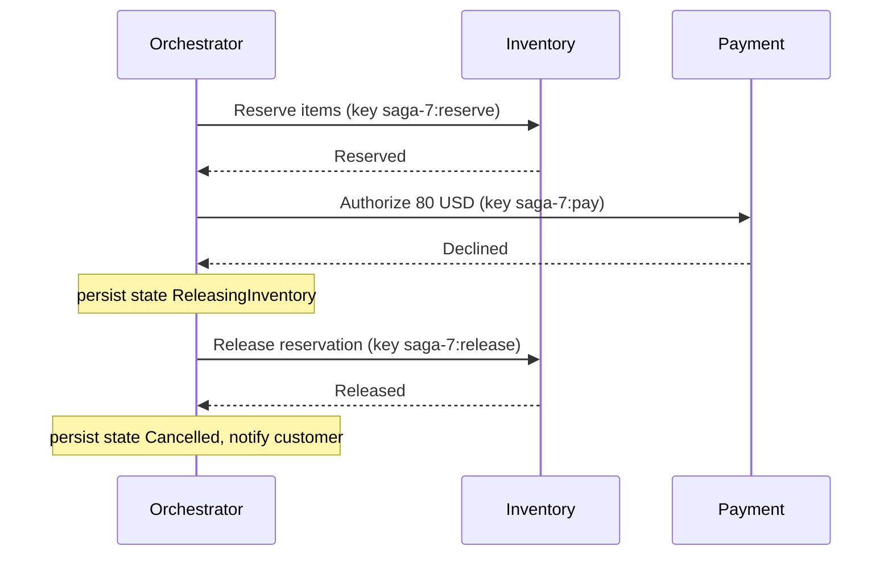

**Numbers.** If step `i` fails with probability `fᵢ`, the share of sagas that compensate is `1 − Π(1 − fᵢ)`. Four steps at 1% each: `1 − 0.99^4 ≈ 3.9%`. At 100 orders/s, about 4 sagas per second compensate, and compensations themselves fail sometimes, so plan a queue of sagas needing human repair. The orchestrator costs about 2 durable writes per step (command sent, reply recorded); a 4-step saga at 100/s needs about 800 writes/s plus timer storage.

**Where it's used.** Uber built Cadence for long-running business logic; its creators forked it as Temporal. AWS Step Functions and Azure Durable Functions provide the same model as managed services. In these engines, workflow code is deterministic and replayed from recorded history, while activities (the side-effecting calls) are retried and may run more than once.

**Trade-offs and failure modes.**

- No isolation: other requests see intermediate states. Model them (`PAYMENT_PENDING`) or use reservations.
- Compensations can fail or be impossible (an email was sent). Make them idempotent and retryable, and alert on stuck sagas.
- Workflow code changes need versioning; in-flight sagas still run the old logic.
- The orchestrator is logically central but can be replicated; its store is the real dependency.

Sources: [Garcia-Molina and Salem, Sagas (1987)](https://www.cs.cornell.edu/andru/cs711/2002fa/reading/sagas.pdf), [microservices.io, Saga](https://microservices.io/patterns/data/saga.html), [Temporal, Workflow Execution](https://docs.temporal.io/workflow-execution), [AWS, Saga orchestration](https://docs.aws.amazon.com/prescriptive-guidance/latest/cloud-design-patterns/saga-orchestration.html).

### Saga choreography

**What it is.** The same multi-step transaction without a coordinator: each participant listens for events, does its local transaction, and emits the next event. Compensation is also triggered by events.

**How it works.** Order publishes `OrderCreated`; Inventory reserves and publishes `InventoryReserved`; Payment charges and publishes `PaymentCompleted` or `PaymentFailed`; on `PaymentFailed`, Inventory releases and Order cancels. Each service persists its own part of the state and dedupes events by ID. Nobody holds the whole process; it exists only in the subscriptions.

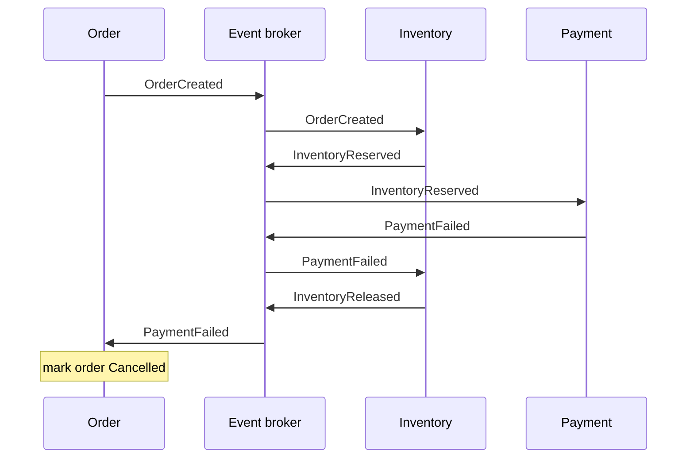

**Orchestration vs choreography.**

| Concern | Orchestration | Choreography |
|---|---|---|
| Where the process lives | One workflow definition | Spread across subscribers |
| Timeouts ("payment never answered") | Orchestrator timer | Someone must own a timer; often nobody does |
| Adding a step | Change the orchestrator | Change subscriptions in several services |
| Coupling | Orchestrator knows participants' commands | Participants know each other's events |
| Messages per step | Command + reply (2) | One event (1), fanned out |
| Visibility | Query the saga state | Reconstruct from traces and logs |
| Best for | Branching, timers, many steps, human steps | 2–4 stable participants, simple linear flows |

**Numbers.** Choreography's hidden cost is understanding, not messages. A flow with `n` participants where each may react to any other's events has up to `n(n − 1)` possible subscription edges: 12 for 4 services, 30 for 6. Each edge is a contract to evolve and a possible cycle. Message volume is lower: a 4-step choreographed saga emits about 4 events against about 8 messages for orchestration.

**Where it's used.** Common in event-driven systems built on Kafka or Amazon EventBridge where a few services react to domain events. AWS's prescriptive guidance describes it alongside orchestration and recommends it for simpler flows.

**Trade-offs and failure modes.**

- Cycles: two services reacting to each other's events can loop.
- A missing event leaves the process stuck with no component noticing. Add a timeout owner or a reconciliation job.
- Choreography removes the coordinator, not the coupling: services still depend on each other's event schemas.

Sources: [AWS, Saga choreography](https://docs.aws.amazon.com/prescriptive-guidance/latest/cloud-design-patterns/saga-choreography.html), [microservices.io, Saga](https://microservices.io/patterns/data/saga.html).

### Reservation and Try-Confirm-Cancel

**What it is.** Hold a scarce resource provisionally, then confirm or release it. **Try-Confirm-Cancel (TCC)** makes this a protocol: every participant offers `try` (reserve), `confirm` (make permanent) and `cancel` (release), and a reservation expires on its own if neither arrives.

**How it works.** `try` creates a reservation row with a TTL and decrements available stock in one local transaction. `confirm` turns it into a sale; `cancel` or expiry returns the stock. All three are idempotent on the reservation ID, and a late `confirm` after expiry must fail cleanly.

```sql
-- Try: reserve 2 seats if available, in one transaction
UPDATE inventory SET available = available - 2
WHERE sku = 'SEAT-A' AND available >= 2;
INSERT INTO reservations (id, sku, qty, status, expires_at)
VALUES ('r-91', 'SEAT-A', 2, 'HELD', now() + interval '10 minutes');

-- Confirm: only a HELD, unexpired reservation can be confirmed
UPDATE reservations SET status = 'CONFIRMED'
WHERE id = 'r-91' AND status = 'HELD' AND expires_at > now();
```

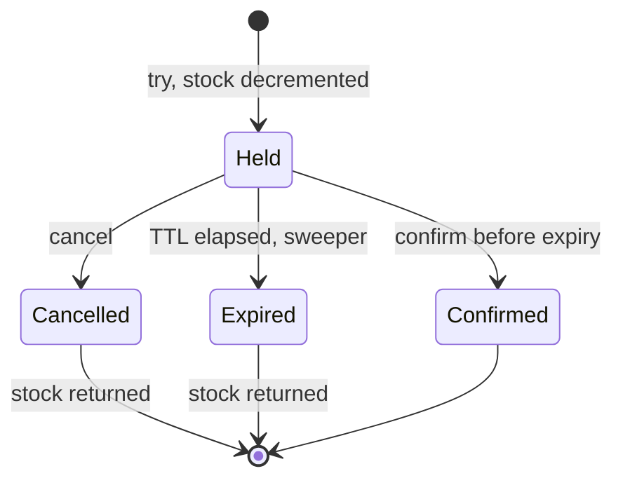

**Numbers.** By Little's law, units held at any moment = reservation rate × hold time. At 200 reservations/s with a 10 minute TTL and an average hold of 4 minutes for completed checkouts, but the full 10 minutes for the 30% that abandon, the average hold is `0.7 × 240 + 0.3 × 600 = 348 s`, so about 70,000 units are held. For a 50,000 seat event that sells out in holds before anyone pays. Shorter TTLs or a per-user hold cap fix it. Sweepers add lag: with a sweep every 30 s, stock returns up to 30 s late.

**Where it's used.** Ticketing seat holds, hotel and airline bookings, flash sales, and cloud capacity reservations. Atomikos described TCC for REST services, and Apache Seata (from Alibaba) offers a TCC mode. Pat Helland's "Life beyond Distributed Transactions" describes the same tentative-operation idea between entities.

**Trade-offs and failure modes.**

- Confirm racing expiry: the conditional update above decides the winner; the payment side must handle the loser (refund).
- Stranded holds when the sweeper stops: monitor held stock and oldest hold age.
- `cancel` can arrive before `try` (reordered messages). Record a tombstone so a late `try` is refused.
- It is not global ACID: other participants can be confirmed while one fails.

Sources: [Helland, Life beyond Distributed Transactions](https://queue.acm.org/detail.cfm?id=3025012), [Apache Seata, TCC mode](https://seata.apache.org/docs/user/mode/tcc/), [microservices.io, Saga](https://microservices.io/patterns/data/saga.html).

### Scatter-gather

**What it is.** Send one request to many recipients in parallel and aggregate their answers under an explicit completion rule.

**How it works.** An aggregator splits the request (by shard, provider or region), sends all parts with a shared deadline, and merges results as they arrive. The **completion rule** decides when to answer:

| Rule | Answers when | Example |
|---|---|---|
| All | Every branch responds | Exact count across shards |
| Deadline | Time is up, with whatever arrived | Search results, price quotes |
| Quorum or required subset | Enough or the critical branches responded | Replicated reads, mandatory providers |
| Good enough | First `k` acceptable answers | Cheapest of several suppliers |

The response must say whether it is partial. Hedged requests (send a second copy after the p95 delay) reduce tails when there is spare capacity.

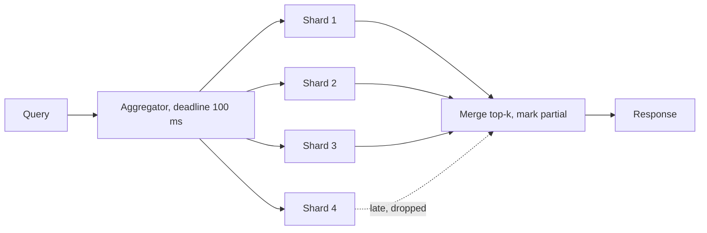

**Numbers.** If each branch is fast with probability `p`, all `n` are fast with probability `pⁿ`. "The Tail at Scale" gives the canonical example: if one server's p99 is 1 s and a request fans out to 100 servers, 63% of requests take more than 1 s (`1 − 0.99^100 ≈ 0.63`). Load multiplies too: 1,000 queries/s over 50 shards is 50,000 shard requests/s. A two-phase search (query then fetch) doubles the round trips.

**Where it's used.** Web search serving trees at Google (the source of "The Tail at Scale"). Elasticsearch runs every search as scatter-gather across shards, with query and fetch phases. Travel and insurance sites gather quotes from many providers under a deadline.

**Trade-offs and failure modes.**

- Tail latency and fan-out load grow with `n`. Bound `n`, or partition so most queries hit few shards.
- Partial results must be visible to the caller; silently missing shards produce wrong answers.
- Retrying a whole fan-out multiplies load; retry only the failed branches, within the deadline.

Sources: [Dean and Barroso, The Tail at Scale](https://research.google/pubs/the-tail-at-scale/), [AWS, Scatter-gather](https://docs.aws.amazon.com/prescriptive-guidance/latest/cloud-design-patterns/scatter-gather.html), [Hohpe, Enterprise Integration Patterns: Scatter-Gather](https://www.enterpriseintegrationpatterns.com/patterns/messaging/BroadcastAggregate.html).

### Pipes and filters

**What it is.** A processing job decomposed into independent stages (filters) connected by channels (pipes). Each stage does one transformation and can scale, deploy and fail on its own.

**How it works.** A stage reads from its input queue or topic, transforms, writes to its output, and commits its input position after the output is durable. That gives at-least-once processing, so each stage must be idempotent or deduplicate. Bounded channels apply backpressure; checkpoints let a restarted stage resume. Stream processors (Kafka Streams, Flink) add exactly-once state within their own boundary by checkpointing state and offsets together.

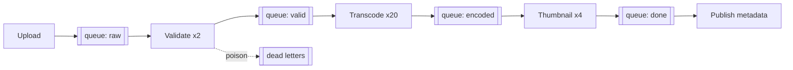

**Numbers.** Pipeline throughput is the slowest stage: `X = min(instancesᵢ × rateᵢ)`. With validation at 2 × 500/s = 1,000/s, transcoding at 20 × 2/s = 40/s and thumbnails at 4 × 50/s = 200/s, the pipeline does 40 videos/s; the queue in front of transcoding grows at `arrivals − 40` per second. End-to-end latency is `Σ (queue wait + service time)`. Scale the bottleneck stage, not all stages.

**Where it's used.** Unix pipelines are the original. Media pipelines (upload, transcode, thumbnail), log ingestion, ETL, and stream processing in Kafka Streams and Apache Flink. Microsoft documents it as a cloud design pattern.

**Trade-offs and failure modes.**

- A poison message blocks an ordered stage; route it to a dead-letter queue with an alert.
- Duplicate effects after crashes; side effects outside the pipeline (emails, payments) need idempotency keys.
- Stage versions must stay compatible with messages already in the queues.
- Many small stages add serialization and hop latency; merge stages that always scale together.

Sources: [Azure, Pipes and Filters](https://learn.microsoft.com/en-us/azure/architecture/patterns/pipes-and-filters), [Flink, Fault tolerance via state snapshots](https://nightlies.apache.org/flink/flink-docs-stable/docs/learn-flink/fault_tolerance/).

### Single-writer entity and actor ownership

**What it is.** Every entity (an account, a game session, a cart) has exactly one owner at a time that processes its commands sequentially. Owning the entity removes locks: the owner's in-memory state is the serialization point.

**How it works.** Commands for an entity are routed by its ID to the node that hosts it. The owner handles one message at a time from a mailbox, updates memory, and persists (a database write, an event append, or a journal). Frameworks differ in how ownership is placed:

- **Virtual actors (Microsoft Orleans):** actors ("grains") always logically exist. The runtime activates one on first message, places it on a server, routes messages to it wherever it lives, and deactivates it when idle.
- **Sharded entities (Akka Cluster Sharding):** entity IDs hash to shards; a coordinator assigns shards to nodes and moves them on rebalance or failure.
- **Single writer thread (LMAX):** all business logic for a market runs on one thread fed by an ordered input journal.

Ownership transfer is the hard part: a paused old owner must not keep writing. Use leases with fencing, or make the persistence layer reject stale writers (an expected version on append).

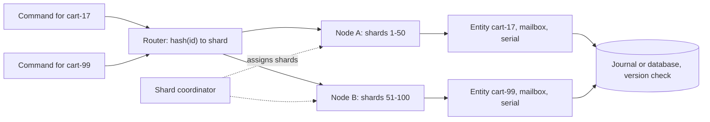

**Numbers.** One entity's throughput is capped at `1 ÷ service time`: at 1 ms per command, 1,000 commands/s per entity, however many nodes you add. If each command waits on a 5 ms database write, the cap drops to about 200/s unless you batch writes. Across entities it scales linearly. Doing the work in memory on one thread can be very fast: LMAX reported 6 million orders per second on a single thread.

**Where it's used.** Orleans has run in production at Microsoft since 2011 and powered the Halo 4 services. Akka Cluster Sharding is used for carts, sessions and IoT devices. LMAX's exchange uses a single-writer business logic processor.

**Trade-offs and failure modes.**

- Hot entities (a celebrity's feed, a popular auction) cap at one owner's throughput; split the entity or shard its state.
- Failover pauses that entity's traffic until a new owner activates and recovers state.
- In-memory state is lost on crash unless persisted before acknowledging.
- Cross-entity operations need a saga or reservation; actors don't give multi-entity transactions.

Sources: [Bernstein et al., Orleans: Distributed Virtual Actors](https://www.microsoft.com/en-us/research/publication/orleans-distributed-virtual-actors-for-programmability-and-scalability/), [Akka Cluster Sharding](https://doc.akka.io/libraries/akka-core/current/typed/cluster-sharding.html), [Fowler, The LMAX Architecture](https://martinfowler.com/articles/lmax.html).

## Evolution and isolation

These patterns decide how systems change safely and how far a failure can spread.

### Anti-corruption layer

**What it is.** A translation layer between your domain and a legacy or external system, so the other model's concepts, codes and quirks never leak into yours. Eric Evans named it in *Domain-Driven Design*.

**How it works.** The ACL exposes an interface in your language (`CustomerProfile`, `ShippingQuote`) and implements it by calling the other system and translating: field mapping, code tables (`"ST=07"` to `Shipped`), unit and currency conversion, error mapping, and sometimes caching and retries. In hexagonal terms it is a driven adapter with real logic. It can be a class inside your service or its own service when several consumers need it.

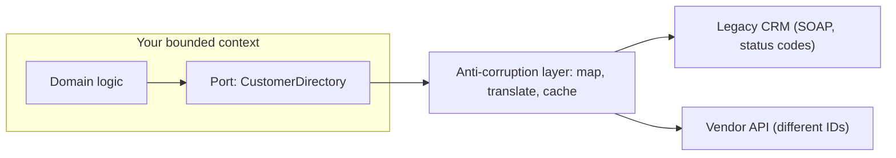

**Numbers.** An ACL as a separate service adds one network hop, roughly 1 ms in the same data center, and its own availability term. A cache in the ACL can protect a fragile legacy system: if the legacy system handles 200 requests/s and the ACL serves 90% from cache, the new system can sustain about 2,000 requests/s (`200 ÷ (1 − 0.9)`), as long as the data can tolerate the cache TTL.

**Where it's used.** Any migration from a mainframe, ERP or CRM; integrating payment, shipping or identity vendors whose models differ from yours. AWS and Microsoft both document it as a modernization pattern.

**Trade-offs and failure modes.**

- Semantic mismatches are the real work: a legacy "customer" may mean an account, a household or a billing contact.
- It can become permanent and grow into a second legacy system. Keep it thin and tested with contract tests against recorded responses.
- It translates; it does not fix the other system's availability or consistency.

Sources: [AWS, Anti-corruption layer](https://docs.aws.amazon.com/prescriptive-guidance/latest/cloud-design-patterns/acl.html), [Azure, Anti-corruption Layer](https://learn.microsoft.com/en-us/azure/architecture/patterns/anti-corruption-layer).

### Strangler fig migration

**What it is.** Replace a legacy system incrementally: put a routing layer in front, move one capability at a time to the new system, and retire the old one when nothing routes to it. Martin Fowler named it after strangler figs he saw in Queensland in 2001.

**How it works.** Four moves, repeated per capability:

1. **Intercept:** a proxy or gateway in front of the legacy system routes by path, header or tenant.
2. **Build and shadow:** the new service receives a copy of real traffic; responses are compared but discarded.
3. **Move reads, then writes:** shift traffic gradually (1%, 5%, 25%, 100%), then **cut over write ownership**: at any moment exactly one system is the authority for each record.
4. **Retire:** remove the legacy path and its data.

**Data during the transition.** Two ways to keep both sides populated:

| Approach | How | Risk |
|---|---|---|
| Dual writes from application code | Write to old and new stores in one request | No atomicity: a crash between writes leaves them divergent; needs reconciliation |
| CDC backfill | Snapshot the legacy table, then stream its change log into the new store | Snapshot and stream must line up (start the stream position before the snapshot); new side lags |
| Write-through ownership flip | New system owns writes and syncs back to legacy via CDC or events | Legacy consumers see lag; flip must be per entity or per tenant |

Prefer CDC or outbox-based sync over application dual writes. Compare old and new continuously; a mismatch rate above a small threshold blocks the next step.

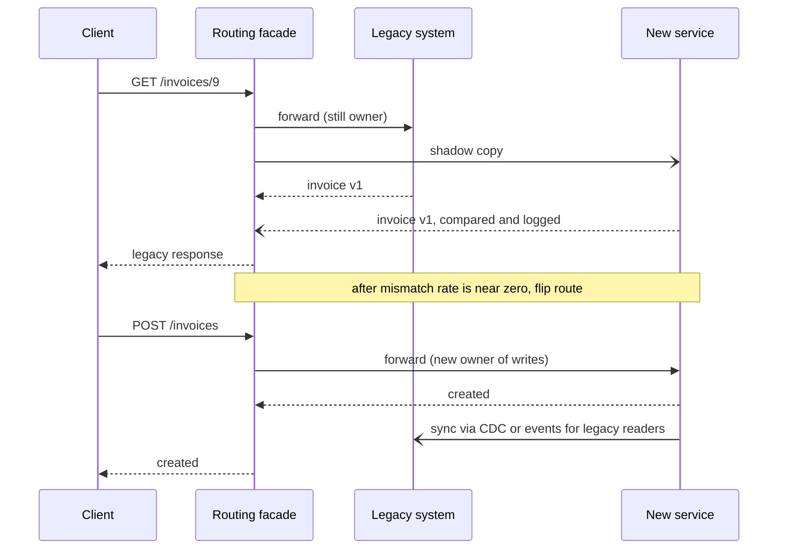

**Numbers.** Shadow traffic doubles load on the new path and on any shared dependency, so shadow a sample (say 10%) of a heavy endpoint. Comparisons need volume to be meaningful: to detect a 0.1% mismatch rate with reasonable confidence you need several thousand compared requests per variant (roughly `3 ÷ rate` gives at least one expected mismatch at about 95% probability, so 3,000 at 0.1%). Each ramp step should run long enough to cover the daily traffic cycle.

**Where it's used.** Fowler's article is the canonical description, updated in 2024 with the idea of transitional architecture. GitHub's open source Scientist library runs the old and new code paths side by side and reports mismatches, which is the shadow-and-compare step in library form. AWS documents the pattern for modernizations.

**Trade-offs and failure modes.**

- You run and pay for two systems, sometimes for years.
- Unclear write ownership is the classic failure: both systems accept writes for the same record and diverge.
- Shadowed writes must never cause side effects (emails, charges); route them to a sandbox.
- Migrations stall at 80% when the hardest capabilities remain; plan for them early.

Sources: [Fowler, Strangler Fig Application](https://martinfowler.com/bliki/StranglerFigApplication.html), [AWS, Strangler fig](https://docs.aws.amazon.com/prescriptive-guidance/latest/cloud-design-patterns/strangler-fig.html), [GitHub, Scientist](https://github.blog/developer-skills/application-development/scientist/).

### Control plane and data plane separation

**What it is.** Split the system into a **control plane** that makes changes (create, configure, scale, delete) and a **data plane** that serves the traffic using the resulting configuration. Design the data plane to keep working with its last known configuration when the control plane is down: **static stability**.

**How it works.** The control plane validates requests, stores desired state in a strongly consistent store, computes configuration and pushes (or lets data-plane nodes pull) versioned snapshots. Data-plane nodes cache the latest snapshot locally, serve every request from it, and never call the control plane on the request path. AWS's guidance adds: pre-provision the capacity you need to survive a failure, rather than relying on the control plane to launch it during the failure.

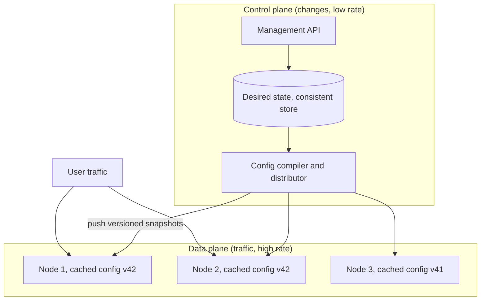

**Numbers.**

- **Availability:** if every request consulted the control plane, request availability would be `A_dp × A_cp`. With cached config it is about `A_dp`; a control-plane outage only blocks changes.
- **Static capacity:** to survive losing one of `N` availability zones without launching anything, each zone must carry `1 ÷ (N − 1)` of peak. With 3 zones that is 50% of peak per zone, 150% total: 50% overprovisioning bought in advance.
- **Staleness:** config propagation time is the window where nodes disagree (v41 vs v42 above). Measure the age of each node's config and alert when it exceeds a bound.

**Where it's used.** AWS describes EC2 this way: launching instances is control plane; routing packets for running instances and serving EBS reads and writes is data plane, which keeps working during control-plane impairment. AWS notes the control plane has more moving parts and is statistically more likely to be impaired, so the data plane targets higher availability. Kubernetes (API server and controllers vs kubelet and kube-proxy) and Envoy (xDS management server vs proxies) follow the same split.

**Trade-offs and failure modes.**

- Stale configuration: during a control-plane outage you can't revoke access or deploy a fix quickly.
- A bad config pushed everywhere at once is a global outage; roll config out in waves, as you would code.
- A hidden data-plane dependency on the control plane (a credential refresh, a lookup on cache miss) defeats the design. Test by turning the control plane off.

Sources: [AWS Builders' Library, Static stability using Availability Zones](https://aws.amazon.com/builders-library/static-stability-using-availability-zones/), [AWS, Fault isolation boundaries: control planes and data planes](https://docs.aws.amazon.com/whitepapers/latest/aws-fault-isolation-boundaries/control-planes-and-data-planes.html).

### Cells and deployment stamps

**What it is.** Run many complete, independent copies of the service stack (**cells**, or **deployment stamps** in Azure terms), each serving a fixed subset of customers, with a thin router in front. A failure, bad deployment or overload stays inside one cell.

**How it works.** Each cell has its own compute, databases and queues, sized to a tested maximum. A **cell router** maps a partition key (tenant ID, account ID) to a cell via a mapping table and should be as simple as possible, since it is shared by everyone. Deployments roll out one cell at a time, starting with a small one. New customers go to new cells; a **cell migration** process moves tenants when a cell fills or a tenant grows. **Shuffle sharding** refines isolation: instead of fixed groups, each customer gets a random combination of `k` workers out of `n`, so two customers rarely share all their workers.

```mermaid
flowchart TB
  U["Requests with tenant ID"] --> RT["Cell router, thin, mapping table"]
  RT -->|tenants A-F| C1
  RT -->|tenants G-M| C2
  RT -->|tenants N-Z| C3
  subgraph C1["Cell 1"]
    A1["App"] --> D1[("DB")]
  end
  subgraph C2["Cell 2"]
    A2["App"] --> D2[("DB")]
  end
  subgraph C3["Cell 3"]
    A3["App"] --> D3[("DB")]
  end
  CPL["Control plane: placement, migration"] -.-> RT
```

**Numbers.**

- **Blast radius** with `N` equal cells is `1/N` of customers: 20 cells limit a cell-wide failure to 5%.
- **Shuffle sharding:** with `n` workers and shard size `k`, there are `C(n, k)` distinct shards. AWS's example uses 8 workers and shards of 2: `C(8, 2) = 28` combinations, so a poison customer affects 1/28 of others, against 1/4 with 4 fixed shards of 2. Route 53 assigns each hosted zone 4 of 2,048 virtual name servers, about 730 billion combinations, and no two zones share more than two name servers.
- **Overlap probability:** a random other customer shares all `k` of your workers with probability `1 ÷ C(n, k)`; at `n = 100, k = 5` that is about 1 in 75 million.
- **Cost:** each cell carries fixed overhead (minimum instances, database, monitoring), and each cell needs headroom; more, smaller cells cost more in total.

**Where it's used.** AWS has used cell-based architecture in its services for more than a decade and published a Well-Architected guide to it in 2023. Slack migrated to a cellular architecture aligned to availability zones after a 2021 gray failure in one AZ, so traffic can be drained from a zone within 5 minutes; the project took about 1.5 years, with stateful services the hardest part. Azure documents the same idea as deployment stamps.

**Trade-offs and failure modes.**

- The router and any shared dependency (identity, a global database) are still global failure domains.
- Cross-cell features (search across all tenants, global uniqueness) need a separate global layer.
- A tenant larger than a cell's maximum breaks the model; plan dedicated cells.
- Tenant migration between cells is a delicate data move; build and practice it before you need it.

Sources: [AWS, Reducing the Scope of Impact with Cell-Based Architecture](https://docs.aws.amazon.com/wellarchitected/latest/reducing-scope-of-impact-with-cell-based-architecture/reducing-scope-of-impact-with-cell-based-architecture.html), [AWS Builders' Library, Workload isolation using shuffle-sharding](https://aws.amazon.com/builders-library/workload-isolation-using-shuffle-sharding/), [Slack, Migration to a cellular architecture](https://slack.engineering/slacks-migration-to-a-cellular-architecture/), [Azure, Deployment Stamps](https://learn.microsoft.com/en-us/azure/architecture/patterns/deployment-stamp).

### Multi-region architecture

**What it is.** Running the system in more than one geographic region for disaster recovery, lower latency or data residency. The key decision is not where you serve traffic but **where each record may be written**.

**How it works.** Three common shapes:

| Shape | Writes | Reads | RPO | RTO | Main risk |
|---|---|---|---|---|---|
| Active-passive (warm standby) | One primary region | Primary; standby may serve stale reads | Replication lag (seconds) | Minutes: detect, promote, reroute | Failover never tested; split brain if the old primary is not fenced |
| Active-active, home-region ownership | Each user or tenant writes in its home region | Local, with remote data stale | Lag for the failed home's records | Minutes to re-home | Users who travel; re-homing during an outage |
| Active-active, multi-writer | Any region | Local | Lag (async) or zero (sync quorum) | Near zero | Conflicts: last-writer-wins drops updates; sync adds WAN RTT to every write |

**Conflict handling** for multi-writer data: last-writer-wins by timestamp (simple, silently loses concurrent updates), CRDTs for counters and sets, application merge functions, or avoid conflicts entirely by giving each record a single home region. Strong multi-region consistency needs a consensus quorum across regions (Spanner, DynamoDB's multi-region strong consistency mode), which costs at least one inter-region round trip per write.

```mermaid
flowchart LR
  DNS["Geo DNS or global load balancer"] --> R1
  DNS --> R2
  subgraph R1["Region us-east, home of US users"]
    A1["App"] --> D1[("Primary for home-us users")]
  end
  subgraph R2["Region eu-west, home of EU users"]
    A2["App"] --> D2[("Primary for home-eu users")]
  end
  D1 -.->|async replication, lag = RPO| D2
  D2 -.->|async replication| D1
  A2 -->|write for a home-us user, forwarded| A1
```

**Numbers.**

- **WAN round trips:** roughly 60–80 ms between US coasts and 70–100 ms between US East and Western Europe. A synchronous cross-region write pays at least one RTT; a quorum write across three regions waits for the second-closest.
- **RPO for async replication = replication lag at the moment of failure.** DynamoDB global tables (eventual mode) replicate typically within a second; AWS states their RPO is the replication delay, usually a few seconds. Aurora Global Database documents RPO typically measured in seconds and RTO in minutes.
- **Availability:** two independent regions at 99.9% give `1 − 0.001² = 99.9999%` in theory; correlated failures (shared control plane, bad global deploy, DNS) make the real figure much lower. DynamoDB's SLA rises from 99.99% for a single-region table to 99.999% for global tables.
- **Cost:** a full active-passive copy roughly doubles infrastructure, plus inter-region transfer for every replicated byte.

**Where it's used.** Facebook's memcache paper describes one master region holding the primary MySQL databases, with other regions serving reads from replicas and using "remote markers" to reduce stale reads after a user's own write. DynamoDB global tables offer both last-writer-wins eventual mode and a three-region strong mode with `RPO = 0`. Google Spanner uses Paxos across replicas and TrueTime for external consistency.

**Trade-offs and failure modes.**

- Failover ambiguity: a slow region looks dead. Fence the old writer before promoting a new one, or you get two primaries.
- Transactions in an eventually consistent multi-region table are atomic only in the region where they ran; other regions may see partial results.
- Data residency rules can forbid replicating some records at all.
- Active-active serving is not multi-writer data. Most systems serve reads everywhere and keep each record's writes in one place.

Sources: [DynamoDB global tables: how it works](https://docs.aws.amazon.com/amazondynamodb/latest/developerguide/V2globaltables_HowItWorks.html), [Aurora Global Database failover](https://docs.aws.amazon.com/AmazonRDS/latest/AuroraUserGuide/aurora-global-database-disaster-recovery.html), [Nishtala et al., Scaling Memcache at Facebook](https://www.usenix.org/conference/nsdi13/technical-sessions/presentation/nishtala), [Corbett et al., Spanner](https://research.google/pubs/spanner-googles-globally-distributed-database-2/).

## Further reading

- **Books:** Martin Kleppmann, *Designing Data-Intensive Applications* (replication, partitioning, stream processing); Chris Richardson, *Microservices Patterns* (sagas, CQRS, API composition); Eric Evans, *Domain-Driven Design* (bounded contexts, aggregates, anti-corruption layers); Sam Newman, *Building Microservices* and *Monolith to Microservices* (strangler fig, data migration).
- **Pattern catalogs:** [AWS cloud design patterns](https://docs.aws.amazon.com/prescriptive-guidance/latest/cloud-design-patterns/introduction.html), [Azure architecture patterns](https://learn.microsoft.com/en-us/azure/architecture/patterns/), [microservices.io](https://microservices.io/patterns/), [Enterprise Integration Patterns](https://www.enterpriseintegrationpatterns.com/).
- **Resilience at scale:** the [Amazon Builders' Library](https://aws.amazon.com/builders-library/), [The Tail at Scale](https://research.google/pubs/the-tail-at-scale/), and Pat Helland's [Life beyond Distributed Transactions](https://queue.acm.org/detail.cfm?id=3025012).
- **In this book:** the [overview and decision tables](tutorials/application-design-patterns/), [low-level primitives](tutorials/low-level-primitives/), [infrastructure building blocks](tutorials/infrastructure-building-blocks/), and [how to run a deep dive](tutorials/interview-format/#5-deep-dives).
